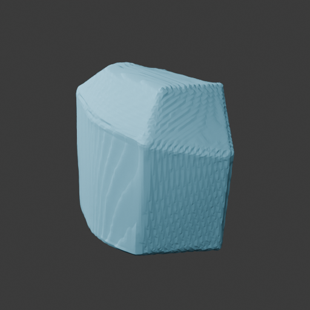

# Agent云端部署与联调验收

- 日期：2026-10-21，Asia/Shanghai；接续基线cc189bf，包0.3.0的云端修订，公共1.0.0/runtime-v1保持兼容。
- 本轮接续工作流与后端全部20项，不在单个子项结束后停止。已完成同一实例的服务部署、Linux回归、真实DeepSeek与TripoSR/Blender联调；前端不在本轮方向。
- 后端实现和真实缺陷停止路径已验证。真实摆件的“打印检查全通过→人工切片→最终成功交付”尚未取得，本报告不把工具/服务验证通过写成可打印或完整中期验收通过。

## 1.接续范围与基线

上轮[后端交付](Agent工作流与后端交付.md)的186项通过/5跳过及本机HTTP证据保持为历史。恢复时本机工作树干净；云端16核/80GiB、RTX4090D24564MiB且0MiB，模型/Blender已在，backend环境和新API代码不在根目录。原始基线见[cloud-baseline.json](agent-cloud-evidence/cloud-baseline.json)。

用户在了解此缺口后要求继续完成，并选择DeepSeek，以项目被忽略的文本保存密钥。本轮允许隔离部署和真实联调，覆盖上轮“不部署云端”的停止边界；没有重装模型、下载新权重或添加第三重建模型，没有运行evaluation/holdout、训练、前端或公网发布。

## 2.实际目录与服务

| 用途 | 云端实际位置/状态 |
| --- | --- |
| 模型/权重/工具根 | /root/autodl-tmp/image-to-3d-print-agent，保持原环境 |
| 服务源码 | deployments/backend-20261021-01，独立于历史根目录和几何验证目录 |
| 服务Python | runtime/envs/backend/bin/python，Python3.11.17 |
| 实际用户服务配置 | runtime/config/backend.json，confirmation_origin=human |
| 实际用户数据 | runs/agent-application，与自动化验证数据隔离 |
| 本轮验证证据 | runs/agent-cloud-20261021-01 |
| API/worker | screen的i3d-backend-api、i3d-backend-worker；空闲运行 |
| 访问 | 仅云端127.0.0.1:8000，未开放公网；/docs为接口调试页，不充当前端 |

部署入口为[prepare_cloud_backend.sh](../scripts/tools/prepare_cloud_backend.sh)，已有依赖不重复安装；[start_cloud_backend.sh](../scripts/tools/start_cloud_backend.sh)分别启动API/worker。实际配置模板见[backend.autodl.example.json](../config/backend.autodl.example.json)，CPU服务依赖见[Linux快照](../locks/backend-linux.txt)，该快照不是GPU模型环境或跨机器直接可用的requirements文件。

实际[production-ready.json](agent-cloud-evidence/production-ready.json)已确认两个模型注册、Blender配置、DeepSeek密钥可用及并发1。自动化验证服务已经退出；上述人工模式服务保留空闲运行供接手，实例由用户自行关机，不自动关闭。

## 3.20项核对与新增证据

| 项 | 本轮核对/验证 | 仍需区分的验收 |
| --- | --- | --- |
| 6需求解析 | 真实DeepSeek提取高度/单位，歧义转追问；建议仍须接受 | 自动化表单提交=test_fixture |
| 25工作流 | 真正API→队列→runner→LangGraph→真实重建/定标/检查→报告 | 实际成功交付未取得 |
| 26语言模型 | DeepSeek真实解析和检查说明，精确usage记录 | 不使用固定回复，不保存思维过程 |
| 27追问 | 缺尺度/姿态进入constraints，实际补充后到前景复核 | 固定问题与LLM建议分别记录 |
| 28恢复 | 等待runner释放后实际重启API/worker，等待ID/网格保持 | 在途强杀明确停止，不自动重放 |
| 29结构确认 | Linux固定回归覆盖提案/版本/拒绝/幂等及独立应用 | 本轮真实网格未批准或应用结构提案 |
| 30分支/上限 | 真实缺陷进入repair_request，固定选择停止后failed；2轮上限回归 | 不为了演示降低打印门槛 |
| 31停止/重启 | Linux进程组及取消/超时/父worker强杀回归通过 | 验证脚本首次重启过早的失败保留 |
| 32重复提交 | 约束/图片/打印复核/停止的重复提交均可去重 | 完整真实任务重建计数1 |
| 33证据关联 | 同任务/当前版本/产物/检查/报告，固定拒绝错引用 | 人工与test_fixture来源区分 |
| 34预算 | 300/120/900秒、32工具、4次/12000token及0自动重试保持 | 未配置单价，费用保持未知 |
| 35接口 | Linux真实上传、创建/查询/事件/输入/取消/报告下载 | 前端尚未接入 |
| 36持久化 | SQLite任务/提交/事件及SqliteSaver检查点真实落盘 | 不把内存状态当恢复证据 |
| 37独立worker | API快速排队，独立单worker/runner，第二等待任务可执行 | 服务空闲不占模型显存 |
| 38等待释放 | 实际runner_pid为空，再重启仍等待，重建不重复 | 仅看到waiting不代表检查点已提交完毕 |
| 39安全 | 坏图422、配置不返回密钥/路径；离线安全回归 | 人工模式仅回环/SSH访问，未做公网多用户系统 |
| 40启动配置 | 新Linux环境、两个持久空闲服务及人工配置已实际启动 | 使用现有模型/Blender路径，不重装 |
| 49报告 | 真实JSON/Markdown生成并经API下载，保留缺陷/用量/来源 | 当前结论是失败停止 |
| 50切片确认 | Linux固定回归覆盖版本/分层证据/缺失拒绝 | 无本轮实际切片及人工分层确认 |
| 51最终门槛 | Linux固定成功/失败门槛回归；真实缺陷未被写成成功 | 无真实打印合格交付，等待合格网格与实际切片 |

## 4.实际验证命令与结果

在已部署的backend环境中执行：

```bash
python -m pytest tests -q --tb=short
python scripts/p1/export_schemas.py --check
python scripts/tools/export_tool_schemas.py --check
python scripts/tools/export_runtime_schemas.py --check
python scripts/p1/check_prepared_data.py
python -m pip check
```

最终Linux为**193 passed、0跳过、2个依赖弃用提示、22.67秒**。历史Windows跳过的Linux场景本轮实际执行；三套schema、30例静态准备和pip check均0退出。详见[测试日志](agent-cloud-evidence/linux-tests-final.txt)、[schema日志](agent-cloud-evidence/schemas-final.txt)、[数据检查](agent-cloud-evidence/prepared-data-final.txt)。离线测试禁止真实模型/GPU和公网，不能当作真实推理证据。

真实入口[validate_cloud_agent.py](../scripts/tools/validate_cloud_agent.py)需要显式--automated-fixture-confirmations，使用独立存储、实际HTTP/API/worker、真实DeepSeek/TripoSR/Blender；表单自动化确认明确test_fixture，不能当人工批准。

本轮最终实际执行：

```bash
python scripts/tools/validate_cloud_agent.py \
  --project-root /root/autodl-tmp/image-to-3d-print-agent \
  --secret-file /root/autodl-tmp/image-to-3d-print-agent/runtime/secrets/deepseek_api_key.txt \
  --automated-fixture-confirmations \
  --output /root/autodl-tmp/image-to-3d-print-agent/runs/agent-cloud-20261021-01/live-final
```

结果：47.109515秒，验证脚本passed=true。真实任务d6d629d5-4f08-4449-aa03-94e7b5ac5017最终failed/MESH_NOT_PRINTABLE；“验证通过”表示预期等待/恢复/停止行为符合要求，不表示这个模型打印通过。原始输入为development/block.png，80mm是固定目标，不是实物测量。

流程：真实LLM解析→constraints等待→补充/重复提交→前景准备/复核→真实TripoSR→基础清理→80mm定标→Blender预览→runner释放→API/worker重启→同版本复核/检查→真实LLM说明→repair_request→固定选择停止→失败报告。另一个任务在第一条等待期间也进入等待，随后取消成功；恢复后重建调用仍为1次。

TripoSR加载准备7.586604秒、推理0.769405秒、模型内部总8.713655秒，allocated1939.054MiB/reserved1998MiB；这些不含Python启动及后续几何工具。定标后67.196552×61.900829×80mm；208条边界边、2个非流形顶点、水密失败、底面无接触面积，正式薄壁not_run；自交检查0、悬垂4492面警告。系统正确阻断，未导出“合格STL”或伪造切片确认。

真实DeepSeek最终任务共2次：解析347输入/100输出token，说明627输入/276输出，共974输入/376输出；返回served_model=deepseek-flash。首次失败验证另有一次成功解析344/75，不能漏计或混入最终任务计数。本轮合计3次真实调用、1318输入/451输出token；单价未配置，费用null，实际账单未知。

选用接口、JSON输出和显式关闭thinking的依据分别为[DeepSeek官方接口](https://api-docs.deepseek.com/)、[JSON输出](https://api-docs.deepseek.com/guides/json_mode/)、[thinking选项](https://api-docs.deepseek.com/guides/thinking_mode/)，2026-10-21核对。只保存业务输出/用量，不保存思维内容。



## 5.失败、修订与兼容

- AGENT-CLOUD-BUG-001：新增2条回归先因缺配置字段失败，再支持服务端confirmation_origin与可选thinking_mode。默认人工语义兼容，自动确认记录test_fixture/tool，不能写实际人工证据；客户端不能自填服务端标记。
- BUG-002：JSON示例把字符串explanation写成null；补示例必须通过ParsedRequirements的回归，保留1失败基线再修为字符串，不放宽schema。
- BUG-003：首次真实任务已到预览，但验证器立即停止尚在提交检查点的runner，按既有规则明确WORKER_RESTARTED。原失败不改写；验证器先确认runner_pid为空再重启，新任务通过。首次33秒、模型/LLM调用及报告都保留，不宣称只发生过一次模型调用。
- 兼容：公共20模型、状态、阈值及runtime-v1字段保持；服务端配置新增可选字段，能力查询增加confirmation_origin，工具门面增加仅服务端传递的确认来源参数。默认值保持旧客户端行为。没有重写既有业务模块或手改生成schema。

## 6.访问、停止与人工复核

服务当前在云端回环地址，Windows项目目录可建立SSH隧道：

```powershell
ssh -F runtime/ssh/p2a_config -N -L 8000:127.0.0.1:8000 p2a-autodl
```

保持该终端运行后打开http://127.0.0.1:8000/docs。这里是接口调试页；前端成员应使用同一接口/状态，不另造字段。换电脑须使用自己的已授权SSH配置，私钥不随Git交付。

模型计算已结束，GPU0MiB；两个服务空闲保留供接手。停止/恢复命令见[后端启动说明](Agent后端调用与启动说明.md)。用户关机会中断服务，已保存数据在数据盘；不代操作实例。

人工复核记录：2026-10-21，用户按本节要求核对本报告、主要代码差异和结果，明确答复“已核对，本轮人工复核通过”。据此记录本轮新增代码与结果人工复核通过；复核材料包括[完整接口说明](Agent后端调用与启动说明.md)、[主要代码差异](../src/image_to_3d_print/workflow/graph.py)及193项日志，关注自动确认来源、恢复不重复重建、检查失败阻断和凭据隔离。未展开的逐行阅读过程不补造，不使用上轮几何结论代替本次结论。

本轮可执行交付/部署/真实停止路径及上述人工复核完成，按授权提交推送后停止；此结论不批准具体结构修改、开发映射启用或实际切片，不替代前端联调及真实成功交付证据。

## 7.证据备份

精简[validation.json](agent-cloud-evidence/validation.json)及[final-context.json](agent-cloud-evidence/final-context.json)保留数值/错误/产物引用，长数值索引只留数量/前10项，原始完整JSON在备份。源码摘要见[deployment.json](agent-cloud-evidence/deployment.json)，服务/计算状态见[stop.json](agent-cloud-evidence/stop.json)。

完整备份runs/agent-cloud-20261021-01/download/evidence.zip，111文件、4728381字节，SHA256=9db10f838fb02571ea6958bae5d48d1a89b2a692fe330ccd88585a5feded0ec9；下载后CRC/摘要通过。完整模型、数据库、日志和凭据不入Git；备份不含密钥文件，实际密钥内容检查未检出。原始源码/模型环境保持，实例由用户自行关机。
