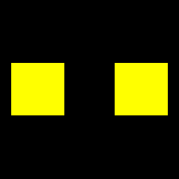
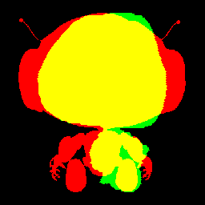
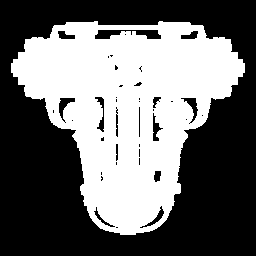

# CPU坐标与轮廓测量最小验证

- 日期：2026-10-21；子项：P2A-MEASURE-001；工具版本：cpu_silhouette_0.1.0。
- 结论：CPU测量最小子项技术通过，用户已于2026-10-21按本清单明确确认人工验收通过。固定几何有已知答案；真实后端输入视角未完成development校准，质量IoU仍为null/not_run，P2-A未整阶段验收，未启动简单摆件比较。
- 授权：接续用户已指定的小任务及提交要求；用户随后明确希望统一云端执行并报告开机，因此本机编辑与备份、同一云端CPU验收。没有新模型生成、GPU算子、模型/权重下载、LLM或切片任务，不代关机。

## 1.实现与可交接接口

| 位置 | 实际能力 |
| --- | --- |
| [measurement.py](../src/image_to_3d_print/measurement.py) | 内部Pydantic请求/报告、固定正交CPU几何投影、蒙版归一、IoU、明确错误及公共证据引用 |
| [操作入口](../scripts/p2a/measure_silhouette.py) | 项目根目录内相对路径、明确请求、独立输出；输出目录存在时拒绝覆盖 |
| [固定验收入口](../scripts/p2a/validate_cpu_measurement.py) | 两个已知几何及三份已存在GLB；原始文件前后摘要一致；不运行神经模型 |
| [测试](../tests/measurement/test_silhouette.py) | 手算IoU、归一化、非对称轴向、场景节点变换、错误、协议、路径及原始文件保留 |
| [CPU依赖快照](../locks/cpu-measurement-linux.txt) | probe与本轮test-deps合并后的实际版本；不含密钥或模型权重 |

公共20个模型及JSONSchema1.0.0不变。内部请求的mesh/input_mask均为项目内POSIX相对路径，input_mask可以缺省；backend为fixture/triposr/trellis2_candidate，rotation为有来源的正交旋转、不得镜像或非等比形变。只有backend=fixture、有明确来源及蒙版的known_fixture允许返回实测IoU；其他请求只作诊断，不能把人工设置一个标志当作真实后端校准证据。

内部报告复用MetricValue、ToolResult、ErrorInfo、ArtifactRecord与EvidenceRecord。同一run_id关联具体已有网格、报告和图像；tool_name=inspect、measurement_kind=silhouette_diagnostic。ToolResult.succeeded表示诊断执行成功，不表示MeshInspection或产品任务通过。错误文件、空蒙版、越界路径和无效配置明确失败；缺输入视角映射保留not_run/null。

渲染器以Pillow在CPU上绘制不透明三角形投影的并集，处理场景节点变换，不调用OpenGL/CUDA/Blender。使用整数像素填充、无抗锯齿；这里只验证确定性测量及几何轮廓，不评估纹理透明度、物理尺寸、薄壁或打印质量。Pillow/numpy/trimesh版本参与测量版本，后续正式比较需确认同一口径，不能与其他渲染器分数直接混用。

## 2.固定口径与坐标发现

相机和蒙版规则读取[protocol_v1.json](../evals/protocol_v1.json)，协议文件未改。正交相机位置(0,-3,0)、目标原点、Z朝上、尺寸2.2；网格旋转后包围盒居中、最长边等比归一到2。alpha或单通道值至少128为前景，紧包围盒裁切、最近邻等比缩放到最长边224、居中放入256方形画布。

P1自产输入相机为(3,-4,3)、正交尺寸3.6。它与测量相机不相同；当前没有按development重建图逐后端确认的固定输入视角映射，因此不能用已有预览或最高分角度替代校准。本轮不修改数据/协议/阈值，不运行evaluation或holdout。

发现候选GLB有已知导出轴转换：固定TRELLIS.2提交75fbf0183001ed9876c8dbb35de6b68552ee08bd的`o-voxel/o_voxel/postprocess.py:312-314`将(x,y,z)改为(x,z,-y)。诊断时显式使用逆变换(x,-z,y)，仅作用于内存坐标；原文件不变，转换来源写入请求。TripoSR原始网格采用其已有Z朝上记录。**撤销导出轴转换不等于完成后端到输入视角的校准。**

## 3.真实执行结果

执行环境为同一AutoDL实例的Linux，配额16核/80GiB，使用已有probe/Python3.11.17、numpy1.26.4、trimesh4.0.5。Pillow10.1.0、Pydantic2.12.5和pytest8.4.2及其依赖只安装到本轮独立test-deps，未改动TripoSR/TRELLIS.2模型环境。模块的measurement可选依赖已声明，原P1默认测试范围保持。

| 检查 | 实际结果 |
| --- | --- |
| 修改前基线 | 新测试收集失败：measurement模块不存在；记录在本机baseline-failure.txt |
| 全量离线测试 | 最终96 passed in 0.91s，包含原68项及新增28项；真实GPU/模型库被测试保护阻断 |
| CLI、公共Schema及30例静态检查 | 均退出0；没有执行30例模型评估 |
| 原10毫米立方体 | CPU投影有效，已知方形蒙版IoU=1，原36顶点/12面不变 |
| 两个分离方块 | CPU投影与解析矩形IoU=1，16顶点/24面；间隔未被补平 |
| 已有TripoSR汉堡 | 13404顶点/26699面有效，生成诊断叠加图；IoU=null/not_run，输入视角映射未核验 |
| 已有TripoSR机器人 | 19111顶点/38049面有效，生成诊断叠加图；IoU=null/not_run，输入视角映射未核验 |
| 已有TRELLIS.2官方T | 801210顶点/965545面有效，已撤销导出轴转换；未制造前景蒙版，IoU=null/not_run，只作环境/导出诊断 |
| 固定五例总区间 | 11.320秒，包含读文件、CPU投影、蒙版及图像写入，不是模型推理时间 |
| 最大RSS | 1018344KiB，约994.5MiB；不是GPU显存 |
| GPU/停止 | CUDA_VISIBLE_DEVICES为空，torch未导入；收尾设备占用0MiB，本轮测量进程0 |
| 原文件保留 | 五份输入网格前后SHA256一致，数值见精简证据 |
| 备份 | 32785字节/39文件ZIP已下载本机、CRC通过；7份部署代码/配置与本机内容一致 |

原始证据见[validation.json](cpu-measurement-evidence/validation.json)和[停止快照](cpu-measurement-evidence/stop.json)。固定几何IoU=1只证明工具对已知答案正确，不能报告为真实生成模型的成功率或质量分数。

## 4.图像核对

叠加图中红色为输入蒙版、绿色为模型诊断投影、黄色为两者交集。真实模型图存在差异不直接表示生成质量差，因为其输入视角尚未校准。

两个分离方块的解析轮廓完全重合：



已有机器人的诊断叠加，未据此计算质量IoU：



官方T样例撤销已知导出轴转换后的几何投影，仅作环境证据：



## 5.云端复现与接手

本次隔离目录为云端项目内`runs/cpu-measurement-20261021-01/workspace`；其相邻test-deps保存本轮声明依赖。实际工作目录中已有的上传脚本和模型文件没有覆盖或清理。完整备份在本机`runs/cpu-measurement-20261021-01/evidence-final.zip`，不入Git；原始缺模块失败和两轮诊断同目录保留。

在本轮云端隔离目录实际执行：

```bash
export CUDA_VISIBLE_DEVICES=""
export PYTHONPATH="../test-deps:src"
PYTHON=/root/autodl-tmp/image-to-3d-print-agent/runtime/envs/probe/bin/python
$PYTHON -m pytest tests -q --tb=short
$PYTHON scripts/p2a/validate_cpu_measurement.py \
  --existing-root /root/autodl-tmp/image-to-3d-print-agent --output results-final
$PYTHON scripts/p2a/measure_silhouette.py \
  --request results-final/cli-request.json --output results-final/cli
$PYTHON scripts/p1/export_schemas.py --check
$PYTHON scripts/p1/check_prepared_data.py
```

再次执行必须选择新的输出目录，不能覆盖本次results-final。从Git重新克隆时，需要在独立CPU环境安装`.[test,measurement]`，既有模型及运行产物另行取得；不能认为Git已复制云端环境。验证脚本的resource采样用于Linux，本次没有验证Windows执行。核心测量模块不调用平台GPU或神经模型。

## 6.人工复核与停止

- [x] 阅读measurement.py的请求校验、纯CPU投影、缺映射/缺蒙版分支及公共证据封装。
- [x] 阅读两个入口和新增测试，理解known_fixture只用于有依据的固定几何，不能给真实后端伪造映射确认。
- [x] 查看上述三图及结果表，核对固定方块重合、机器人只作诊断、官方T只作环境例。
- [x] 理解测量使用无量纲归一，不是毫米定标或打印验收；主要代码和结果由用户明确给出复核结论。

人工结论：2026-10-21，用户在收到本报告第6节及主要代码、结果表和三图清单后明确答复“已按清单复核，通过本小任务人工验收”。仅覆盖本CPU子项，不替代此前云端安装/官方例代码的人工复核或后端输入视角校准。本小任务完成，记录及授权Git同步后停止；其他中期功能按后续明确指令推进。近期优先中期原型，最终冻结批量评估、保留集和额外研究暂缓，质量门槛不降低。

提交前检查：本机运行`runtime/envs/contracts/Scripts/python.exe -X utf8 runtime/check_cpu_delivery.py`退出0；25份交付文件中14份Markdown、205处本地链接、4份Python AST和2份严格JSON检查通过，UTF-8、围栏、常见凭据模式及git diff --check无错误。公共契约、fixture、evals和原始课程规范未改。记录在`runs/cpu-measurement-20261021-01/delivery-check.json`；此处为交付检查，没有重跑云端任务。
