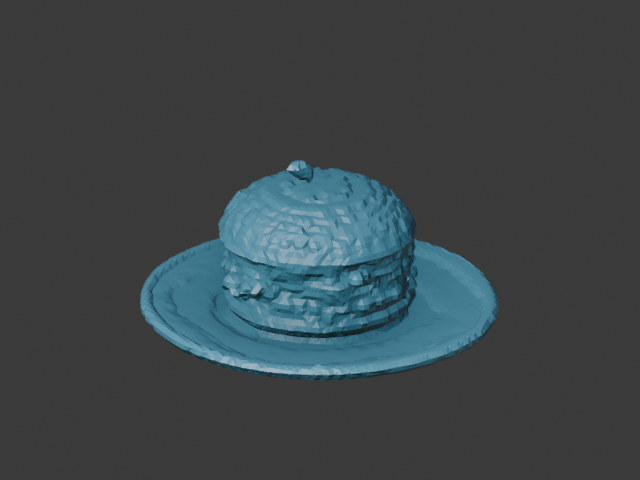
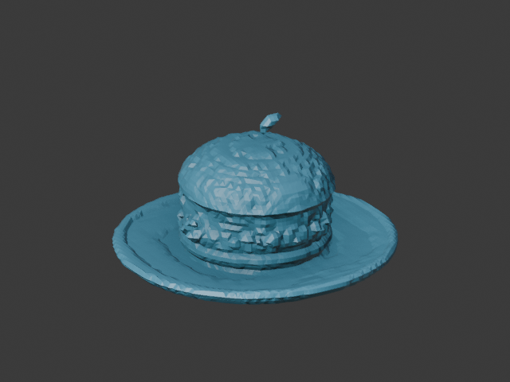
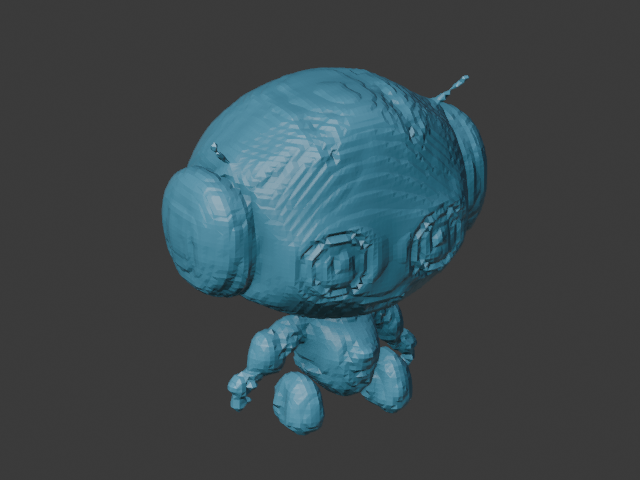
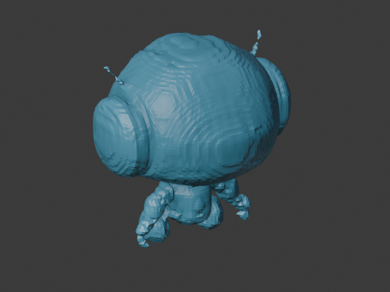

# P0本机环境与工具可行性验证

- 日期：2026-10-18；执行编号：`p0-20261018-01`；修改前仓库版本：`a3d4c01`。
- 当前状态：P0已完成；2026-10-18用户按清单人工复核并通过P0验收，当前仍保留P0已完成状态，不进入P1。
- 范围：本机环境、现成模型和工具的P0可行性验证；不进入P1，不实现业务API、Agent编排、修复算法或前端。
- 依据：[当前任务](../spec/当前开发任务.md)、[评估记录](评估设计.md)、[Bug记录](../spec/bug调试文档.md)。

## 1.没有打印机时验证到哪里

用户已确认小组目前没有打印机。本次P0不要求实体打印，采用明确标注的虚拟FDM/PLA配置，验证模型文件可读、尺寸正确、能够生成分层和G-code。此结论不能证明实际机器可打印、成品强度或表面效果；真实打印机空间、耗材牌号和实物结果均未验证。

在线复核可使用[Kiri:Moto](https://grid.space/kiri/)。按[官方界面文档](https://docs.grid.space/kiri-moto/interface/)选择FDM，导入本次生成的`geometry/cube_10mm.stl`，建立明确标注的虚拟设备，依次执行Arrange、Slice、Preview、Export。核对毫米单位、10×10×10毫米尺寸、0.2毫米层高与末层10毫米，并保存软件版本、配置、截图和导出文件。该在线步骤为供人工复核的可选方法，本次未把私有材料上传到网站，也未声称已在线切片。

本次实际执行的是本机PrusaSlicer命令行验证；生成的G-code也可用[官方G-code Viewer](https://help.prusa3d.com/article/prusaslicer-g-code-viewer_193152)检查路径。虚拟配置的220×220×250毫米空间仅为演示数值，没有对应实机。

## 2.安装前基线与实际环境

| 项目 | 实际记录 |
| --- | --- |
| 执行机 | 本机Windows11，10.0.26200；未迁移到队友机器或云端 |
| GPU | NVIDIA GeForce RTX3060LaptopGPU，6144MiB；准备前可用3935MiB |
| NVIDIA驱动 | 591.86 |
| Python | 项目内CPython3.11.17；保留系统默认3.13.9 |
| PyTorch/CUDA运行时 | 2.5.1+cu121/12.1；本机CUDA可用 |
| Blender | 4.5.14LTS，构建62c1db4208e8 |
| 打印检查工具 | 官方blender-addons提交b42d68627734cb18af0e6f41537063984313a284；上游未提供独立语义版本 |
| TripoSR源码 | 107cefdc244c39106fa830359024f6a2f1c78871 |
| TripoSR权重/配置 | stabilityai/TripoSR，revision5b521936b01fbe1890f6f9baed0254ab6351c04a |
| DINO配置 | facebook/dino-vitb16，revisionf205d5d8e640a89a2b8ef0369670dfc37cc07fc2；只下载配置 |
| torchmcubes | 0.1.0，源码879926d0ef58e6ce0ac2630fdecb5e53af7ed3ff |
| 编译工具 | Visual Studio2022Community，MSVC19.44.35211.0、CMake3.29.6 |
| 切片工具 | 便携PrusaSlicer2.9.6 |
| 环境管理 | 便携uv0.13.1，不更改系统PATH、默认Python或注册表 |

新增依赖均用于本次重建、网格读写或工具构建。环境分为CUDA重建、轻量独立读取、临时CPU构建三套，全部在被忽略的`runtime/`内。实际完整版本见[锁定清单](../locks/README.md)与[p0-runtime.json](../locks/p0-runtime.json)。

安装前基线先于安装保存，见[原始基线摘要](p0-evidence/baseline_environment.json)。本机原先缺少项目Python3.11、Blender、uv和CUDA编译器；C++工具已存在。未关闭用户应用。

## 3.固定输入和低显存范围

两张图是官方TripoSR仓库同一固定提交中的`hamburger.png`和`robot.png`，来源、许可与预期见[fixture说明](../fixtures/p0/README.md)。它们是两个不同物体，不是同一张图重复执行。源图已有透明前景，本次按上游方法缩放前景至0.85并合成灰色RGB输入，不另行下载抠图模型。

预先固定参数：CUDA神经重建、float32、随机种子0、chunk_size2048、mc_resolution128、不烘焙纹理。它们用于6GB显卡的P0可行性验证，不能视为默认256分辨率或最终质量已通过。

本机没有nvcc。首次在CUDA版PyTorch环境编译扩展失败后，先记录P0-BUG-004，再使用同一PyTorch2.5.1的独立CPU环境编译原样上游torchmcubes。扩展装回CUDA环境后，固定体素产生96顶点、188面，CUDA输入和返回张量设备均核对成功。神经网络在GPU上运行，等值面提取明确在CPU上完成；该步骤不是模型CPU推理，也不是更换模型。

## 4.两张图的真实重建结果

| 输入 | 加载并转移GPU/秒 | GPU推理/秒 | 表面提取/秒 | 整个子进程/秒 | 峰值分配/预留显存MiB | 顶点/面 | 返回码/独立读取 |
| --- | --- | --- | --- | --- | --- | --- | --- |
| hamburger | 29.985 | 13.457 | 1.608 | 110.336 | 1866.54/2058 | 13424/26704 | 0/通过 |
| robot | 5.952 | 4.138 | 0.984 | 21.238 | 1866.54/2058 | 19102/38064 | 0/通过 |

两次模型参数和scene_code设备均为`cuda:0`，均在300秒限额内完成。峰值是PyTorch进程的已分配/预留显存，不是系统全部GPU占用。整个子进程耗时包含Python导入和首次库初始化，不能只把神经推理耗时当作用户总等待时间。这仅是两张固定输入的可行性结果，不是稳定性或泛化性能结论。

两个原始网格均非水密，机器人细节较粗；没有真实背面参考，不能据单图证明几何还原精度。当前未修复或定标，坐标是模型单位，不能当作毫米。详见[重建和独立读取JSON](p0-evidence/reconstruction_summary.json)。

以下是同一原始GLB的两组互补视角，使用单色工作台渲染查看几何，不修改原始文件。TripoSR采用Z朝上，预览场景仅补偿glTF导入轴转换；这不是用户确认的打印姿态。

| 对象 | 视角A | 视角B |
| --- | --- | --- |
| 汉堡 |  |  |
| 机器人 |  |  |


原始网格只表示重建模型可运行：当前没有毫米定标、修复或对这些原始网格做最终可打印性判定。P0不报告最终工作流成功率、轮廓IoU或打印合格率。

## 5.几何和切片实际结果

| 固定输入/检查 | 阈值或预期 | 实际结果 | 技术结论 |
| --- | --- | --- | --- |
| 10毫米立方体STL往返 | 边长误差≤0.01毫米，体积误差≤1立方毫米 | Blender边长10.0000007078毫米，体积1000.00021234立方毫米 | 通过 |
| 同一STL独立Trimesh读取 | 10×10×10毫米、1000立方毫米、坐标有限 | 10×10×10毫米、1000立方毫米，坐标有限 | 通过 |
| 正常立方体检查 | 非流形、错误连续边、自交、薄壁计数均0 | 四项均0 | 通过 |
| 0.9毫米薄壁 | 1.2毫米阈值，应检出 | Thin Faces为2 | 检出符合预期 |
| 相交闭合壳 | 必须检出自交 | Intersect Face为6；非流形边仍为0 | 检出符合预期，证实不能只看水密/流形 |
| 演示配置切片立方体 | 0.2毫米层高，50层，末层10毫米，有挤出指令 | 50层，末层10毫米，G-code165839字节，有挤出指令；退出码0 | 通过 |
| 物理打印 | 本次不具备设备 | 未执行 | 未验证 |

几何最终回归进程退出码0，耗时1.916秒；独立读取和切片的最终切片子进程耗时约0.630秒。检查调用官方3D-Print Toolbox；薄壁采样种子固定0，不自行替换检查算法。

证据：[几何JSON](p0-evidence/geometry.json)、[独立读取及切片JSON](p0-evidence/slice_verified.json)、[修订前体积测量失败基线](p0-evidence/geometry_before_transform_fix.json)。

## 6.失败、修订与复验

| 问题 | 实际失败及最小调整 | 回归状态 |
| --- | --- | --- |
| P0-BUG-001 | 上游无bl_info.version；改用真实Git提交并把缺失版本记为null | 同组几何样例已完整运行 |
| P0-BUG-002 | 导入缩放未进入体积测量；BMesh应用对象世界矩阵，保持原阈值 | 立方体、薄壁、自交及独立STL读取均通过 |
| P0-BUG-003 | cmd嵌套引号阻止开发环境初始化；修正固定批处理调用 | MSVC成功完成原生编译 |
| P0-BUG-004 | CUDA轮子的CMake需要Toolkit；同版本独立CPU环境构建扩展 | 扩展CUDA张量冒烟和两张真实图片重建均通过 |
| P0-BUG-005 | NumPy bool_不能序列化；边界转换为原生bool，保持原阈值 | 原命令重跑通过并实际保存JSON |
| P0-BUG-006 | 原始Z朝上与glTF导入转换不同；仅预览场景补偿轴转换，提供互补视角 | 同两份GLB重新渲染，退出码0、2.068秒，AI查看完成；用户已按清单核对 |

每个失败均先进入Bug记录再作小范围修订。原始日志未覆盖：`geometry.log`、`geometry_retry1.log`、`geometry_retry2.log`、`build_torchmcubes.log`与`build_torchmcubes_cpu.log`分别保留。没有触发显存不足重试，也没有换GPU机器或模型。

## 7.复现命令和产物

先按[环境交接说明](../locks/README.md)准备固定版本和DINO配置缓存。以下在项目根目录执行：

```powershell
$env:PYTHONIOENCODING='utf-8'
& runtime/tools/blender/blender-4.5.14-windows-x64/blender.exe --background --factory-startup --python-exit-code 1 --python scripts/p0/verify_geometry.py -- --addon-dir runtime/upstream/blender-addons --output runs/p0/p0-20261018-01/geometry
& runtime/envs/probe/Scripts/python.exe scripts/p0/verify_slicing.py --output runs/p0/p0-20261018-01
& runtime/envs/probe/Scripts/python.exe scripts/p0/verify_reconstruction.py --output runs/p0/p0-20261018-01/reconstruction
& runtime/tools/blender/blender-4.5.14-windows-x64/blender.exe --background --factory-startup --python-exit-code 1 --python scripts/p0/preview_meshes.py -- --input runs/p0/p0-20261018-01/reconstruction
```

单张重建由外层脚本强制300秒超时，失败即退出，不自动换模型、换机器或忽略失败。几何和预览命令本次由外层120秒子进程执行，实际命令与返回码摘要随证据保存；重新手工执行命令时也应保持相同超时。

完整原始网格位于`runs/p0/p0-20261018-01/reconstruction/<case>/raw_mesh.glb`；立方体、薄壁、自交STL及几何预览在同次运行的`geometry/`，G-code为`cube_10mm.gcode`。模型权重、环境和完整运行产物不入库；提交固定来源、锁定依赖、脚本、摘要和必要人工复核预览。

## 8.人工复核与停止点

AI工具检查与人工复核分别记录。复核人为当前用户，日期2026-10-18；收到报告、两份原始网格预览及主要辅助脚本的[具体核对清单](P0人工复核清单.md)后，用户明确回复“已按清单复核，通过P0验收”，没有提出待修改项。

据此P0技术检查8项和人工验收1项全部完成，已在已完成任务中归档。该验收范围仅为本机环境和工具可行性；原始网格的最终质量、业务工作流和物理打印仍保持各自未完成或未验证状态。

本轮在P0记录、提交推送后停止。P1仍为唯一未来任务，未启动；实际打印、业务接口、修复和最终整条工作流验收均未完成。
