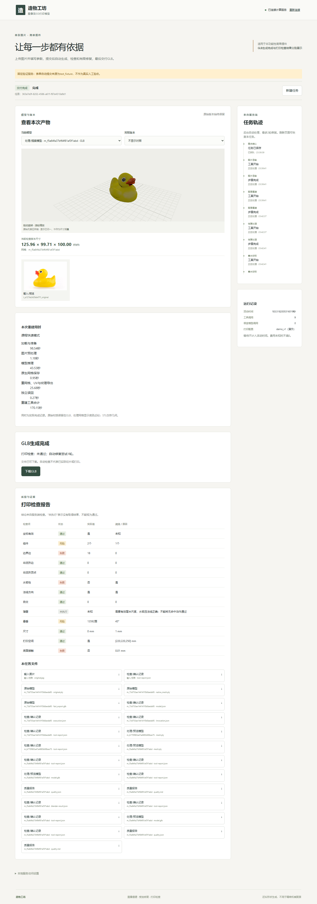

# 一次提交自动生成与GLB交付

日期：2026-10-21；任务MID-AUTO-001；修改前main/01426bf。开发验证完成，用户已按本轮清单明确人工复核通过。

## 1.现在如何使用

1. 用户自行开机后，双击项目根目录“启动造物工坊.exe”，或刷新已有http://127.0.0.1:5173/。
2. 选择图片，填写正目标高度；单位默认毫米、尺度来源默认设计目标、方向默认Z朝上，打印配置使用已有演示配置。重建后端默认TRELLIS.2，TripoSR基线仍可选。
3. 点击一次“创建建模任务”。后台自动准备、快速重建、清理、定标、检查和有限修复，不弹出中途确认。
4. 完成后查看模型与实际打印检查结果，点击“下载GLB”。**完成、刷新和恢复均不会自动下载。**取消任务仍可用。

新生产TRELLIS.2固定课程快速1024_cascade/seed42、10万目标面、2K纹理、无转台视频，沿用已装源码/权重。官方完整入口只作历史复现材料，不出现在新页面模式选项。多图继续暂缓，没有新模型、安装、训练或视觉API。

## 2.流程、契约与界限

- 新图：prepare→reconstruct→clean→scale→inspect→plan；按需propose→confirm→apply→inspect，最后export_glb→可选LLM证据说明→finish。提案、策略确认及应用仍分节点，但不要求用户点击。
- 基础去重/法线清理为预处理；结构修复最多2次，采用≤40mm小孔、面积/面数均≤1%的极小组件或必要简化。无法受控处理时提前停止修复，不任意加厚或加底座，不为了凑轮数重复无效操作。
- 保存所有版本、实际尝试和检查历史；交付检查结果较好的有效版本。未知/失败不能成为通过。薄壁依然要求有效毫米、水密、法线正确的实体；悬垂、组件及接触风险分别显示。
- 服务端workflow_policy=automatic_glb，新响应schema_version=generation-v1，succeeded只表示GLB完成并经独立读回且带同版本报告。delivery.print_check与实际检查一致，print_certified恒false；公共1.0.0的STL/实际切片成功校验未修改。字段以[接口](接口与字段.md)为准。
- 方向为一次提交的轴参数或模型Z朝上约定，orientation.confirmed仍为false；结构来源automatic_policy，不能写human。首次缺高度/单位/来源在创建时422，禁止计算后再追问；旧任务按快照继续guided，不将历史等待改为批准。
- GLB使用米/Y朝上，独立读回后反变换检查毫米外形；保留原始PBR文件，处理网格为顶点底色近似。导出不等于可打印；当前自动路径不生成打印认证STL或实际切片证据。
- 取消、超时、worker重启仍明确停止，中断的昂贵节点不自动重跑。没有有效网格/模型/导出时失败，不能编造GLB。LLM仅可选说明，不决定几何和阈值；本轮真实生成验证未调用LLM，生产原DeepSeek配置保留。

## 3.固定验证及实际命令

本机backend隔离Python3.11，Linux复用已有backend环境，无新依赖。模型/Blender测试替身只在tests中明确标为test_fixture；SQLite、LangGraph、几何/GLB/HTTP和浏览器实际执行。正常水密、小孔、不可修薄壁、2轮无改善、缺检查器/模型/导出、初始参数、幂等/刷新/取消、超时/重启、跨任务结果、伪造自动批准及虚假打印标签分别覆盖。

```powershell
runtime/envs/backend/Scripts/python.exe -m pytest tests -q --tb=short
runtime/envs/backend/Scripts/python.exe scripts/p1/export_schemas.py --check
runtime/envs/backend/Scripts/python.exe scripts/tools/export_tool_schemas.py --check
runtime/envs/backend/Scripts/python.exe scripts/tools/export_runtime_schemas.py --check
runtime/envs/backend/Scripts/python.exe scripts/tools/export_frontend_types.py --check
runtime/envs/backend/Scripts/python.exe tests/frontend/serve_fixture.py --root runs/automatic-glb-20261021-01/browser-fixture --port 8002 --workflow-policy automatic_glb
```

在frontend中，I3D_API_TARGET=http://127.0.0.1:8002启动5175；I3D_UI_URL=http://127.0.0.1:5175和独立I3D_BROWSER_EVIDENCE_DIR下运行npm run test:browser -- tests/fast-profile.spec.ts。npm test为6项，npm run build含TypeScript检查。浏览器2项实际通过：双击只创建1次，无inputs/slicer提交；无模式/方向勾选；自动修补1轮完成、刷新同任务、下载0→点击后1；缺高度/负高度不创建。

首次4失败是缺自动配置；后续可读报告语义新增1失败后修复，原日志保存在runs/automatic-glb-20261021-01。最终Windows241通过/6平台跳过/55.54秒，Linux247通过/28.52秒；自动流程专项16项。额外跨任务回归最初错误修改冻结模型，修正测试构造后验证重建/检查均拒绝异任务结果，生产归属代码保持。收尾修改运行时注释后Schema描述不一致，重新导出后--check通过；类型未变化。历史guided浏览器回归保留但仅对显式历史服务运行，不以旧结果代替新路径。构建保留既有约834KB大包警告，不影响通过。

## 4.真实云端结果

复用同一RTX4090D24564MiB及既有16核/80GiB实例、TRELLIS.2固定75fbf0183001ed9876c8dbb35de6b68552ee08bd。仍使用开发鸭子910×609JPEG，SHA256为1d6ac093c18648fc9568f58e310db3d1666d942cb0a2ea36b21be8384993f4ff，来源沿用[上一轮报告](颜色保留与快速生成验证.md)，不是保留集。

真实页面任务363a7e0f-8202-4586-a61f-f87e4510a9d1，仅POST一次资产和一次任务，没有中途确认、human_reviews或切片提交。重建1次，模型总170.152807秒：加载准备98.543280、预处理1.179477、推理43.532667、原生保存0.945854、重网格/UV/烘焙导出25.678070、独立读回0.273459秒；峰值allocated5302.650MiB。首次worker区间183.518201秒，不包含后续部署修订的接续区间，不把它当最终全流程耗时。

| 项目 | 实际结果 |
| --- | --- |
| GLB完成 | succeeded/generation-v1，独立读回通过 |
| 网格/外形 | 98994面；125.959×99.707×100.000mm |
| 外观/下载 | 真实顶点色，RGB跨度251/233/215；1980988字节GLB |
| 几何缺陷 | 2组件、18边界边、非水密；非流形边/点均0，法线/自交检查通过 |
| 其他检查 | 尺寸/打印空间通过；底面接触失败；悬垂风险；薄壁因非水密未执行 |
| 自动修复 | 尝试1次fill_small_holes，孔洞退化或非平面而拒绝；无其他适用操作，提前结束 |
| 最终结论 | GLB可交付，打印检查failed，print_certified=false，原版本保留 |
| 浏览器 | 首次和刷新都0次下载，点击后1次；下载与登记文件SHA256一致，独立读回毫米尺寸一致 |

首次独立部署漏带locks/linux-geometry-tools.json，检查按not_run显示并正常交付GLB；保留[首次结果](evidence/automatic-glb-20261021/result-before-inspection-fix.json)及FileNotFoundError。补齐原锁文件后，通过隔离开发任务的已有scale检查点接续检查/修复/交付，**没有重复重建**，不冒称首次完整检查已通过。最新[真实结果](evidence/automatic-glb-20261021/result.json)、[首次浏览器轨迹](evidence/automatic-glb-20261021/real-browser-first.json)、[修订后只读/下载](evidence/automatic-glb-20261021/real-browser.json)与[下载/生产核对](evidence/automatic-glb-20261021/download-and-production-check.json)分别保留。



## 5.部署、限制和交接

隔离验证为deployments/automatic-glb-20261021-01及runs/automatic-glb-20261021-01/application。生产升级前确认5取消/1失败/4等待，无运行或排队；备份原数据库/配置/源码，只停止归属明确的API11903和worker12041，再同步至既有稳定目录deployments/official-20261021-01。该目录名保留启动器兼容，新配置为automatic_glb/default_backend=trellis2_candidate；存储runs/agent-application及旧任务不迁移/不删除。新生产API18375、worker18515已启动，本机5173真实配置核对通过；启动器无需重建。临时API8001/worker已停止；完整67文件/84821588字节备份已下载本机，SHA256与CRC通过。生产API/单worker继续提供服务，最终GPU0MiB，实例由用户自行关机。

本轮没有实际打印/切片、单图隐藏面真值、保留集、正式同机选型、模型常驻缓存、多图或PPT/PDF。实际修补不是任意缺陷都可处理；上限是最多2次而非保证做满2次。已有历史人工验收不代表本轮新增代码通过。

## 6.本轮人工复核

状态：用户已明确“已按清单核对，本轮人工复核通过”，据此记录本轮新增代码和结果复核通过。不补写未展开的逐行阅读；这不代表实际打印合格或批准未来任务。以下保留复核清单，页面不会再要求图片/方向/修复/打印确认。

建议核对4项：

1. 刷新5173，确认没有生成模式选择和“我已核对上述朝上方向”；完成后只有点击按钮才下载。
2. 阅读[automatic.py](../src/image_to_3d_print/workflow/automatic.py)的计划/确认/应用/交付，确认最多2次、来源automatic_policy、原件保留、失败不伪装通过。[契约](../src/image_to_3d_print/runtime_contracts.py)和[导出](../src/image_to_3d_print/artifacts/export.py)区分GLB完成与打印认证。
3. 阅读[主要回归](../tests/workflow/test_automatic_generation.py)、[页面](../frontend/src/App.tsx)和[浏览器回归](../frontend/tests/fast-profile.spec.ts)，核对一次提交/失败/停止/点击下载。
4. 核对第4节实际鸭子、检查失败、补洞拒绝、首次部署缺文件及接续记录。可下载GLB不等于打印合格；认可后可回复本轮人工复核通过，否则记录具体问题，不沿用历史结论。
