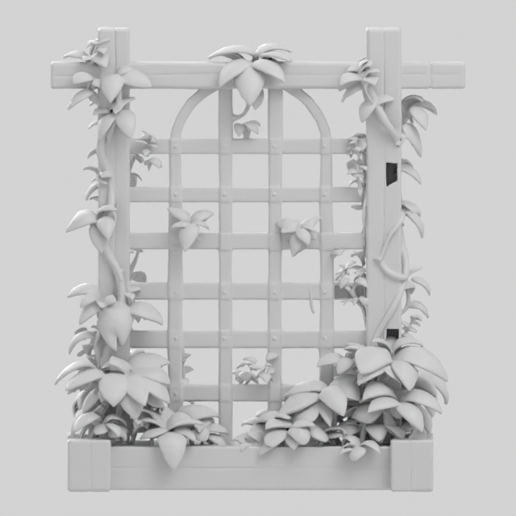
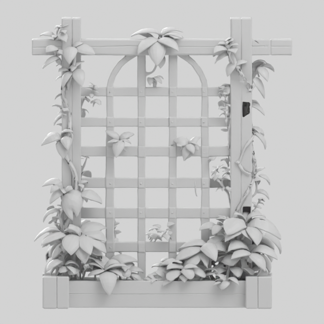
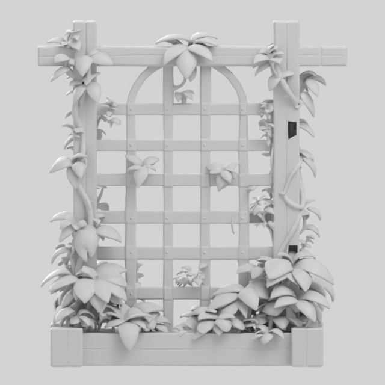
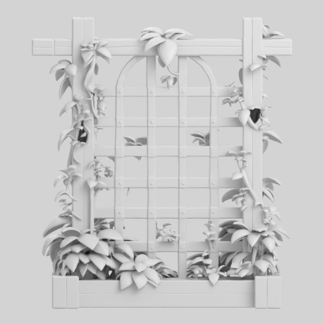
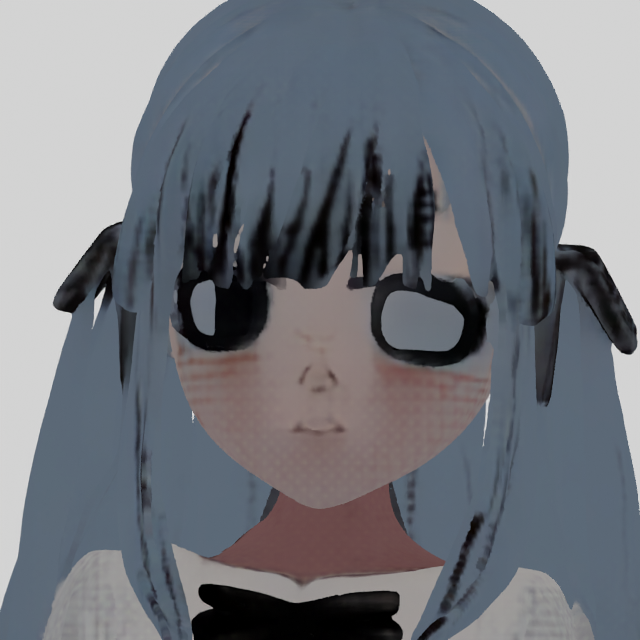

# 云端GPU补洞与两份模型诊断

日期：2026-10-22。代码基线：1742940。**后续新任务已接入GPU复查和有界开放边界补片；架子这类异常拓扑缺口尚未安全解决，不能称为全部大洞自动修好。**

## 1.本次做了什么

按用户后续明确要求，将处理放到同一云端GPU，后续TripoSR/TRELLIS.2新任务自动启用gpu-boundary-fill-v1，不需要用户中途点确认。重建模型/权重保持；首次GLB形成前完成几何处理，不二次烘焙。

TRELLIS.2在官方to_glb内部的UV展开前调用新GPU算子，先保存before_gpu_repair.ply；之后仍为首次官方属性采样和PBR导出。TripoSR在extract_mesh返回后，通过同实例已有TRELLIS.2环境的独立几何进程调用同一算子，保留原顶点色，新中心点颜色为邻近颜色近似；不换生成后端。模型推理本身没有改成新的模型。

GPU边计数、平面/面积/方向判定、BVH辐条相交检查和补片数组构造使用CUDA；少量闭环连通关系在CPU整理。“使用GPU”不表示GPU具备语义判断能力。正常带壁面的通孔不具有开放边界，保持不变；这也意味着错误生成的封闭通孔不能靠这种算法识别或修补。

## 2.边界和失败行为

- 最多2次实际补片尝试，与后续副本结构修复合计不超过2次。阈值复查但没有候选不计作执行了一次修补。
- 周长分级为最大外形的0.12/0.30，直径≤0.10、面积≤0.003×外形平方、最大离平面距离≤闭环直径0.01，闭环最多512边；均为固定工程限制，非语义识图。
- 分叉、过大、非平面、方向混乱、已有表面相交、补片包围盒相互覆盖均拒绝。接受必须边界减少、非流形边不增加，原顶点及原面保持，只添加中心和补片。
- 工具异常记status=failed和明确error，保留原几何继续首次导出；不把失败记成修补通过。完整自交/薄壁/打印仍由后续检查判断，GPU辐条测试不是完整自交证明。
- 新任务保存策略快照，旧任务不补写策略、不重新生成。页面增加GPU实际结果说明，下载仍由用户点击；原始GLB指本次流水线首次导出文件，可能已经包含首次导出前的GPU补片，不是未做工程处理的原生网格。

## 3.架子的实际结果

源任务01504c4c-1c1e-48ea-b975-9542e170baa9，原GLB949063面、858404个含UV接缝顶点，精确合并位置后451069顶点。原文件SHA256：76876ddcb7ba76561863769de2a3d7c45b305ca64a49a8ab4c3213d05b7ae189。

| 处理/诊断 | 实际结果 | 结论 |
| --- | --- | --- |
| 原GLB无纹理渲染 | 木条明显缺口仍存在 | 不是PBR颜色或网页HDR伪影 |
| 已有原生几何GPU清理/减面诊断 | 13373414面→1029398面，10.662秒；相同木条缺口仍存在 | 缺陷在首次导出前已存在，不是百万面不足造成 |
| 原GLB精确拓扑/CuMesh | 50条边界、13737条非流形边；CuMesh识别15个3边小环 | 明显大缺口不能等同于这15个微小环 |
| 保守GPU补片回放 | 50→50边界、0个补片；5个退化边界和15个方向不一致环拒绝 | 未修好，不伪报成功 |
| 隔离候选：GPU清重复/非流形面后fill_holes | 949063→清理924929→补后950476面；0.542秒；前面两处明显缺口视觉减轻，背面仍有缺口 | 原50条边界增加到7788，候选拒绝，不接入生产 |
| 同候选第2轮 | 952224面、6042条边界、0.753秒 | 仍远多于原件边界；到2轮停止，不继续堆补片 |

旧质量报告副本的7660条边界属于清理/定标后的另一版本，不能与原件50条混成“前后改善”。上表诊断使用同一原件、精确位置合并口径。

原GLB几何视图：



原生几何诊断也有缺口：



GPU异常面清理候选前面有所改善，但边界变多且背面仍缺损，因此拒绝：





原件严重非流形/重叠面会掩盖常规边界计数；早期仅根据大洞没有简单边界，推测为封闭通孔/内壁缺损，但清理候选表明不能把原因唯一归为封闭通孔。当前确定的是：缺陷已存在于原生几何，且简单闭环补洞不足以安全修复。

**后续需针对异常拓扑做局部结构补全，并结合原图验证开口意图。当前未实现这一能力；不把全局加厚、封住所有格子或损伤其他区域的候选上线。**本次没有改写这份GLB，也没有提供一个号称三个洞全补好的替代文件。

## 4.人物眼部原因

源任务e524638a-f707-4cb3-9be2-3bc85b1d334e；原GLB977035面、762827个UV顶点，SHA256：3a4e93d89e9c273fc4df6a66ba6be2b7e570e16e809ba40990afee89aec38b72。

已证实：

1. 原图1192×2980，为全身正面人物。官方预处理先把最长边降到1024，再去背景/裁正方形，本次backend_input为998×998，眼睛只占全图很小一部分。没有额外的人脸裁图条件或眼睛专用处理。
2. 实际1024_cascade使用512和1024两级图像条件；不能把特征提取器默认512说成全程只有512。手动4096是最终纹理图集大小，不是眼部输入分辨率。
3. 本次原GLB无光底色渲染已丢失原图棕色虹膜、高光和正确眼型。不是网页打光导致，也不是本次已取消的二次烘焙造成。

原图局部与原始GLB无光底色：




合理推断：全身条件中的眼部信息较少，加上生成模型对二维动漫脸的几何/材质推测，造成眼型和虹膜被重新解释。**没有执行裁脸/分辨率/种子/属性采样的消融，不能把全部偏差唯一归因于缩图，也不能量化各原因占比。**补洞器不会修正眼睛的语义外观；增加面数、把纹理调到4K或让DeepSeek写提示词不能保证还原，当前生成接口也不接收这类文字提示。

源码依据为锁定TRELLIS.2 revision 75fbf0183001ed9876c8dbb35de6b68552ee08bd的[预处理与条件入口](https://github.com/microsoft/TRELLIS.2/blob/75fbf0183001ed9876c8dbb35de6b68552ee08bd/trellis2/pipelines/trellis2_image_to_3d.py)和[官方首次导出](https://github.com/microsoft/TRELLIS.2/blob/75fbf0183001ed9876c8dbb35de6b68552ee08bd/o-voxel/o_voxel/postprocess.py)，本机/同一云端实际代码已核对。

## 5.实际验证与部署

同一RTX4090D，CuMesh revision 12289e1062f0603f2f0d0771b02e1395d247f26f，复用既有TRELLIS.2/TripoSR环境，不安装依赖。必要回放命令：

```bash
runtime/envs/trellis2/bin/python scripts/tools/validate_gpu_holes.py --output runs/gpu-hole-fixed --real-glb <本次原GLB路径>
runtime/envs/trellis2/bin/python scripts/tools/gpu_hole_worker.py --input <固定PLY> --output <新候选PLY> --report <新报告JSON>
```

固定结果：8边平面孔8→0边界、增加8面、非流形0；重复调用不再加面；正常环形通孔未填；过大开口拒绝；坏索引与CPU静默回退拒绝；真实CuMesh UV展开前钩子加8面且退出后恢复。另一个真实独立几何进程验证了固定顶点色保留/新增点近似路径。均不加载生成模型，不构成新的真实照片端到端/PBR或打印验收。

首次CPU全边分析超时手动停止；第二轮补片重叠门槛位置错误产生UnboundLocalError，记录后修订，同输入GPU回放重新执行。没有抹掉这两次失败。完整自交/薄壁/新图片模型端到端、浏览器与全量自动测试未执行，沿用用户自行网页验证，不引用历史测试作本轮通过。

静态AST、工具/运行时Schema导出及前端类型/Vite构建完成。12个明确文件在生产空闲备份后更新，GET配置gpu_hole_policy=gpu-boundary-fill-v1；21个旧任务状态保持，没有新增重建/LLM调用，没有代关机。前端源文件已更新，刷新本机页面即可看到后续任务实际GPU记录；未用浏览器验收冒充通过。最终静态交接检查覆盖42份文件、11份Python AST、11份JSON和267处本地链接；文档检查器首次误截断含括号的尖括号路径，修正解析后通过，原课程规范未改。前端最终46模块/JS868.66kB，保留原大包提示。停止快照GPU0MiB、21任务状态保持，两原GLB云端摘要与本机一致。

精简[GPU验证](evidence/gpu-holes-20261022/validation.json)、[发布](evidence/gpu-holes-20261022/deployment.json)、[候选拒绝基线](evidence/gpu-holes-20261022/gpu-clean-fill.json)保留。

## 6.人工复核及交接

新增主要代码：geometry/gpu_holes.py、scripts/tools/gpu_hole_worker.py、model_worker.py的两个导出前接入口、automatic.py的累计轮数，以及前端GPURepairInfo。人工可核对：8边固定孔确实增加8面；正常通孔没有封；原架子和人物文件保持；被拒候选没有替换生产；页面不把“边界减少”写成“所有缺口修好”。

本轮AI代码检查和图像检查已执行；用户本轮新增人工复核尚未提供，不代填通过。此前用户的人工验收及旧任务仍保持历史。

## 7.当前未完成项

本轮**开放边界GPU复查/补片子项已交付**。用户要求的“所有这类大洞自动修好”尚未完成：架子异常拓扑缺口的安全局部结构补全没有实现，眼睛也未修正。当前任务保留这一真实限制；不将有损清理候选上线，不宣称整项完成。下一步若继续，应围绕原图约束的局部结构补全单独设可保形验证，而不是继续无限提高补洞周长。
