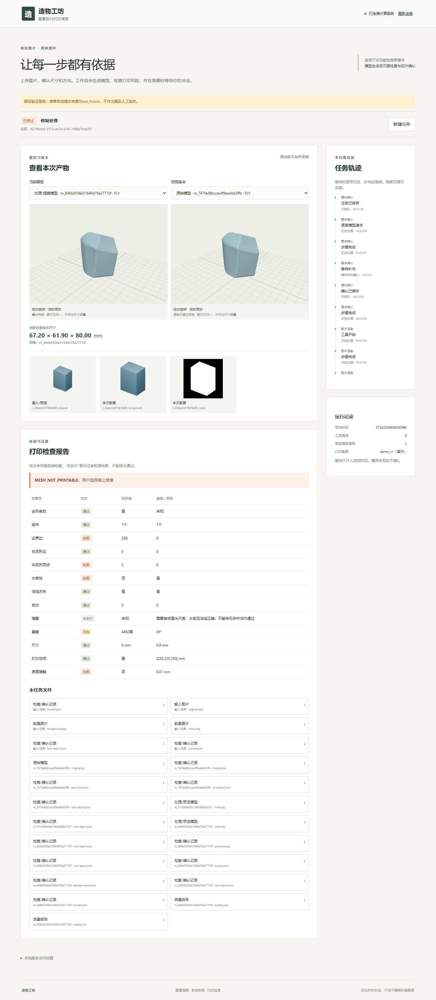

# 初步前端与评估交付

- 日期：2026-10-21。范围：第41～47、55、57～60及汇报交付；用户随后要求先不做PPT，配套PDF同时暂缓。
- 基线：d5a41c2，无前端和评估入口。本轮前端0.1.0、后端公共1.0.0/runtime-v1保持；没有修改模型、数据划分、协议或打印门槛。
- 结论：前端、固定回归、真实云端缺陷停止、同原始网格对照及汇报文档已交付。**真实打印合格成功链和最终保留集未完成，不能将本方向全部验收标通过。**

## 1.功能与逐项状态

| 项 | 实现与实际证据 | 限制 |
| --- | --- | --- |
| 41上传与约束 | 页面PNG/JPEG上传、大小限制、约束/单位/测量依据、后端/打印配置和本次前景复核 | 服务端负责真实格式/分辨率校验；演示打印配置不作实机认证 |
| 42进度 | 从runtime与增量事件显示排队/步骤/等待/失败，无百分比计时器 | 轮询1500ms，服务断开明确报错 |
| 43交互 | 六类等待表单，版本/等待ID绑定、同步提交锁、重试复用提交体 | 自动验证确认均test_fixture；具体人工确认仍需真实操作者 |
| 44模型预览 | Three.js加载本任务GLB/PLY/STL，旋转缩放及版本并排对照，实际云端2个canvas截图 | 显示归一不当作测量；尺寸来自后端毫米检查 |
| 45报告 | 通过/失败/风险/未执行分别显示，未知数值不填0 | 前端不自行计算打印合格 |
| 46下载/切片 | 任务级下载、同版本分层图上传、尺寸/软件/支撑复核表单 | 固定fixture走通下载和切片失败；真实任务因缺陷未到切片 |
| 47真实联调 | 实际页面上传、DeepSeek追问、TripoSR、Blender、刷新恢复及失败报告下载 | 只验证真实缺陷停止；未取得真实打印成功 |
| 55集成回归 | 4项浏览器、6项前端单元、193项Python通过/5项Windows平台跳过；既有成功/超时/取消/工具失败门槛回归保留 | 浏览器中的重建/外部检查为明确替身；真实工具另列 |
| 57真实完整任务 | 新任务92796bb8-3713-4e7e-a7f4-1999e7bab3f7从页面运行到真实模型、检查和JSON报告 | 失败/MESH_NOT_PRINTABLE，无该任务合格STL或实际分层，不标完整成功验收 |
| 58修复/定标对照 | 同一原始网格，基础清理/定标/预览/检查与Agent结果一致，原始摘要不变 | 孔洞/非流形仍在；无真值网格误差/未批准视角IoU均未知 |
| 59Agent对照 | 同TripoSR原始结果和工具，固定后处理实际执行11.339901秒，无新增重建/LLM；Agent缺尺度追问、恢复重建1次、正确停止 | 只作一例过程/调用对照，不宣称成功率或速度提升，不混减不同计时区间 |
| 60最终评估 | 新增Pydantic计划/冻结记录、门禁、汇总/同任务配对入口及5项离线回归；本次holdout门禁拒绝 | 尚未正式选型/批准相机/完成3个正常完整对象及切片/冻结，实际保留集not_run |

本轮没有消耗保留集，没有为了演示更换后端、挑正式评估输入或下调检查。第60项实施范围与历史前置冲突已先写入当前任务：完成可执行门禁和记录，实际最终评估保持阻断。

## 2.模块与接口

- frontend/src/contracts.generated.ts：由现有两套JSONSchema生成，字段、状态和输入联合类型不另造；scripts/tools/export_frontend_types.py负责导出/一致性核对。
- api.ts：现有HTTP接口、超时、错误解释及受保护产物下载。Vite在服务侧转发/api，浏览器不持有模型密钥。
- App.tsx：上传、创建、真实轮询/事件游标、任务URL恢复、模型/报告/下载。只保存最近run_id，不把文件路径当接口引用。
- PendingForm.tsx：约束、图片、打印、修复参数、提案和切片表单；所有提交绑定pending_input_id/mesh_version；网络失败不自动重试，不重复上传已生成证据。
- ModelView.tsx：仅获取登记的本任务产物，拒绝GLB外部资源，加载失败显示错误；卸载释放几何/材质/纹理/控制器/渲染器。
- evaluation.py：固定计划、冻结门禁、未知量与失败保留、同任务同原始结果配对，不自动运行模型或保留集。

依赖仅安装在frontend/node_modules：React19.2.0/ReactDOM用于页面，TypeScript5.9.3用于类型检查，Vite7.1.12用于构建和本地代理，Three.js0.180.0用于模型预览；Vitest3.2.4和Playwright1.56.0分别用于单元/浏览器验证，package-lock.json锁定实际依赖。模型环境未修改。实现参考[React副作用清理](https://react.dev/reference/react/useEffect)、[Vite服务代理](https://vite.dev/config/server-options)及[Three.js模型加载](https://threejs.org/docs/pages/GLTFLoader.html)，卸载与连接切换清理资源。

没有修改公共Schema、API路径、成功门槛或后端人工身份。新服务能力的TypeScript类型按既有configuration接口核对；任务状态/请求全部由公共Schema导出。启动见[前端说明](../frontend/README.md)。

## 3.实际验证与失败保留

| 检查 | 实际结果 |
| --- | --- |
| npm.cmd run build | TypeScript/Vite成功，Three.js包体832.08kB，存在大包提示，尚未做加载性能验收；浏览器回归使用Edge，其他浏览器兼容性未单独验收 |
| npm.cmd test | 6项通过 |
| npm.cmd run test:browser | 4项通过：缺尺度/刷新/双击去重/前景/结构提案/下载/切片失败；取消；坏图/文本安全；网络失败重试请求体相同 |
| python -m pytest tests -q --tb=short | Windows193 passed、5 skipped、2个依赖提示、53.94秒；跳过为4个Linux进程组和1个符号链接权限场景 |
| 云端新增评估回归 | 5 passed/0.09秒；后端此前Linux193项结果保持历史，不称本轮重跑全套Linux |
| 类型/三套Schema/30例静态准备 | 全部一致；静态读取不算实际保留集模型执行 |

首次失败均保留在runs/mid-frontend-20261021-01：9个可选字段类型错误；缺录屏FFmpeg；WebGL录屏收尾超时；Vitest误收集浏览器套件；空文件lastModified导致重试ID变化；并排画布撑开侧栏及检查单位显示问题。修订详见FRONT-BUG-001～006，增加布局边界和单位回归。测试首轮还有辅助路径/引用命令错误，未改变业务代码或算作有效验证。最终结果见[验证摘要](frontend-evidence/validation.json)。

真实页面脚本的首次精确文本定位失败未创建任务。第二次业务轨迹实际走通后，末尾事件读取相对URL无baseURL报错，原51.104秒失败记录保留；随后只读原run_id补核事件/报告，未再次建模或调用LLM。修订后的入口使用绝对URL。不能将该脚本错误抹除或把补核包装为第二次模型执行。

## 4.真实模型、对照与结论

输入为项目development/block.png，目标80mm；TripoSR固定revision107cefdc244c39106fa830359024f6a2f1c78871、seed0、MC128、chunk2048。实际加载准备8.432661秒、推理0.769662秒、模型内部总9.568243秒，allocated1939.054MiB/reserved1998MiB。页面上传本次图片，不使用预存GLB替代新生成。

流程为页面上传/描述→真实DeepSeek解析→缺尺度/方向等待→刷新后补充原任务→前景复核→真实TripoSR→清理/80mm定标→预览/刷新→真实Blender检查/DeepSeek说明→受控修复选择→明确停止并下载报告。自动化表单为test_fixture；**工具真实执行与人工验收是两类证据**。

| 指标 | 原始 | 定标/检查后 |
| --- | --- | --- |
| 外形 | 0.814668×0.750464×0.969893，无单位 | 67.196552×61.900829×80mm |
| 边界边 | 208 | 208 |
| 非流形顶点 | 2 | 2 |
| 水密 | false | false |
| 法线 | 一致 | 一致 |
| 自交 | 原始未作同口径检查，不填0 | Blender检出0 |
| 薄壁 | 未执行 | 因拓扑缺陷not_run/null |
| 底面 | 无实际毫米检查 | 接触面积0，失败 |

同一原始SHA256=c103147054df602540a4d9fc1e16b12a01f3627c0ed139c4983b0241d5d87610。固定工具后处理与Agent所有检查状态/数值及尺寸相等，源文件保持；这是调用编排对照，不是Agent改变生成算法。固定流程先给齐约束，缺尺度前置探针拒绝后处理；Agent实测等待/恢复且重建1次。两者时间边界不同，不计算加速比。详情见[对照](frontend-evidence/fixed-comparison.json)。

DeepSeek实际2次调用，971输入/320输出token，费用未知；未配置价格不填写0。未跑正式30例或保留集，正式成功率未知；自动化确认记录单列，不进入真实人工成功统计。没有合法形状真值或批准相机，网格误差和输入视角IoU保持null。

## 5.离线交付与运行状态

真实输入/网格/检查/报告/数据库/固定对照已备份为runs/mid-frontend-20261021-01/cloud-evidence.zip，71文件/4663673字节，CRC/SHA256通过；SHA256为c3fe52a3ae949d11771bdc461241ea03e827f3298dc1e88e2445c5d8490eed2f。完整产物不入Git；本机runs目录另存真实页面录屏、固定回归录屏及截图，交接时单独提供该目录。

本轮独立云端测试API/worker已停止，GPU0MiB/0%；此前人工模式服务保持，实例不代关机。浏览器/Vite在本机，重建/检查计算在同一云端；更换电脑只同步代码和小证据，不能假定模型环境已复制。前端可经SSH连接既有人工服务，详见前端README。

收尾已启动http://127.0.0.1:5173页面及本机9000到云端8000的SSH隧道，连接confirmation_origin=human的既有人工服务；不再指向自动化测试存储。保留空闲供用户操作，停止本机页面/隧道可结束其终端进程，实例仍由用户自行关机。真实录屏保留当时的并排布局问题，修订后布局已用原任务只读截图和浏览器边界回归核对，未重复推理来重录成功。

## 6.本轮人工复核清单

2026-10-21用户按本节清单明确答复“已按清单复核，本轮人工复核通过”，据此记录本轮新增页面、主要代码和结果人工复核通过；未逐行展开的阅读过程不补造，不使用上轮后端结论代替本轮。

1. 阅读本报告与[演示及来源说明](中期演示与交接说明.md)，确认真实失败、测试替身、未执行和延后内容的边界。
2. 检查App.tsx、PendingForm.tsx、api.ts、ModelView.tsx和evaluation.py的主要流程，能说明输入、输出、等待/错误、版本与幂等规则。
3. 观看runs目录真实录屏，核对原任务刷新恢复、真实生成、模型对照、未执行薄壁、失败停止和报告；固定切片图只是测试fixture，不能写成实际分层通过。
4. 实际操作者后续再批准具体结构提案/映射/切片。可给本轮代码与结果复核结论，不把复核通过当作模型打印合格或第60项最终评估通过。

本轮停止于上述交付与授权Git同步，不自动开始正式选型、保留集、模型优化或新增方向。PPT/PDF依用户要求暂缓，成员讲解和现场彩排仍由成员实际完成。本轮人工复核不替代具体结构/映射/切片批准，不改变第57项真实成功链及第60项最终评估未完成的事实。
