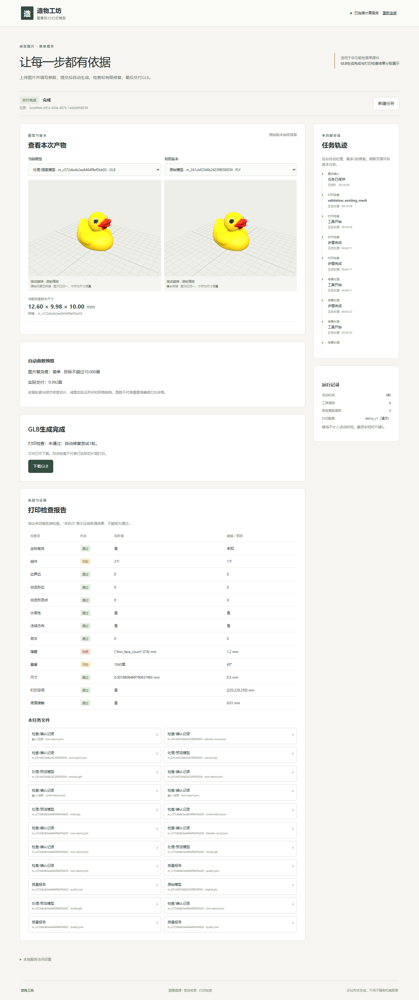

# 图片复杂度与自适应面数验证

日期：2026-10-22；任务MID-MESH-001；修改前main/81cf04e。技术验证及同一云端服务更新完成，用户已明确“已核对，本轮人工复核通过”，据此记录本轮新增代码与结果复核通过。

## 1.现在的行为

新任务仍只上传一次图片和参数，不提供生成模式选择，不增加中途操作。服务用已有CPU图像工具估计轮廓与内部边缘复杂度：简单目标10000面、中等30000面、复杂或背景不确定100000面。页面和报告显示分类、目标、实际交付面数及未达到预算的原因，完成/刷新不下载，点击按钮才下载。

这是一套确定性启发规则，不是新增视觉大模型，也不声称识别物体名称或隐藏面。纹理、阴影、遮挡可能影响分类；简单图片不保证几何简单。预算只用于重建后的保形减面，现有TripoSR/TRELLIS.2生成过程与固定权重不改，不能据此声称推理加速或解决单图扁平。

## 2.模块、契约与停止条件

- [图片分析](../src/image_to_3d_print/image/complexity.py)：只对分析副本缩略至256像素，原图继续传给模型；透明alpha或近似均匀背景提取前景，异常分离保守回退。记录策略版本、coverage、组件/孔、轮廓紧凑度、内部边缘密度及原因，simple/medium/complex/uncertain和预算由Pydantic联合规则校验。
- [工具入口](../src/image_to_3d_print/geometry/commands.py)：analyze_complexity关联注册图片及SHA256，返回既有ToolOutcome/ToolResult及证据。adaptive_budget只能由内部automatic_action和automatic_policy共同启用；客户端不能自行批准。guided的原有10万面简化下限保持。
- [工作流](../src/image_to_3d_print/workflow/automatic.py)：新任务快照face_budget_policy=image-complexity-v1；准备后分析，再重建/清理/定标/检查。计划节点先尝试预算，再按检查做适用修复；提案、策略确认、应用、复检仍分节点。**简化与其他结构修复合计最多2次**。低预算不合格可按1万→3万→10万有界回退；不能达到目标时保留检查较好的有效版本并解释。
- [保形门槛](../src/image_to_3d_print/geometry/structure.py)：三固定视图轮廓IoU均≥0.95、各轴外形变化≤1%、组件数保持、不增加边界/非流形，不破坏已通过的水密/法线/自交/薄壁项。最终实际面数必须不超过本次候选预算。任一门槛或工具失败就拒绝候选，原件/失败及逐版证据保留；不任意拉厚或加底座。
- 兼容：公共1.0.0/generation-v1不改，工具Schema自动导出；GET配置增补face_budget_policy，RuntimeTask.resources和质量报告增补mesh_budget。旧任务不补分析、不自动重跑，不改其历史政策或验收。具体字段见[接口](接口与字段.md)。
- [外观导出](../src/image_to_3d_print/geometry/appearance.py)：处理顶点底色GLB明确非金属、roughness=0.85、平滑顶点法线，并将PLY的sRGB底色转换为glTF线性浮点颜色。原始纹理PBR和PLY颜色字节不变；处理色仍为采样近似，独立读回用于核对几何尺寸，不宣称还原全部PBR。

## 3.固定验证与命令

正常、边界、失败和安全样例覆盖：单色/透明简单前景、内部纹理、孔、多组件、背景不确定/空图；低于预算、不允许的分类预算组合；保形成功、损伤拒绝、第二档回退、旧任务；自动权限伪造、历史取消/超时/重启/幂等、两轮上限；顶点颜色/材质/法线、已有纹理不覆盖。

新工作流fixture中的生成模型和Blender是明确test_fixture替身，CPU网格、LangGraph、SQLite、GLB和版本管理实际运行。它们不能证明真实模型质量。真实已有网格和Blender验证另见第4节。

```powershell
runtime/envs/backend/Scripts/python.exe -m pytest tests -q --tb=short
runtime/envs/backend/Scripts/python.exe scripts/p1/export_schemas.py --check
runtime/envs/backend/Scripts/python.exe scripts/tools/export_tool_schemas.py --check
runtime/envs/backend/Scripts/python.exe scripts/tools/export_runtime_schemas.py --check
runtime/envs/backend/Scripts/python.exe scripts/tools/export_frontend_types.py --check
```

本机完整255通过/6平台跳过/88.59秒；同一Linux环境使用`CUDA_VISIBLE_DEVICES= PYTHONPATH=src ../../runtime/envs/backend/bin/python -m pytest tests -q --tb=short`，261通过/53.95秒。不带tests参数只运行pyproject声明的68项，不能当全量，最终以显式tests结果为准。四项Schema/类型导出检查通过，无新依赖。

frontend内`npm test -- --run`为6项，`npm run build`含TypeScript检查并通过；保留既有约835KB大包警告。已有CPU固定HTTP服务/5175下执行`npx playwright test tests/fast-profile.spec.ts`，2项通过：双击只创建1次、新预算显示、无中途输入、缺/负高度拒绝、刷新不下载、点击下载1次。真实只读页面执行`I3D_ADAPTIVE_REAL_BROWSER=1 node tests/adaptive-real.mjs`，0次写请求，完成/刷新0次下载，点击1次。

修改前6项缺分析/权限回归失败；首次平底fixture、CPU检查点入口、浏览器URL、Windows编码和远端解包命令问题分别保留记录并修订，没有放宽实际质量门槛。新增材质/颜色回归首次2失败后7项外观专项通过。失败及根因见[Bug记录](../spec/bug调试文档.md)，原日志保存在runs/adaptive-mesh-20261022-01。

## 4.已有真实鸭子网格的CPU验证

复用生产已完成任务9e10c058-029e-47d3-991b-d6b44718e73d的毫米PLY及原图，原重建为固定TRELLIS.2快速后端。本轮**没有重新生成模型、使用GPU、调用LLM或消耗保留集**。脚本[scripts/tools/validate_adaptive_mesh.py](../scripts/tools/validate_adaptive_mesh.py)复制到隔离存储，从已有毫米版本接续真实CPU检查/Blender简化/复检/GLB交付。不能把这次CPU重放说成新增上传到GPU重建的完整真实联调。

Linux在独立部署中执行：

```bash
CUDA_VISIBLE_DEVICES= PYTHONPATH=src ../../runtime/envs/backend/bin/python scripts/tools/validate_adaptive_mesh.py --project /root/autodl-tmp/image-to-3d-print-agent
```

| 项目 | 实际结果 |
| --- | --- |
| 分类/预算 | simple/10000；轮廓紧凑度3.201350、内部边缘密度0.026253 |
| 顶点/面 | 49645/99282→5000/9992 |
| 外形 | 12.600028×9.972781×10.000000mm→12.599752×9.976611×10.001981mm |
| 三视图IoU | 0.991233、0.993077、0.992626 |
| 最大相对外形变化 | 0.038403% |
| 拓扑 | 两版均2组件、水密/法线通过、边界/非流形边/点均0 |
| Blender检查 | 两版自交0；薄壁均失败、悬垂风险保持 |
| 自动尝试 | 1次simplify，automatic_policy批准、实际应用及复检 |
| 时间 | 本轮CPU几何/检查/交付区间37.140687秒；外观修订仅再导出同版本，未重复简化或重建 |
| 原件 | SHA256核对未改变 |
| 交付 | succeeded/generation-v1，打印failed，print_certified=false |
| 最终GLB | 321456字节，SHA256为6d59726564473c73276a2f8c28a0cb572cafb8563d9025f9b1e3ecd7a2a8554e |

薄壁面数会随三角划分改变，不能用1921→374面宣称壁厚改善。最近顶点底色转移最大距离0.115696mm，是近似；形状/外观相近不等于恢复实物真值或可打印。真实任务2ccbf4de-d91c-420e-8875-1a06d8f08539、交付版本m_c572dbdb2ee8404f9ef5bb03及精简[结果](evidence/adaptive-mesh-20261022/result.json)、[浏览器](evidence/adaptive-mesh-20261022/real-browser.json)保留。原始模型的展示登记随后补入同一隔离任务，仅元数据登记，未重新生成几何。

用户指出暗版后，核对发现旧处理GLB没有材质和法线；GLTFLoader按metalness=1显示，原PLY按非金属显示。修订仅再导出同一9992面网格，未调整RGB源值/全局灯光或篡改原始PBR。[修改前暗版](evidence/adaptive-mesh-20261022/dark-baseline.png)保留，以下为实际修订后同场景：左侧处理GLB、右侧原始PLY。



## 5.部署与遗留限制

生产升级前逐项核对改动文件与81cf04e一致，无运行/排队任务；备份旧代码、配置及两个SQLite库，再同步13个明确文件至既有稳定部署，重启归属明确的API/单worker。12个历史任务状态保持，GET配置确认image-complexity-v1/automatic_glb，启动器路径与5173/9000连接沿用。独立API8001和本轮本机测试服务收尾停止，生产API/单worker及5173/9000保留；最终GPU0MiB/0%。完整76文件/21797429字节备份已下载本机，SHA256与CRC通过，包含原始失败和修订后产物，不含模型权重/环境。实际[部署结果](evidence/adaptive-mesh-20261022/production-result.json)单列；旧任务文件不重写，旧下载GLB不会自动被替换。

真实新重建全路径、更多物体泛化、精确曲面误差、实际打印/切片、正式同机选型与保留集未在本轮执行。减面降低后处理/预览文件规模，不减少已完成的重建推理成本；复杂/不确定可能保留10万面，保形不通过也可能超目标。多图、第三模型/视觉API、训练、PPT/PDF继续暂缓。实例由用户自行关机。

## 6.本轮人工复核

状态：用户已明确“已核对，本轮人工复核通过”。据此记录本轮新增代码和结果复核通过，不补写未展开的逐行阅读，不代表实际打印合格或批准下一项。以下保留复核清单：

1. [complexity.py](../src/image_to_3d_print/image/complexity.py)和[测试](../tests/geometry/test_adaptive_budget.py)：规则估计的边界、三档预算、背景不确定回退，未冒充语义识图。
2. [automatic.py](../src/image_to_3d_print/workflow/automatic.py)、[structure.py](../src/image_to_3d_print/geometry/structure.py)、[回归](../tests/workflow/test_adaptive_mesh.py)：最多2次包含减面，损伤拒绝、第二档回退、原件与旧任务保留。
3. [appearance.py](../src/image_to_3d_print/geometry/appearance.py)、[导出](../src/image_to_3d_print/artifacts/export.py)、[外观回归](../tests/geometry/test_glb_appearance.py)：非金属/法线/颜色转换，原纹理不覆盖；第4节暗版和修订后效果。
4. [页面预算](../frontend/src/MeshBudgetInfo.tsx)、本报告结果及下载行为：99282→9992、薄壁仍失败、不自动下载；CPU重放与真实新重建的证据边界。认可后给本轮结论，否则记录具体问题。
