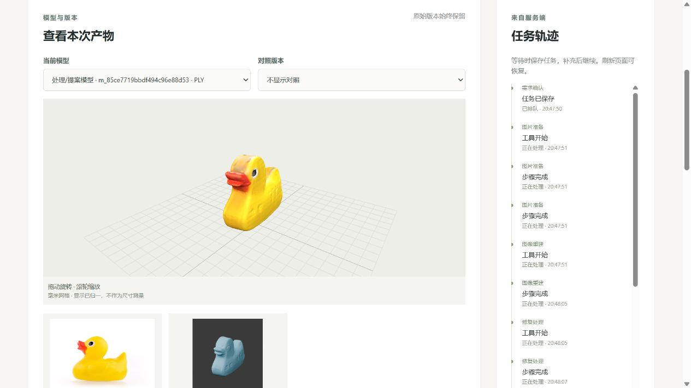
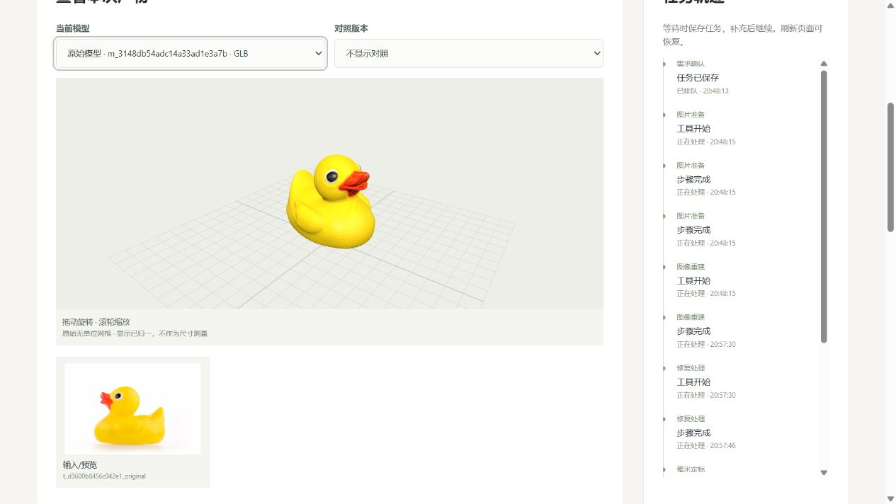

# 官方推理对齐与自动图片准备

日期：2026-10-21；任务MID-MODEL-002；修改前版本aa48536。用户要求取消页面中的前景/适用范围复核，并将两个重建后端对齐论文官方实现。

## 1.交付和边界

已取消新任务的初始图片人工复核，原图交给所选后端的官方入口处理；服务端记录automatic、semantic_suitability=not_checked，不代填“主体完整”等人工结论。缺尺度仍追问，结构修改、打印姿态/底面和最终切片仍绑定实际版本等待用户操作。历史图片等待可自动接续；已有打印/结构/切片等待不会被自动批准。

两个后端现在直接运行固定版本、未修改的作者入口，使用已有权重和默认质量参数。这里的对齐指预训练推理和官方导出，不表示复现训练、论文全部实验或保证任意图片得到论文展示效果。已安装环境仍含此前记录的兼容构建；没有声称与作者训练机器、依赖栈、随机状态完全相同。

本轮没有训练、新增第三重建模型、正式模型选型、执行保留集、制作PPT/PDF或替用户确认真实切片。完整原始产物不入Git；精简实证见[JSON记录](evidence/official-alignment-20261021/live-results.json)。

## 2.原来的差异与本次对齐

| 环节 | 修改前接入 | 本次行为 |
| --- | --- | --- |
| 项目预处理 | 256×256画布、主体最长边224像素，之后再进入模型预处理 | 传递原图字节和分辨率，官方入口自行预处理 |
| TripoSR | 128等值面、chunk2048、无顶点颜色 | 作者run.py默认256/8192/前景比例0.85，输出顶点颜色 |
| TRELLIS.2 | seed0，原生PLY，略去官方完整导出 | 作者example.py，默认seed42/1024_cascade，官方视频、重网格、1百万面目标及4096纹理GLB |
| 图片确认 | 每次停在前景/范围复核 | 服务端automatic政策自动继续，明确语义未人工复核 |
| 页面 | PLY固定灰色，GLB按统一轴假设 | 保留PLY顶点颜色；逐产物登记y_up/z_up，GLB使用原材质 |

这些差异已经确认，但本轮同时修订多个环节，不能将视觉改善全部归因于某一项，也不是控制变量的论文性能对比。

官方源码和论文：

- TripoSR：[论文](https://arxiv.org/abs/2403.02151)、[固定run.py](https://github.com/VAST-AI-Research/TripoSR/blob/107cefdc244c39106fa830359024f6a2f1c78871/run.py)，revision=107cefdc244c39106fa830359024f6a2f1c78871。
- TRELLIS.2：[论文](https://arxiv.org/abs/2512.14692)、[固定example.py](https://github.com/microsoft/TRELLIS.2/blob/75fbf0183001ed9876c8dbb35de6b68552ee08bd/example.py)，revision=75fbf0183001ed9876c8dbb35de6b68552ee08bd。

TripoSR仅通过作者命令行参数指定本地权重、输入/输出和GLB格式，未开启非默认纹理烘焙。TRELLIS.2在隔离工作目录将本次图片原字节复制到作者脚本要求的assets/example_image/T.png；SHA256相同，文件名不表示使用旧官方T形图。forest.exr来自固定上游，官方120帧视频保留，页面不新增视频功能。

官方GLB完整保留；打印链另行读回为Z轴朝上的几何。TRELLIS.2的GLB为y_up，按固定逆变换读回；TripoSR为z_up。只做坐标转换，不以读回名义补洞、删组件或改拓扑。原生TRELLIS网格另存，不混作官方重网格导出后的结果。

TripoSR官方rembg所需u2net.onnx此前缺失，本轮从官方rembg发布源补齐175997641字节，MD5=60024c5c889badc19c04ad937298a77b，与rembg锁定值相符；保存数据盘缓存，不入库。它是去背景依赖，不是第三个3D重建模型。

## 3.真实小黄鸭结果

复用用户先前任务43d395d8-aed2-49e8-8c1f-1bda3fcceda1的910×609原始JPEG，两次输入SHA256均为1d6ac093c18648fc9568f58e310db3d1666d942cb0a2ea36b21be8384993f4ff。本轮描述留空，真实LLM调用0；不把历史DeepSeek验证算作本轮调用。

同一AutoDL实例RTX4090D24564MiB、16核/80GiB，复用既有环境：TripoSR的PyTorch2.5.1+cu124，TRELLIS.2的2.6.0+cu124。冷启动、导出和CPU处理均包含在记录范围，不构成标准性能基准。

| 结果 | TripoSR | TRELLIS.2 |
| --- | --- | --- |
| 本次任务UUID | e71621a8-c661-4534-b29b-1c88518d0dda | 0a1eccbb-2d8b-47a2-9d7f-db8d49e767df |
| 官方入口加独立读回 | 9.264秒 | 540.276秒 |
| 模型子进程总时长 | 12.514秒 | 544.881秒 |
| 峰值已分配显存 | 4238.971MiB | 7387.771MiB |
| 官方GLB大小/外观 | 2423640字节/顶点颜色 | 35490600字节/4096×4096纹理 |
| 读回顶点/三角面 | 60632/121042 | 499493/998978 |
| 组件/边界边 | 1/438 | 2/0 |
| 初检watertight | false | false |
| 本轮实际停止点 | 打印姿态/底面确认 | 超过50万面，等待受控简化选择 |

模型加载和纯推理分段未对作者脚本插桩，分别记null；不能把540秒称作纯GPU推理。TRELLIS.2包含视频、重网格、CPU纹理展开/烘焙，某些阶段GPU利用率低是正常现象。边界边为0也不等于所有边流形、水密、薄壁及自交检查通过。

两任务均只重建1次，未经过初始input_review等待，无human_reviews记录；原先3个任务保留。未提交真实打印/结构/切片确认，打印完整检查和合格STL交付未验收。看起来更像鸭子与可打印是两个结论。

实际浏览器结果：





TripoSR仍有细节粗糙、形体偏差；TRELLIS.2外观更完整，但仍有2个组件及拓扑问题，且接近百万面。截图仅证明实际页面显示和本次外观，不替代几何合格结论。

## 4.接口、部署与复现

主要位置：image/assets.py的原图准备/自动记录，adapters/reconstruction.py与official.py的配置/入口/独立读回，scripts/tools/model_worker.py的官方执行，workflow/graph.py及jobs/的自动接续，frontend/src/ModelView.tsx的颜色与轴向。公共1.0.0保持；内部工具Schema兼容联合旧InputReview和AutomaticInputAcceptance，runtime-v1增补默认空字典artifact_frames，客户端类型从Schema生成。

input_review_policy仅服务端设置，默认automatic，可显式manual复用旧路径。自动记录不经公共人工提交接口，也不接受客户端自称人工。官方profile拒绝自定义seed、128等旧参数；要复现历史简化接入须明确legacy_geometry，不能静默降级。缺源码/权重、源码revision或官方入口被修改、缺官方GLB均明确失败；没有原生PLY冒充官方GLB的回退。

当前云端源码目录为/root/autodl-tmp/image-to-3d-print-agent/deployments/official-20261021-01，存储仍为runs/agent-application，配置runtime/config/backend.json。启动说明已同步；启动器从当前部署加载源码，模型进程清除PYTHONPATH以隔离既有环境。API/单worker仍仅回环访问，不新增公网端口，不重装环境。任务活动上限1800秒，模型工具分别300/1200秒；这是有界产品运行，不是用户已取消的整轮工作时限。

页面仍通过本机5173和既有SSH隧道访问。刷新后若选择器回到打印网格，可选择“原始模型·GLB”看官方外观；PLY/STL打印几何与PBR外观分开，纹理不写入普通STL。

复现与回归命令：

```powershell
runtime/envs/backend/Scripts/python.exe -m pytest tests -q --tb=short
runtime/envs/backend/Scripts/python.exe scripts/p1/export_schemas.py --check
runtime/envs/backend/Scripts/python.exe scripts/tools/export_tool_schemas.py --check
runtime/envs/backend/Scripts/python.exe scripts/tools/export_runtime_schemas.py --check
runtime/envs/backend/Scripts/python.exe scripts/tools/export_frontend_types.py --check
runtime/envs/backend/Scripts/python.exe scripts/p1/check_prepared_data.py
```

云端对应在明确部署目录使用PYTHONPATH=src及已有backend解释器运行pytest。前端在frontend目录执行npm.cmd test和npm.cmd run build。浏览器人工政策4项/自动政策1项使用tests/frontend/serve_fixture.py的明确测试替身，不消耗GPU，不作为真实重建证据；真实两任务证据单独保存。

## 5.工作流完成到哪里

已有可运行的前端、真实API/单worker、LangGraph编排、SQLite任务/检查点、DeepSeek适配、真实重建、几何定标、打印检查、报告、等待/恢复/取消/超时及缺陷停止。此前各方向人工复核保留。

完整中期验收尚缺范围内真实模型通过检查、同版本STL导出和实际切片确认的成功闭环；正式冻结/保留集也未执行。本轮不是从零重做Agent，而是修正已有模型接入和输入交互。模型导出成功、能下载文件或界面有鸭子，均不替代最终交付验收。

## 6.本轮验证与人工复核

先保留缺自动契约的失败基线，再实现；Schema导出器patternProperties的类型失败、Linux进程fixture冲突及历史等待迁移状态冲突均保留并补回归，详见OFFICIAL-BUG-001～004。历史等待迁移先3通过/1失败，定位为running状态仍携带旧pending导致公共校验拒绝；清除已消费的图片等待后重新登记原图，4项通过。

最终Windows207通过/6平台跳过/46.23秒；Linux213通过/20.89秒；前端6项，浏览器人工政策4项/34.743秒、自动政策1项/6.795秒通过；Schema/类型/清单检查通过。前端构建通过，有832.26kB主包的既有体积提示，未顺带重构。最终命令、结果及收尾以[validation.json](evidence/official-alignment-20261021/validation.json)为准。本轮自动化测试与AI视觉检查不算新增人工复核；此前用户对前端、后端或几何的结论不套用到本轮。

收尾时云端已保存57文件/333413685字节原始产物，并生成173180596字节压缩包，最后可达快照运行任务0、GPU0MiB。随后SSH连接被关闭，完整包未成功下载本机，最新远端状态未知；不自动开机或再跑模型。精简JSON、截图及Windows日志已本机保存，Linux最终213项结果也已取得；最后文档不声称已同步云端。恢复SSH后只需下载runs/official-alignment-20261021-01/task-artifacts.tar.gz及收尾记录，无需重建。完整包SHA256=33b4082dd57fc7af1cb2674a7db7d9b3cf3714c0ef55f073bcf3e899943324d1。

人工复核建议核对：本文件第1～3节、两个实际页面/截图、官方入口执行/原图证据、自动接续及打印门槛的主要代码差异。只确认本轮新增代码和结果；不要求代填真实结构或切片确认。

2026-10-21用户回复本轮复核请求：“已核对，本轮人工复核通过”。据此记录新增代码/结果整体人工复核通过，不补写未展开的逐项阅读，不替用户批准实际结构修改、底面或切片，也不认定模型可打印。本轮按已有授权提交推送后停止。

交付检查：49份授权文件、21份Python语法、5份严格JSON、203处本地链接、UTF-8/围栏/凭据模式及Git空白检查通过；权重、虚拟环境、密钥和完整产物不入库。明细本机runs/official-alignment-20261021-01/delivery-check.json。提交前远端main仍为aa48536，按普通提交推送，不强制覆盖。
