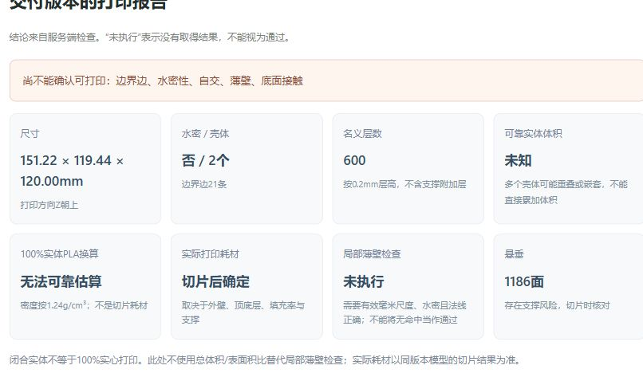

# 打印检查估算与补洞方法验证

日期：2026-10-29；任务：MID-CHECK-001；基线：1e55f12。用户要求参考Tiny打印检查/修复器，并明确“同时验证新的修补方法，通过后再接入”。本轮仅本机现有CPU/Blender验证及检查摘要，原件/UV/PBR、后台自动修复和TRELLIS.2常驻保持。

## 1.参考网站实际在做什么

已阅读[可打印性检查器](https://tiny-online.tools/zh/3d-%E5%B7%A5%E5%85%B7/3d%E5%8F%AF%E6%89%93%E5%8D%B0%E6%80%A7%E6%A3%80%E6%9F%A5%E5%99%A8)和[STL修复与优化](https://tiny-online.tools/zh/3d-%E5%B7%A5%E5%85%B7/stl%E4%BF%AE%E5%A4%8D%E4%BC%98%E5%8C%96)页面及公开客户端模块。页面声称文件在浏览器内处理；本轮未向外站选择/上传模型，也未运行其在线修复，使用相同数学思路自主编写独立候选。网页可见代码不等于获得复制/再分发许可，未复制其代码入库。

| 项目 | 已核对原理 | 应如何解读 |
| --- | --- | --- |
| 体积 | 对变换后的三角形求有向四面体体积之和，再取绝对值 | 非封闭、自交、重叠/嵌套壳会使结果不可靠 |
| 重量 | 体积cm³×密度，默认PLA为1.24g/cm³ | 没有外壁、填充或支撑参数，是100%实体换算，不是切片耗材 |
| 线材长度 | 体积除以直径1.75mm线材截面积 | 同样依赖实体体积假设 |
| 壁厚 | 总体积与总表面积比的2倍 | 全局特征尺度，不能找出鸭嘴、翅膀等局部最薄处 |
| 层数 | 高度除以层高后向上取整 | 名义主体层数，未做切片，不能代替包含支撑的路径层数 |
| 悬垂 | 下垂面法向阈值，按表面积加权 | 比面数比例更有解释性，但不等于已设计支撑 |
| 补洞 | 识别边界环，在环顶点均值位置加一点，以扇形连接边界 | 简单孔可封口，凹/非平面孔可能重叠、自交，不能据水密单项认定可打印 |

页面介绍和当前客户端实现还存在细节差异：说明文字把绕序统一放在补洞之前，实际公开函数先补扇形面，再统一绕序。本轮只验证核心质心扇形方法，不宣称逐字节复现该网站或其全部开关。

公开模块定位/摘要见[来源实证](evidence/print-check-20261029/sources.json)，原网页/脚本只保存在被忽略的本机runs目录，不再分发。

## 2.截图里的2kg与29.19mm如何得到

指定任务为`123a6686-eb9c-42af-b917-9f8515f0422f`，网格`m_0d802a61e59646979ddb886d`，9499面、高120mm。对其实际下载STL进行只读复算，未修模型：

\[
m=1614.414287\times1.24=2001.873716\text{g}
\]

\[
t_{\mathrm{estimate}}=\frac{2V}{A}
=\frac{2\times1614414.287}{110610.809}
=29.190895\text{mm}
\]

这两项与截图四舍五入结果完全一致。但模型不封闭，存在21条边界边/365面自交，不能据代数求和得到可靠物理体积。两个壳的代数体积约798.971和815.443cm³，尺寸几乎一致、包围盒大幅重合；相加会产生重复计量风险。不能把“有两壳且都朝外”当作经过布尔并集的实体，也不能将它们当成正确内外壁。

组件分析用面邻接和process=False分别提取，保留原面数4668/4831。Trimesh.split的默认小孔处理会将组件变为4670/4836面，故不把那份便利函数结果作为原件已闭合的证据。详见[原件只读计算](evidence/print-check-20261029/local-diagnostic.json)。

STL/GLB通常描述表面边界，不包含FDM外壁条数、内部填充率和支撑路径。闭合的实体模型交给切片器后，可以按15%等填充率打印，几何实体不意味着100%耗材填满；反过来，一张开口薄片也不是可打印空心模型。[Prusa官方填充说明](https://help.prusa3d.com/article/infill_42)解释填充对耗材、时间和结构的影响。

之前独立通过的12cm展示小鸭是另一打印副本：已记录3圈外壁/15%填充/自动支撑，真实切片耗材体积约201.05cm³；按同密度换算约249.3g。它不是本次9499面网页文件的切片结果，也不是本轮重切片或实物称重。

## 3.我们完善的检查摘要

实现[PrintSummary](../frontend/src/PrintSummary.tsx)、[独立样式](../frontend/src/print-summary.css)和[固定回归](../frontend/src/PrintSummary.test.tsx)，只在[App](../frontend/src/App.tsx)的主交付与检查mesh_version一致时显示。上传、参数、生成/下载、原逐项报告及服务端Schema不改。

摘要包括尺寸、水密/壳体/边界、名义层数、可靠实体体积、100%实体PLA换算、实际耗材、局部薄壁和悬垂。只有毫米、有效有限体积、单壳、水密、正常法线、无非流形及自交检查pass且值0时才换算实体重量；开孔、多壳、自交或缺检查时明确未知，避免重复体积误算。实际耗材始终留给同版本切片，不简单乘以15%假装已计算外壁和支撑。

已有[薄壁检查](../src/image_to_3d_print/inspection/service.py)使用固定Blender工具的局部射线抽样，水密或法线不满足则not_run。通过时显示“抽样未发现低于1.2mm的薄壁”，不把阈值1.2mm说成实测全局最小值；不换成2V/A。悬垂保留已运行工具的面数/风险，不把面数比冒充网站的面积比。

未新增重叠体积布尔计算、最小壁厚证明、切片服务或模拟耗材，这些不能由页面公式替代。REST、公共Pydantic/JSONSchema及历史任务保持；没有后端部署需求。

## 4.补洞候选的真实验证

独立[质心扇形候选](../src/image_to_3d_print/geometry/hole_experiment.py)只追加顶点/三角面，不改原点/面/文件，不删除壳或自动合并。拒绝分支边界、非流形边、未闭环和超上限输入，保留production_approved=false。[验证入口](../scripts/tools/validate_hole_candidate.py)复用本机Blender4.5.14及固定PrintToolbox；Windows真实执行明确记录，不冒充Linux云端验证。

对同一STL原件和候选，实际结果：

| 检查 | 原件 | 质心扇形候选 |
| --- | --- | --- |
| 三角面 | 9499 | 9520 |
| 追加补片 | 无 | 7个三角孔各加3面，共21面 |
| 边界边 | 21 | 0 |
| 水密 | 否 | 是 |
| 壳体 | 2 | 2 |
| 非流形边/顶点 | 0/0 | 0/0 |
| 方向一致 | 是 | 是 |
| Blender自交面 | 365 | 365 |
| 薄壁射线命中 | 原件开口，不作有效厚度结论 | 9459面命中低阈值；自交仍使物理厚度解释受限，不能记通过 |
| 外形包围盒变化 | — | 0% |
| 接入生产 | — | **否，未通过整体门槛** |

这证明“孔封住”和“可打印”是两件事。固定U形凹口还验证了另一失败：均值质心落在凹口外，扇形虽使边界闭合，却产生反向/重叠补片。此方法不作为通用修复器接入，不替换原GLB或网页STL；候选文件保留在本机试验目录，不包装为可打印交付。

可以在网站选择STL副本试修再下载，但它不保留GLB的UV/PBR，而且仍需独立检查自交、薄壁、壳体和切片。当前已验证方法不足以解决本件问题，所以继续保留既有受限修复；后续真正应处理首次导出丢面及双壳/相交结构，而不是放宽通过门槛。

## 5.命令、实际检查和交接

```powershell
$env:PYTHONUTF8='1'
runtime/envs/backend/Scripts/python.exe -m pytest tests -q
runtime/envs/backend/Scripts/python.exe scripts/tools/validate_hole_candidate.py --source runs/web-stl-20261029-01/candidate-123a6686.stl --output runs/tiny-check-20261029-01/fan-candidate-新目录 --blender runtime/tools/blender/blender-4.5.14-windows-x64/blender.exe --addon-dir runtime/upstream/blender-addons
cd frontend
npm test -- --reporter=dot
npm run build
```

- 先保存缺模块失败：Python新测试无法导入、前端新增文件失败/原17项通过。实现后补洞专项4通过；完整Python300通过/14项平台条件跳过，93.76秒，2项既有警告。前端21通过，类型/Vite构建通过，已有主包>500kB提示保持。
- 首轮类型构建发现checks在生成类型中可省略，按未知处理并加缺检查边界，不调整公共Schema或伪造值。
- 本机5173/8000/9000没有监听，未启动SSH/云端。浏览器验证为5174本机历史真实任务回放，醒目标明“非实时计算服务”，不能视为新的真实服务联调。回放只允许GET、未带入输入图片或其他未备份产物，未伪造文件；验证后关闭回放页面/进程。
- 原GLB/STL摘要保持；GPU、重建、LLM、烘焙、切片和云端发布本轮均未执行。新前端dist已构建，用户按原exe连接后即可使用，不需重装后端。
- 完整源码基线、网站只读材料、候选及Blender日志在本机runs/tiny-check-20261029-01；精简结果见[实证](evidence/print-check-20261029/result.json)。按授权Git交接后停止，不接入未通过的算法。

## 6.本轮人工复核

状态：用户2026-10-29按本节清单明确回复“已核对，本轮人工复核通过”，据此记录本轮新增代码和结果人工通过；不代表候选通过打印门槛，不替代历史预览待人工或实物打印验收。

1. 阅读PrintSummary及App差异，确认不可靠体积不估重量、实际耗材未造数、薄壁阈值未冒充最小值。
2. 核对第2节复算、两个壳的尺寸及第4节Blender对照，接受候选虽闭合但没有通过，不进入生产流程。
3. 阅读候选/验证入口，确认原件不变、输出拒绝覆盖、受限输入和固定检查工具。
4. 按原exe启动网页，核对同一任务的检查摘要；本轮页面证据为历史报告回放，不是云端在线验收。


