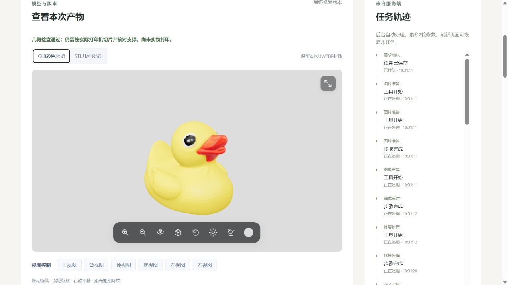

# 最终彩色修复版与双文件交付

日期：2026-11-02；任务：MID-FINAL-COLOR-001；基线：54c55fb。用户要求预览和供下载的仅保留最终修复彩色GLB与STL。

## 1.用户路径

新任务生成、打印副本修复与复检后，只提供最终彩色GLB和同版本毫米STL。预览只保留GLB彩色/STL几何切换；移除原始版切换/下载、中间文件/报告文件下载列表、预览PNG/JSON导出。原件和完整证据继续后台保存，质量检查表继续展示，上传/参数/两轮修复/按钮点击下载保持。

历史原始模型及上一轮单色打印结果不自动迁移、不重复重建；未取得最终彩色文件时明确提示新建任务，不把源模型替代修复几何。旧快照及已完成验收保持。

## 2.彩色实现与契约

上一轮打印副本重网格后没有原UV。本轮[print_color.py](../src/image_to_3d_print/artifacts/print_color.py)在同任务祖先中找已毫米定标的贴图源，按近表面对应重建最终几何的UV，复用原PBR材质、纹理/采样器及嵌入图像字节；没有重烘焙、生成新贴图或修改几何。每个目标面选取同一源UV片，材质组分别输出，平滑法线沿目标几何计算。

对应使用源三角面中心近邻的12个候选、最近点距离与法向方向，在固定4096面分块中处理。目标面中心到选定源面的最大距离必须≤2mm；该工程门槛不是图像/语义还原证明。补洞、加厚及UV缝附近的颜色属于近似，可能拉伸或丢失局部纹理细节，不能写成原UV逐点不变。

最终GLB独立读回后，将位置对应回已检查网格，逐三角形核对索引/坐标集合；GLB允许为UV拆分顶点，不增加或删除实际三角形。源材质/图像摘要独立核对。STL仍由同一毫米几何导出，不包含颜色；已有打印检查仅适用于对应的同一几何。缺UV/贴图、距离过大、不同来源或读回不符明确失败，不伪造彩色成功。

generation-v1兼容新增geometry_policy枚举值print_copy_color；原print_copy/preserve_uv仍可读取。新任务内部print-copy-color-v1，统一工具新增export_print_color；original_artifact_id继续仅作后台来源引用。公共1.0.0、打印阈值、print_certified=false与两轮上限保持，Schema及前端类型同步。

## 3.实际验证

使用上轮成功修复的12cm小鸭现成几何，没有重新重建、修复或调用LLM。复制到隔离验证存储后，仅更新该验证副本的彩色导出/报告，生产旧任务未改。

| 项目 | 实际结果 |
| --- | --- |
| 网格 | m_9aca1fce00d84b02b63ff34b；166738面 |
| 尺寸 | 151.407×120.173×120.000mm，保持 |
| GLB/STL几何对应 | 逐三角形独立核对通过 |
| 材质与2份原贴图 | 字节摘要保持，不重烘焙 |
| 映射距离 | 面中心最大1.02136mm，95%分位0.69355mm |
| 彩色导出 | 23.4026秒，GLB35160516字节 |
| STL | 8336984字节，SHA256与上轮切片件完全一致 |
| 打印状态 | 沿用同网格检查通过、悬垂warn需支撑；没有实物打印 |
| 页面 | 最终彩色GLB和STL实际加载，仅2个下载按钮 |
| 下载 | 两次点击的文件摘要与云端逐一一致 |

本轮没有重新切片；STL与上轮已实际672层/120mm/非空挤出切片的文件同SHA256，不能写成本轮新切片。模型与截图都是已有真实几何回放，不是新图片GPU推理或普遍成功率。

固定回归包含移动/新增几何的UV映射、源材质/纹理不变、无贴图拒绝、超距离拒绝、禁止覆盖原件/已有文件、两个材质组、仅最终模型可预览、2个下载入口及无自动下载。新增模块缺失/旧入口断言失败先保存；旧工具栏截图断言按用户新需求同步，未改打印门槛。

完整本机312通过/14平台跳过/100.87秒，Linux专项12通过，前端24通过及TypeScript/Vite构建通过，保留既有大包提示。后台复用现有SciPy/Trimesh，不新增依赖/模型。

交接检查：工具Schema、runtime-v1快照和前端生成类型一致；37份现存交付文件的UTF-8、10份Python语法、3份JSON及467处本地Markdown引用、凭据模式和Git空白检查通过。实际全量日志/收尾清单保存在本轮被忽略的runs目录。

## 4.云端和交接

用户活动任务完成后，空闲备份代码/配置/任务和检查点，更新同一部署12份清单文件，API返回appearance_policy=print-copy-color-v1。37个生产旧上下文/响应/状态保持，API/单worker恢复；模型常驻及low_vram源码不改，不自行关机。前端已构建，刷新现有网页后新任务生效。

验收收尾已停止本轮隔离验证API、临时5174预览和9012隧道并关闭临时标签页，生产服务及用户原有连接保持；继续使用原一键启动入口和生产网页，不使用临时验证地址。

本轮颜色处理是CPU导出，无新GPU/模型/LLM/训练调用；没有安装新工具。完整源文件/日志在本机runs/final-color-20261102-01及云端对应独立目录。精简[结果](evidence/final-color-20261102/result.json)记录实际摘要和部署，原始GLB、STL、数据库、密钥及完整模型不入Git。

## 5.验证命令

```powershell
$env:PYTHONUTF8='1'
runtime/envs/backend/Scripts/python.exe -m pytest tests -q
runtime/envs/backend/Scripts/python.exe scripts/tools/export_tool_schemas.py --check
runtime/envs/backend/Scripts/python.exe scripts/tools/export_runtime_schemas.py --check
runtime/envs/backend/Scripts/python.exe scripts/tools/export_frontend_types.py --check
cd frontend
npm test -- --reporter=dot
npm run build
```

## 6.本轮人工复核

状态：用户2026-11-02按本节明确回复“已核对，本轮人工复核通过”，据此记录本轮新增代码/结果通过；不代表实物打印或新图片GPU全链。

1. 核对print_color.py、print_copy.py的彩色分支及automatic.py/GenerationDelivery政策，确认实际几何不变、材质/图像不重烘焙、近似及失败明确。
2. 核对现有真实小鸭的彩色/STL预览、两个下载文件和检查表，接受新增补面/加厚位置外观近似，不把着色当额外打印认证。
3. 核对App/ResultPreview/DeliveryDownloads：只有最终GLB/STL预览与下载，原件/中间件/报告文件/PNG/JSON没有公开下载入口，原始证据仍后台保留。
4. 接受旧任务不迁移、没有新GPU推理/切片/实物打印，本轮给出人工结论。未回复时仍按授权提交推送并保留待人工状态。


