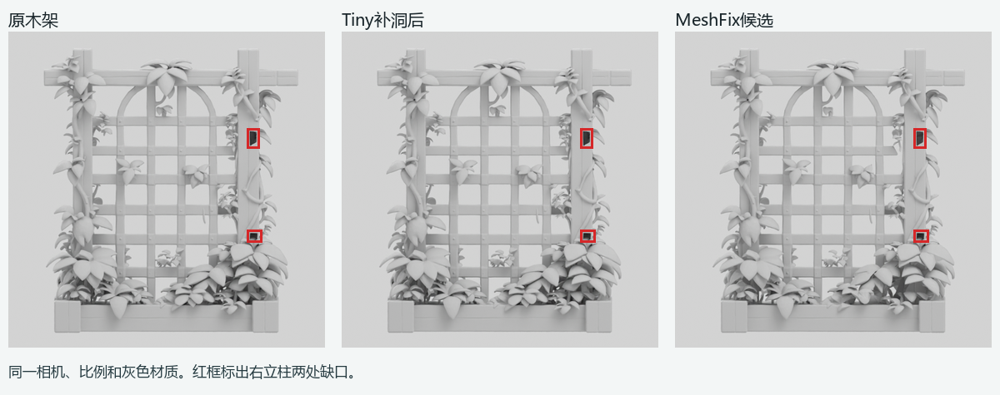
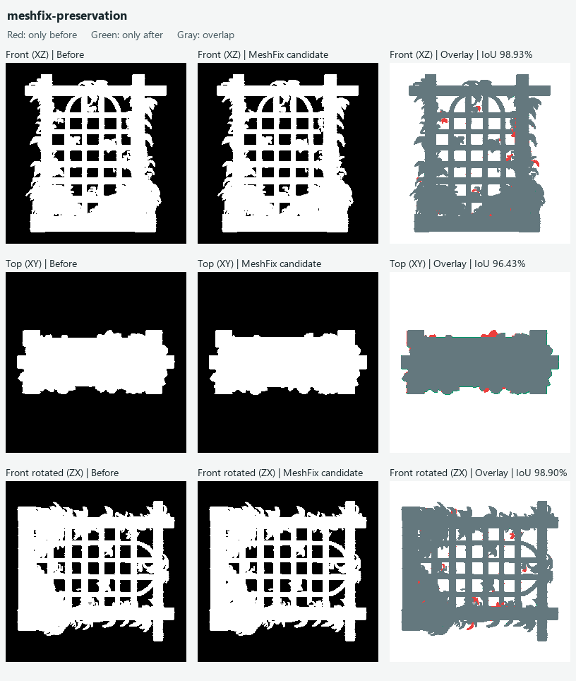

# 木架Tiny补洞对照

2026-11-06，基线c0a0e92。固定同一120mm木架诊断STL和上次MeshFix输入及候选。以Tiny公开客户端`repairGeometry`原始模块在本机Node.js执行，模块与公开地址下载件SHA256相同。读取及写入使用独立二进制STL适配。网站默认启用焊接、去退化、去重、补洞和统一绕序。本轮只切换补洞开关。模型和第三方代码留在本机运行目录。

## Tiny实测

开口立方体的4条边界边补为0，验证了模块能封闭简单边界。木架补洞分支对1877条边界路径追加5869个三角面。补片包围盒对角线最大约1.39mm。Tiny自身统计与STL独立读回使用不同焊接口径，交付判定用下表读回结果。

| 木架STL | 三角面 | 边界边 | 非流形边 | 水密 |
| --- | ---: | ---: | ---: | --- |
| 输入 | 944116 | 7660 | 13419 | 否 |
| Tiny补洞关 | 944116 | 7660 | 13419 | 否 |
| Tiny补洞开 | 949985 | 3824 | 13483 | 否 |

正视、俯视和旋转正视的归一轮廓像素完全一致。固定相机的灰模渲染中，右立柱两处大缺口均保留。Tiny缩小了开放边界统计，增加了64条非流形边，未达到进入生产串联的条件。Tiny→MeshFix串联及切片未执行。

## MeshFix为什么被退回

从上次原生调用的同一输入和候选复现轮廓IoU。MeshFix候选443908面，独立拓扑检查为水密单壳，边界边和非流形边均为0。水密描述的是网格闭合性。正面仍可看到两处缺口。

俯视XY投影中，原有但候选缺失287像素，候选新增324像素。差异主要在前后边缘和叶片等凸起区域。俯视IoU为96.43%，低于97%的保形门槛。其余两项为98.93%和98.90%，最大尺寸变化0.3677%。现有第三项使用绕观察轴旋转的正视投影，当前实现没有独立YZ侧视。这一差异单列记录。被拒候选未执行薄壁、自交和切片验收。

## 复现

本机`runs/print-rack-tiny-20261106-01`保留实际日志与命令入口。`node --max-old-space-size=4096 run_tiny.mjs fixture`验证闭环，`run_tiny.mjs fill-off <木架STL>`与`fill-on <木架STL>`同配置对照。通过项目后端Python和`PYTHONPATH=src`分别执行`compare.py tiny`和`compare.py meshfix`。本机Blender4.5.14执行`--background --factory-startup --threads 4 --python-exit-code 1 --python render.py`完成三个固定正视渲染。[实际数据](evidence/print-rack-tiny-20261106/result.json)记录摘要、配置和输出，新增实证待人工复核。
