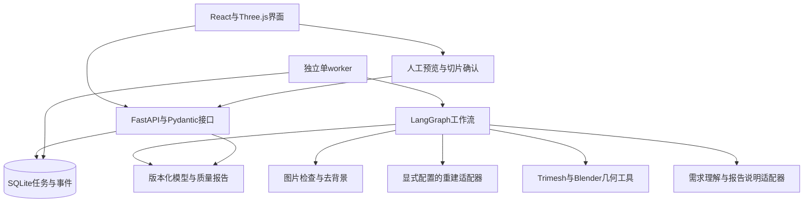

# 架构设计

- 文档版本：v0.8，2026-10-21新增M06/M07运行时及报告；公共字段保持兼容。
- 实现状态：M01～M05及M08工具层保持；M06的LangGraph编排、M07的FastAPI/SQLite/独立单worker及M08质量报告已实现并验证。后续云端部署、真实LLM与重建/检查/缺陷停止已取得证据；M09前端和实际打印合格成功路径尚待验证。P0现成工具及LOCAL-001保持独立历史入口。
- 当前阶段以[当前开发任务](../spec/当前开发任务.md)为准；总体范围和排期见[技术方案](../技术方案与分阶段开发计划.md)。
- 本文件是模块关系和工具边界的权威说明；字段与状态统一引用[接口与字段](接口与字段.md)。

## 1.系统关系

第一版是本地教学原型，采用API与独立单worker，不拆分为多个微服务，不引入分布式队列。GPU任务并发数为1；等待用户输入时保存状态并释放worker。

重建后端只保留TripoSR基线和TRELLIS.2候选，两者均作为M03工具接入；复杂官方样例只验证环境，不扩大M02允许的简单摆件范围。小组主要实现M04/M05/M06与导出证据链，尤其是尺度/姿态追问、证据驱动分支、修复确认、暂停恢复和停止。论文推理流程不等于M06；LLM负责理解和说明，数值、权限与分支条件仍由确定性代码/工具约束。本轮工具实证见[重建与几何交付](重建与几何工具链交付.md)，Agent编排不在该工具层内。

## 2.模块及工具边界

| 编号 | 模块及建议位置 | 输入 | 输出 | 责任边界 |
| --- | --- | --- | --- | --- |
| M01 | `src/image_to_3d_print/schemas/`数据契约 | 用户输入、工具返回和API数据 | Pydantic请求、响应、错误、证据及状态模型 | 所有边界共享定义；禁止由各模块各自猜测字段 |
| M02 | `image/`图片处理 | 图片及背景信息 | 合法性检查、去背景图片和蒙版 | 损坏文件不进入GPU步骤；预处理结果可复核 |
| M03 | `adapters/reconstruction.py`重建 | 图片和显式后端参数 | 原始网格、工具版本、参数、耗时和错误 | 只生成候选网格，不判定可打印 |
| M04 | `geometry/`修复与定标 | 网格、姿态、尺度及获准操作 | 新版本网格、变换及修改记录 | 保留原始文件；结构性修改需确认 |
| M05 | `inspection/`打印检查 | 定标网格和打印配置 | 缺陷、阈值、工具结果及证据 | 流形、自交、厚度等分别检查；不猜填结果 |
| M06 | `workflow/`编排 | 当前状态、工具结果、人工输入 | 步骤选择、待补项、暂停/恢复和终态 | 代码管理分支与停止；有副作用节点与确认节点分离 |
| M07 | `jobs/`与`api/`任务服务 | 创建、查询、输入和取消请求 | 状态、事件、任务及产物访问 | 重计算不在API请求内执行；记录实际进程结果 |
| M08 | `artifacts/`与`reports/`导出报告 | 网格、检查和确认记录 | GLB、STL、JSON/Markdown质量报告 | 导出重读；报告对应具体网格版本与单位 |
| M09 | `frontend/`与`evals/`交付验证 | API、模型及评估清单 | 界面、对比报告、切片与演示证据 | 前端不自行判定合格；评估保留失败分母 |

M01已实现20个公共模型与确定性校验；evals/和fixtures/p1/是固定输入和实验准备，不是正式评估执行器。M02～M08已有对应工具或运行时；M09前端待实现。scripts/p0/与fixtures/p0/仅用于历史可行性试验。各角色分工统一见技术方案第3.2节。

2026-10-21新增内部`measurement.py`及scripts/p2a的CPU入口：读取已存在的网格，用固定正交相机做不透明三角形并集投影、蒙版归一和IoU；复用公共结果/错误/证据模型。它不是M05完整打印检查、M03重建适配器或远程服务；真实后端映射未确认时只输出诊断图。实际环境和限制见[CPU测量报告](CPU坐标与轮廓测量验证.md)。

## 3.运行、状态与产物

- Python服务与重建后端使用独立环境，Blender由固定子进程入口调用；环境版本在P0实际验证后记录和锁定。
- SQLite保存任务元数据、事件及工作流检查点；网格等较大产物保存为文件，数据库记录产物ID与相对路径。
- 任务状态、等待项、错误和产物字段以接口文档为准；不得增设同义状态。
- 每个执行及修复版本只新增，不覆盖原始网格；重建、修复、检查和切片结果分别关联版本。
- LangGraph确认节点只负责交互；重建和修复放在独立节点，避免恢复确认时重复执行昂贵操作。
- 发生异常、中断或重启时明确记录实际状态，不未经说明自动重跑模型。
- 图像到网格的产品流程、尺寸校准、修复和打印判定见技术方案第4.1节、第6章；本文件不另存第二套质量阈值。

## 4.执行机器与队友交接

本机开发环境与重建执行环境分别记录。P0可以在本机、队友电脑或小组已有GPU服务器上进行，必须明确具体执行机器并对相同固定样例验证。

交接至少提供当前任务进度、依赖锁定、模型/工具版本、下载与启动说明、实际验证命令、固定样例来源、Bug和评估记录。Git只同步入库材料，不同步GPU、虚拟环境或权重。

换机器后先做环境冒烟验证；无合适GPU的成员可在后续授权阶段开发接口、前端和fixture测试，真实重建在选定GPU机器完成。远程适配如有需要，应先更新任务与接口约定，不假定当前已有远程服务。

## 5.变更与验证状态

| 版本/日期 | 变化 | 实现与验证 |
| --- | --- | --- |
| v0.1/2026-10-16 | 从总体方案提取模块及工具边界，明确执行机器可交接 | 文档约定已建立；当时P0环境及业务运行未验证 |
| v0.2/2026-10-18 | P0独立辅助脚本及固定输入入库，未实现M01～M09；神经网络用CUDA，表面提取用同版本CPU扩展 | 本机技术验证完成、用户人工验收通过；实际版本及限制见[P0报告](P0环境与工具验证.md) |
| v0.3/2026-10-19 | P2-A/B/C选型依赖及P4小组自主编排职责 | 仅文档；业务模块和云端模型未执行 |
| v0.4/2026-10-19 | P1实现M01、自动导出、固定fixture/实验协议和CPU检查 | 57项测试及静态检查通过；用户于2026-10-20明确确认P1阶段验收，实际导读范围单列；未实现运行服务/工作流 |
| v0.5/2026-10-20 | DOC-006收缩到简单摆件及两个后端，突出M06自主编排和受限工具链；复杂例只作环境证据 | 仅文档，无新增实现/实验；当前P2-A待剩余验收，下一仅P2-B |

P0实际确认的工具能力、版本和限制写入当前任务及评估记录；涉及架构变化时同步本文件并记录理由。与字段有关的变化同步接口文档，不能只改示意图。

LOCAL-001本机附属入口：CMD→Python选图器→本地rembg图片准备→原样P0重建脚本→独立读取→新Blender场景导入。仅内部文件及子进程参数，不实现M01～M09业务架构；详情见[试用说明](本机双击试用说明.md)，公共接口草案不变。

## 6.复现、选型与小组自主工作流

- P1定义业务/实验记录、状态和固定比较协议；P2-A验证环境，P2-B只在范围内简单摆件上选择一个主后端。TripoSR保留为基线，TRELLIS.2已有官方环境验证但尚未通过简单摆件选型，不因文档或复杂展示自动切换。
- P2-C实现确定性工具链，P3补全几何质量门槛。M03的生成证据与M05的打印判定分别保存；原始输出、修复、定标和切片不能混为一份结果。
- P4由小组实现M06：自主设计节点顺序、证据驱动分支、缺尺寸追问、姿态/结构修复确认、检查点恢复、预算和停止条件；M06与LLM适配器协作，数值与文件操作仍由工具完成。
- P4对照P2-C固定流程时使用同一模型版本、输入和几何工具，比较交互正确性、恢复后的重复重建次数、错误停止、时间及调用量；不把替换生成模型的改善归因于Agent。
- 此前P2-A环境阶段：正常模式实测16核/80GiB/RTX4090D，无卡0.5核/2GiB/GPU0。TripoSR两例迁移通过；候选5项扩展、GPU冒烟、完整模型/官方例及独立GLB读回已通过，见[正常模式报告](P2-A正常模式编译与官方样例结果.md)。当时执行已停止且产物已备份；相机/测量口径和人工复核历史状态保持，不进入P2-B。scripts/p2a仅为内部辅助入口，当时未实现业务服务；后续实际服务见本文件末节。
- 阶段门槛见技术方案第7章，实验字段见接口第5节，协议见评估第5节；本文件不复制另一套门槛。

## 重建与几何工具层0.2.0

image/assets→adapters/reconstruction→geometry/core/structure→inspection/service→artifacts/export使用公共ToolOutcome、产物和证据连接；geometry/commands为确定性门面。模型独立环境，Blender为CPU进程，运行目录与版本只新增。结构确认与执行分离；human_action只能来自服务端核验的操作者输入。内部schema0.1与具体调用见[接手说明](几何工具接口与接手说明.md)。队列、等待/恢复、累计预算、状态持久化及切片确认现由下面的运行时接入。

## 工作流与后端0.3.0

api/app→jobs/service/store只做边界校验、持久化和排队；独立jobs/worker通过系统锁串行启动jobs/runner；runner用SQLite检查点编译workflow/graph，同run_id恢复同thread_id。确认节点只含interrupt；工具、人工提交消费、confirm及apply分别执行，避免恢复重放昂贵工具。等待后runner退出，worker可处理其他任务。

父worker监控取消/累计活动时限及LLM截止时间，回收整个工具子树；runner另监视父进程丢失。重启中断任务明确WORKER_RESTARTED，不自动重跑；丢失的精确活动区间和供应商用量保持未知。reports/quality生成版本化报告；最终状态由公共成功validator及当前版本切片/预览/导出记录决定，LLM只提供建议和解释。

运行时扩展与公共模型分开导出，旧events字段不变，前端读取runtime-v1的pending.kind和增量事件。配置、启动、数据库位置及调用例子见[调用说明](Agent后端调用与启动说明.md)；实际验证和未完成依赖见[20项矩阵](Agent工作流与后端交付.md)。本机186通过/5平台跳过及真实本机HTTP不等同云端模型、真实LLM或前端联调通过。

## 实际云端后端部署

同一实例以独立backend环境及deployments/backend-20261021-01源码启动API/单worker，运行数据在runs/agent-application；模型根目录保持。人工服务与固定验证存储/确认来源分离，DeepSeek完成真实解析/说明，真实网格缺陷正确停止。服务只绑定回环，经SSH连接；不开放公网、不包含前端或实际切片。配置、版本、进程与未完成验收见[云端报告](Agent云端部署与联调验收.md)。
