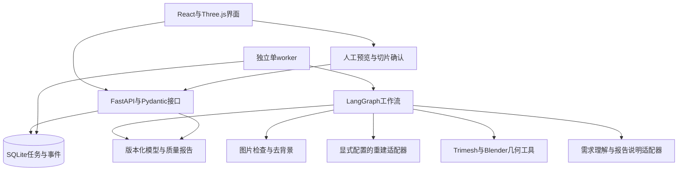

# 架构设计

## 打印摘要与独立补洞试验（2026-10-29）

PrintSummary从同版本MeshInspection/PrinterProfile派生名义层数和有条件的100%实体PLA换算，实际耗材仍需切片；原始逐项证据不变，不发起新检查或写任务。多壳/开孔/自交/缺证据不估体积重量，不用2V/A替代Blender局部射线。

hole_experiment仅由独立validate_hole_candidate脚本/固定测试导入，生产workflow/repair无调用。Windows既有Blender对原件及追加扇形面候选分别检查，真实候选完整门槛失败，不接入；源文件和常驻部署不变。[验证](打印检查估算与补洞方法验证.md)。

## 完成结果查看器（2026-10-29）

App仅在succeeded且主交付GLB存在时使用ResultPreview，PendingForm/未完成任务继续旧ModelView。新组件读取原artifactBlob或同版本deliverySTLBlob，复用认证、传输进度/超时/取消，不创建任务；独立CSS限制在结果区。GLB保持原UV/PBR，STL渲染用诊断色不计文件材质。

模型轴向/包围盒居中/缩放仅放在显示父节点，OrbitControls围绕中心，底网格贴真实显示底部，自动旋转默认关闭；六视图/照明/背景均本机显示状态，不存回任务或模型。截图/统计JSON点击才导出；质量结论、下载和后台流程保持。[实现与实证](生成结果GLB与STL预览.md)。

## 同版本STL按需下载（2026-10-29）

网页继续按delivery.artifact_id/mesh_version展示GLB，突出真实打印状态。相邻STL按钮请求明确版本的已认证只读端点，校验毫米源网格、归属/摘要/GLB几何对应，序列化并独立读回后返回二进制；不推进LangGraph、不写SQLite/报告或调用模型。旧已完成generation-v1无需重建，原始无单位GLB拒绝隐式缩放。

本轮未把print_demo接入网页，格式转换不会修孔。指定鸭子缺面出现在首次UV/PBR/GLB导出区间，后续修复仍失败；算法修复与下载功能分开验收。[接口](接口与字段.md)/[报告](网页STL下载与缺口溯源.md)。

## 单件打印展示转换（2026-10-29）

本轮以一个12cm小鸭为范围，独立print_demo入口复用已生成GLB，不进入或改写生产LangGraph。原始GLB原字节保存→逻辑Z朝上/毫米定标→既有Blender检查→至多2轮打印副本处理→同工具复检→独立STL/GLB读回与真实CPU预览→本机既有PrusaSlicer演示切片。原生算法在有时限的独立CPU进程加载，不改变TRELLIS.2/后端基础环境或常驻缓存。

内腔必须有闭合包含证据，外部多个主要部件拒绝默认删留。打印副本可采用有界厚度补偿/小量底部切平，已有UV/PBR无法精确保留时明确无纹理，原彩色文件独立交付，不重烘焙。成功只代表几何和演示切片证据，实物另验；当前网页仍使用下方修复GLB策略，尚未接入本轮独立工具。[报告](小摆件打印转换与展示件验收.md)。

## 现行：修复版GLB主交付（2026-10-29）

新自动任务保存内部repaired-glb-v1；固定TRELLIS.2常驻重建→GLB保材质清理→毫米定标→检查→最多2轮受控结构修复→选择检查较好的有效版本→独立GLB读回及同版本质量报告。首次GPU补片消耗同一两轮预算。无安全操作可提前结束，检查失败/未执行明确记录；没有有效GLB不得成功。

M08不重烘焙，沿glb-preserve-v1保留已有UV、PBR材质与嵌入图像；新增补片没有原始纹理单独标明，原始文件独立保留。M09按delivery.artifact_id/mesh_version绑定主预览和下载，原件作为次级文件。旧original-glb-v1快照保持，下面原件唯一主交付描述为历史规则；模型常驻及low_vram实现不变。[验证](修复版GLB交付与验证.md)。

## TRELLIS.2单worker模型常驻（2026-10-25）

M06继续按SQLite检查点运行独立任务runner；单worker取得SingleWorker锁后拥有一个TRELLIS.2模型服务子进程。M02通过权限0600的Unix套接字提交本任务图片、摘要、输出目录及导出预算，模型服务串行执行。首次请求懒加载固定pipeline，后续复用同一对象与权重，每图仍重新预处理、推理、解码及首次PBR导出；不缓存上次GLB充当新结果。

常驻进程属于worker，不属于某个runner。正常完成/等待后保留模型缓存，释放任务执行槽；不再承诺等待时所有RAM/显存归零。保持上游low_vram分阶段CPU/GPU迁移策略，不强行把全部权重锁入24GB显存。取消、超时、请求进程丢失、模型异常或worker退出时回收该模型进程；下一任务重新冷启动，失败请求不自动重试、不切换后端。清理/打印检查仍是独立工具，GLB保材质与原始PBR交付规则保持。

生产新任务仅启用TRELLIS.2；TripoSR配置、环境和旧任务保留作历史兼容，不将此工程选择冒充正式成对模型评估。实际冷热时间、资源与限制见[常驻验证](TRELLIS模型常驻复用与冷热验证.md)。

## GLB检查版本保留UV/PBR

M02首次GLB→raw_mesh.glb，以extras.i3d.logical_from_gltf声明逻辑检查坐标；M03在内存焊接完全同位置点做拓扑运算，持久GLB保留原UV接缝/材质顶点、原嵌入图像和材质参数。清理/定标按原角点对应更新，M04读取逻辑毫米/Z朝上位置后用既有Blender检查，不写PLY中转。M08副本导出继续GLB保材质，原始GLB主交付保持。

新补片独立标记无原始纹理；纹理重网格无法精确对应时拒绝，不静默降级。旧PLY兼容只读，旧任务不迁移。单对象静态GLB/多primitive支持，骨骼/动画/外部资源/未知节点变换明确拒绝。实际[验证和部署](GLB检查链与7组材质恢复.md)，无新模型/烘焙。

## 2026-10-23队友便携启动包

桌面启动外层优先使用包内tools/node/node.exe，缺失时兼容系统Node；首次配置在队友用户目录生成专用密钥，只向组长交公钥。白名单包携带已构建网页、Vite运行闭包和许可证；不包含原runtime/业务数据。回环网页→本机SSH隧道→原云端API/单worker的接口/部署保持，未新增公网服务或成员隔离。[交付](队友启动包交付与验证.md)。

## 2026-10-22导出参数下拉

M09仅将现有面数/纹理number改为原生select；默认自动面数/2048，仍通过原export_target_faces/texture_size送入M01。M02～M08、原件交付及局部试用回退保持；本轮无云端部署或模型调用。

## 2026-10-22局部外观试用回退（现行）

M06新任务不创建eye_texture政策、原始登记后直接说明/完成；保留的旧同名节点仅跳过，M08增强命令明确不可用。M09只选择原始GLB，无局部修正区；文件进度/重试保持。旧可空字段/模块和增强文件作为兼容/历史保留，不参与当前运行；输入预处理和GPU几何补片保持。[说明](局部外观试用回退.md)。

## 2026-10-22可见面配准与颜色修正

新TRELLIS.2自动任务的M06独立eye_texture节点保存eye-local-v2，v1旧快照保持。M08父进程校验同任务/根网格/源摘要，经配置的同实例TRELLIS.2 Python调用独立appearance_worker；只使用已安装光栅/图像库，不加载重建模型。外观相机由真实三角面/双眼证据近似配准，有界原图对应只修改可见底色，头发按原图区域参考色保留发丝明暗；UV、几何及其他PBR保持。背面/遮挡不恢复，不能当几何测量相机批准。

进程组取消及独立180秒Linux超时守护，缺GPU/可靠对应时失败或跳过并保留原件；增强副本沿appearance_artifact_id，主预览/下载同源且仍可动态回原件。官方输入准备本轮经实际源码复核未改，首次贴图已有偏色；不将全部管线称为论文原样。实际已有网格回放、失败和限制见[说明](可见面配准与颜色修正.md)。

## 2026-10-22大GLB读取

M09的JSON请求继续20秒，产物通过XHR独立10分钟完整响应体读取，提供真实字节/已知总量和可取消选项；预览分文件/解析/HDR并可重读原产物。下载仍只由按钮发起，进度/错误独立于任务状态轮询。M01～M08、HTTP/公共schema/原始PBR/任务历史均不修改，不重启云端或调用模型。[交接](大模型读取与文件交付说明.md)。

## 2026-10-22眼部局部贴图试用

M06对新TRELLIS.2自动任务保存eye-local-v1，在生成/原始登记之后执行独立eye_texture节点。M08用既有CPU工具找双眼、有限配准、深度过滤并投到原UV，只追加底色图像/引用；不全身烘焙或改原件/几何/其他PBR。未定位/不可靠/共享UV跳过，工具错误明确失败，保留有效原件交付。

appearance_artifact_id指独立增强件，原始来源保持；M09按该引用及动态开关统一选主预览和主下载，显示applied/skipped/failed。关闭后回原件，不改历史/重新生成，旧任务不补跑。仅静态发布，真实投射和视觉待用户[测试](眼部局部贴图试用与回退.md)，不是通用动漫识别或眼眶修复。

## 2026-10-22GPU开放边界补片与已知缺口

M06对新automatic_glb任务保存gpu_hole_policy=gpu-boundary-fill-v1，经受控内部reconstruct参数交给M02。TRELLIS.2首次UV之前在独立模型进程内临时包装CuMesh.uv_unwrap，退出恢复；TripoSR提取网格后调用同实例既有TRELLIS.2环境中的独立几何worker，不加载第三模型。GPU算子检查/新增补片，保存补片前几何及报告，随后首次材质导出；不是已导出GLB再烘焙。

GPU报告/尝试带回同任务ToolOutcome，M06累计GPU和后续结构尝试≤2；API资源/质量报告/前端显示真实状态。失败保留原几何且明确failed，不静默CPU替代。旧快照没有政策则不执行。网页“原始GLB”仍指本流水线首次导出结果，可能含首次导出前补片；未改原件字节指该首次GLB形成之后，不表示原生几何未经处理。

这是有界开放闭环补片，未实现异常拓扑/带内壁缺损的安全局部结构补全；架子候选未上线，不能称为通用大洞修复。[证据和限制](云端GPU补洞与模型诊断.md)。

## 2026-10-22原始GLB直接交付

M02保持首次原始GLB及来源；M06仍在副本执行清理/定标/检查/最多2次受控尝试，但M08只读取同任务原始GLB、校验摘要并登记，不重写文件或二次烘焙。M09只显示/下载原始GLB，移除处理版/对比选择；打印和尺寸明确属于检查副本。original-glb-v1区分原始版本与检查版本，旧记录保持。新自动面数在TRELLIS.2首次导出时应用，不把副本面数冒充原件。用户继续自行网页验证，静态检查与发布不替代验收。[交接](原始GLB直接交付说明.md)。

## 2026-10-22官方HDR与手动导出预算（待用户验证）

M09首次表单收集可选面数/方形纹理，M06持久化并在生成/后处理使用同一有效预算；M02模型worker只改导出参数，不换模型或推理管线。M03减面目标支持最高100万，手动优先于自动，保形/2次结构上限不变；M08沿已有PBR来源的实际纹理边长重烘焙，失败如实回退。M09直接读取官方forest.exr/PMREM及GLTF材质，移除原程序环境和两类灯。仅静态检查/构建/空闲更新，真实HDR与100万/4K效果待用户网页测试；上轮PBR未测状态保持。[交接](官方HDR照明与手动导出设置.md)。

## 2026-10-22最终处理版PBR外观（待网页实测）

M02在根网格版本关联同任务官方GLB/摘要/轴向/纹理大小。M08沿M03版本链读取定标矩阵，以既有Blender CPU在最终网格上展开UV，重烘焙底色/粗糙度/金属度及切线法线并内嵌GLB；M04检查继续使用原毫米几何。独立读回核对尺寸、顶点集合和面数，不能用原始高模替代处理网格。

M06在PBR转移失败时保留有效顶点色GLB及明确警告；M09显示实际材质状态，并用程序环境反射展示PBR。来源/摘要冲突拒绝，无原PBR后端不伪造；旧任务不重跑，面数/质量/2次修复和按钮下载保持。用户要求自行测试，本轮只有代码/构建和服务发布检查，实际烘焙/效果待反馈，见[说明](处理模型PBR外观说明.md)。以下顶点色导出保留为历史与回退路径。

## 2026-10-22图片复杂度与自适应面数

M01在原图准备后新增CPU分析工具，分析副本不替换模型输入；M06将image-complexity-v1写入新任务快照，用简单/中等/复杂或不确定的预算驱动M03保形提案。M03仍调用固定Blender并独立检查，策略确认与副作用节点分离；减面也计入2次结构上限。M06在最终检查版本中选择较好者，M08输出GLB及实际预算/质量，M09显示目标/实际/回退且只按钮下载。

M03/M08共用处理底色GLB导出：显式非金属、平滑法线、sRGB到线性浮点颜色，原始纹理材质不覆盖。新策略不改生成模型/权重/推理预算，旧任务按原快照执行；完整设计/证据/未测项见[报告](图片复杂度与自适应面数验证.md)。下列历史用户路径中的检查/2次上限继续适用。

## 当前用户路径：一次提交到GLB

M06根据持久化workflow_policy路由独立automatic.py，复用M01/M02/M03/M04/M05及M08工具。LangGraph路径为原图准备→快速重建→基础清理→毫米定标→检查→最多2轮受控提案/策略确认/应用/复检→选择检查较好的有效版本→GLB独立读回/质量报告→完成。无适用修复可提前交付，所有版本/失败仍保留。打印检查和GLB完成分开，generation-v1不沿用旧STL打印成功含义。

M07保持SQLite、单worker及任务快照；旧guided任务不迁移为自动批准。M09一次提交后轮询真实事件，取消仍可用，完成后展示模型、实际检查和下载按钮；不会自动下载。自动来源与人工验收分开。当前调用、契约、限制与验证见[本轮报告](一次提交自动生成与GLB交付.md)及[接口](接口与字段.md)，下文按历史阅读。

## 2026-10-21外观与快速模式

M02新增显式course_fast工程变体，同一TRELLIS.2模型/权重/seed42/1024_cascade，导出10万目标/2K纹理且无转台视频；保留官方完整。M03在纹理读回/处理和确认后的简化间保留顶点底色近似，原GLB/PBR独立存档；CPU预览按真实颜色显示，不影响几何检查。M06随任务持久化profile与实测分段，M09按配置提供选择并显示实际完成用时。多图按用户要求暂缓；课程工具对应及真实质量取舍见[验证报告](颜色保留与快速生成验证.md)。

## 2026-10-21桌面启动外层

新增独立Windows启动器，不嵌入业务API或工作流：现有SSH公钥→同部署API/单worker幂等检查→本机9000隧道→已有Vite preview5173及/api代理→真实配置健康后浏览器。启动器仅管理自身本机子进程，远端仍按原screen/单worker及用户关机规则运行。配置/结果契约、错误及实际边界见[一键启动说明](桌面一键启动与连接说明.md)。

## 2026-10-21官方推理与自动图片准备变更

M01在official输入政策下登记原图，不先生成256画布；M02通过隔离模型环境执行固定官方入口，保存完整外观GLB与独立Z轴几何，原生TRELLIS网格单独留存。M06新增无人工语义结论的accept_input工具证据节点，默认automatic，旧人工模式可显式启用；历史输入等待迁移后恢复，打印/结构/切片等待保持。M09依产物坐标/颜色显示，打印链门槛不改。

本轮固定revision、接口兼容、实际任务与剩余合格交付缺口以[官方对齐报告](官方推理对齐与自动图片准备.md)为准；此前架构/实证按历史阅读，不把旧256/原生几何变体当当前官方政策。

- 文档版本：v0.8，2026-10-21新增M06/M07运行时及报告；公共字段保持兼容。
- 实现状态：M01～M05及M08工具层保持；M06的LangGraph编排、M07的FastAPI/SQLite/独立单worker及M08质量报告已实现并验证。后续云端部署、真实LLM与重建/检查/缺陷停止已取得证据；M09前端现有实现与真实缺陷停止，见末节；实际打印合格成功路径尚待验证。P0现成工具及LOCAL-001保持独立历史入口。
- 当前阶段以[当前开发任务](../spec/当前开发任务.md)为准；总体范围和排期见[技术方案](../技术方案与分阶段开发计划.md)。
- 本文件是模块关系和工具边界的权威说明；字段与状态统一引用[接口与字段](接口与字段.md)。

## 1.系统关系

第一版是本地教学原型，采用API与独立单worker，不拆分为多个微服务，不引入分布式队列。GPU任务并发数为1；等待用户输入时保存状态并释放worker。

重建后端只保留TripoSR基线和TRELLIS.2候选，两者均作为M03工具接入；复杂官方样例只验证环境，不扩大M02允许的简单摆件范围。小组主要实现M04/M05/M06与导出证据链，尤其是尺度/姿态追问、证据驱动分支、修复确认、暂停恢复和停止。论文推理流程不等于M06；LLM负责理解和说明，数值、权限与分支条件仍由确定性代码/工具约束。本轮工具实证见[重建与几何交付](重建与几何工具链交付.md)，Agent编排不在该工具层内。

## 2.模块及工具边界

| 编号 | 模块及建议位置 | 输入 | 输出 | 责任边界 |
| --- | --- | --- | --- | --- |
| M01 | `src/image_to_3d_print/schemas/`数据契约 | 用户输入、工具返回和API数据 | Pydantic请求、响应、错误、证据及状态模型 | 所有边界共享定义；禁止由各模块各自猜测字段 |
| M02 | `image/`图片处理 | 图片及背景信息 | 合法性检查、去背景图片和蒙版 | 损坏文件不进入GPU步骤；预处理结果可复核 |
| M03 | `adapters/reconstruction.py`重建 | 图片和显式后端参数 | 原始网格、工具版本、参数、耗时和错误 | 只生成候选网格，不判定可打印 |
| M04 | `geometry/`修复与定标 | 网格、姿态、尺度及获准操作 | 新版本网格、变换及修改记录 | 保留原始文件；结构性修改需确认 |
| M05 | `inspection/`打印检查 | 定标网格和打印配置 | 缺陷、阈值、工具结果及证据 | 流形、自交、厚度等分别检查；不猜填结果 |
| M06 | `workflow/`编排 | 当前状态、工具结果、人工输入 | 步骤选择、待补项、暂停/恢复和终态 | 代码管理分支与停止；有副作用节点与确认节点分离 |
| M07 | `jobs/`与`api/`任务服务 | 创建、查询、输入和取消请求 | 状态、事件、任务及产物访问 | 重计算不在API请求内执行；记录实际进程结果 |
| M08 | `artifacts/`与`reports/`导出报告 | 网格、检查和确认记录 | GLB、STL、JSON/Markdown质量报告 | 导出重读；报告对应具体网格版本与单位 |
| M09 | `frontend/`与`evals/`交付验证 | API、模型及评估清单 | 界面、对比报告、切片与演示证据 | 前端不自行判定合格；评估保留失败分母 |

M01已实现20个公共模型与确定性校验；evals/和fixtures/p1/是固定输入和实验准备，不是正式评估执行器。M02～M08已有对应工具或运行时；M09前端待实现。scripts/p0/与fixtures/p0/仅用于历史可行性试验。各角色分工统一见技术方案第3.2节。

2026-10-21新增内部`measurement.py`及scripts/p2a的CPU入口：读取已存在的网格，用固定正交相机做不透明三角形并集投影、蒙版归一和IoU；复用公共结果/错误/证据模型。它不是M05完整打印检查、M03重建适配器或远程服务；真实后端映射未确认时只输出诊断图。实际环境和限制见[CPU测量报告](CPU坐标与轮廓测量验证.md)。

## 3.运行、状态与产物

- Python服务与重建后端使用独立环境，Blender由固定子进程入口调用；环境版本在P0实际验证后记录和锁定。
- SQLite保存任务元数据、事件及工作流检查点；网格等较大产物保存为文件，数据库记录产物ID与相对路径。
- 任务状态、等待项、错误和产物字段以接口文档为准；不得增设同义状态。
- 每个执行及修复版本只新增，不覆盖原始网格；重建、修复、检查和切片结果分别关联版本。
- LangGraph确认节点只负责交互；重建和修复放在独立节点，避免恢复确认时重复执行昂贵操作。
- 发生异常、中断或重启时明确记录实际状态，不未经说明自动重跑模型。
- 图像到网格的产品流程、尺寸校准、修复和打印判定见技术方案第4.1节、第6章；本文件不另存第二套质量阈值。

## 4.执行机器与队友交接

本机开发环境与重建执行环境分别记录。P0可以在本机、队友电脑或小组已有GPU服务器上进行，必须明确具体执行机器并对相同固定样例验证。

交接至少提供当前任务进度、依赖锁定、模型/工具版本、下载与启动说明、实际验证命令、固定样例来源、Bug和评估记录。Git只同步入库材料，不同步GPU、虚拟环境或权重。

换机器后先做环境冒烟验证；无合适GPU的成员可在后续授权阶段开发接口、前端和fixture测试，真实重建在选定GPU机器完成。远程适配如有需要，应先更新任务与接口约定，不假定当前已有远程服务。

## 5.变更与验证状态

| 版本/日期 | 变化 | 实现与验证 |
| --- | --- | --- |
| v0.1/2026-10-16 | 从总体方案提取模块及工具边界，明确执行机器可交接 | 文档约定已建立；当时P0环境及业务运行未验证 |
| v0.2/2026-10-18 | P0独立辅助脚本及固定输入入库，未实现M01～M09；神经网络用CUDA，表面提取用同版本CPU扩展 | 本机技术验证完成、用户人工验收通过；实际版本及限制见[P0报告](P0环境与工具验证.md) |
| v0.3/2026-10-19 | P2-A/B/C选型依赖及P4小组自主编排职责 | 仅文档；业务模块和云端模型未执行 |
| v0.4/2026-10-19 | P1实现M01、自动导出、固定fixture/实验协议和CPU检查 | 57项测试及静态检查通过；用户于2026-10-20明确确认P1阶段验收，实际导读范围单列；未实现运行服务/工作流 |
| v0.5/2026-10-20 | DOC-006收缩到简单摆件及两个后端，突出M06自主编排和受限工具链；复杂例只作环境证据 | 仅文档，无新增实现/实验；当前P2-A待剩余验收，下一仅P2-B |

P0实际确认的工具能力、版本和限制写入当前任务及评估记录；涉及架构变化时同步本文件并记录理由。与字段有关的变化同步接口文档，不能只改示意图。

LOCAL-001本机附属入口：CMD→Python选图器→本地rembg图片准备→原样P0重建脚本→独立读取→新Blender场景导入。仅内部文件及子进程参数，不实现M01～M09业务架构；详情见[试用说明](本机双击试用说明.md)，公共接口草案不变。

## 6.复现、选型与小组自主工作流

- P1定义业务/实验记录、状态和固定比较协议；P2-A验证环境，P2-B只在范围内简单摆件上选择一个主后端。TripoSR保留为基线，TRELLIS.2已有官方环境验证但尚未通过简单摆件选型，不因文档或复杂展示自动切换。
- P2-C实现确定性工具链，P3补全几何质量门槛。M03的生成证据与M05的打印判定分别保存；原始输出、修复、定标和切片不能混为一份结果。
- P4由小组实现M06：自主设计节点顺序、证据驱动分支、缺尺寸追问、姿态/结构修复确认、检查点恢复、预算和停止条件；M06与LLM适配器协作，数值与文件操作仍由工具完成。
- P4对照P2-C固定流程时使用同一模型版本、输入和几何工具，比较交互正确性、恢复后的重复重建次数、错误停止、时间及调用量；不把替换生成模型的改善归因于Agent。
- 此前P2-A环境阶段：正常模式实测16核/80GiB/RTX4090D，无卡0.5核/2GiB/GPU0。TripoSR两例迁移通过；候选5项扩展、GPU冒烟、完整模型/官方例及独立GLB读回已通过，见[正常模式报告](P2-A正常模式编译与官方样例结果.md)。当时执行已停止且产物已备份；相机/测量口径和人工复核历史状态保持，不进入P2-B。scripts/p2a仅为内部辅助入口，当时未实现业务服务；后续实际服务见本文件末节。
- 阶段门槛见技术方案第7章，实验字段见接口第5节，协议见评估第5节；本文件不复制另一套门槛。

## 重建与几何工具层0.2.0

image/assets→adapters/reconstruction→geometry/core/structure→inspection/service→artifacts/export使用公共ToolOutcome、产物和证据连接；geometry/commands为确定性门面。模型独立环境，Blender为CPU进程，运行目录与版本只新增。结构确认与执行分离；human_action只能来自服务端核验的操作者输入。内部schema0.1与具体调用见[接手说明](几何工具接口与接手说明.md)。队列、等待/恢复、累计预算、状态持久化及切片确认现由下面的运行时接入。

## 工作流与后端0.3.0

api/app→jobs/service/store只做边界校验、持久化和排队；独立jobs/worker通过系统锁串行启动jobs/runner；runner用SQLite检查点编译workflow/graph，同run_id恢复同thread_id。确认节点只含interrupt；工具、人工提交消费、confirm及apply分别执行，避免恢复重放昂贵工具。等待后runner退出，worker可处理其他任务。

父worker监控取消/累计活动时限及LLM截止时间，回收整个工具子树；runner另监视父进程丢失。重启中断任务明确WORKER_RESTARTED，不自动重跑；丢失的精确活动区间和供应商用量保持未知。reports/quality生成版本化报告；最终状态由公共成功validator及当前版本切片/预览/导出记录决定，LLM只提供建议和解释。

运行时扩展与公共模型分开导出，旧events字段不变，前端读取runtime-v1的pending.kind和增量事件。配置、启动、数据库位置及调用例子见[调用说明](Agent后端调用与启动说明.md)；实际验证和未完成依赖见[20项矩阵](Agent工作流与后端交付.md)。本机186通过/5平台跳过及真实本机HTTP不等同云端模型、真实LLM或前端联调通过。

## 实际云端后端部署

同一实例以独立backend环境及deployments/backend-20261021-01源码启动API/单worker，运行数据在runs/agent-application；模型根目录保持。人工服务与固定验证存储/确认来源分离，DeepSeek完成真实解析/说明，真实网格缺陷正确停止。服务只绑定回环，经SSH连接；不开放公网、不包含前端或实际切片。配置、版本、进程与未完成验收见[云端报告](Agent云端部署与联调验收.md)。

## 前端0.1.0与评估接入

frontend的React/TypeScript/Vite页面通过同源/api代理访问既有API；计算仍在同一云端。公共类型从两套JSONSchema生成，页面按pending.kind渲染六类表单，轮询runtime及增量事件；run_id写URL/最近任务，密钥不入浏览器。Three.js只读取本任务登记产物，版本对照和文件下载不判定打印合格。evaluation.py提供Pydantic计划/冻结门禁和证据汇总，compare_fixed_and_agent.py复用同原始模型实测确定性后处理；未满足最终前置不运行保留集。实际边界见[前端交付](初步前端与评估交付.md)。
