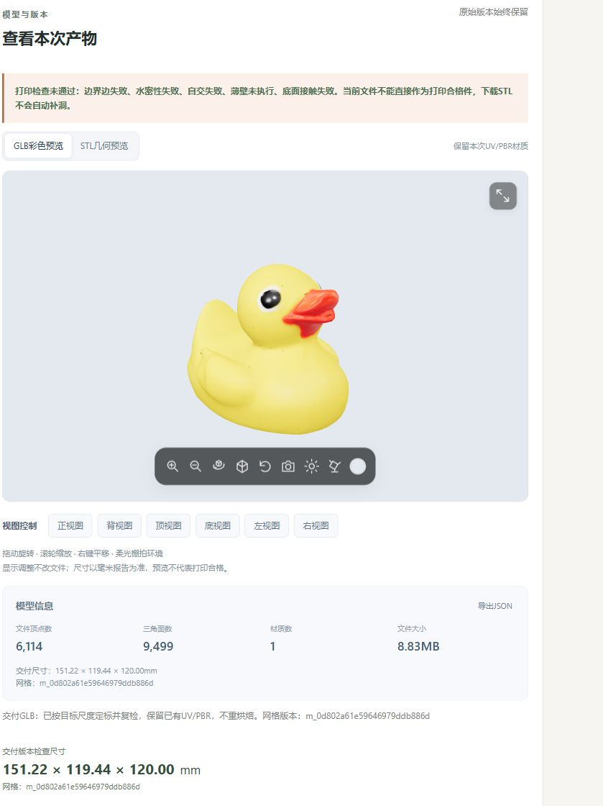
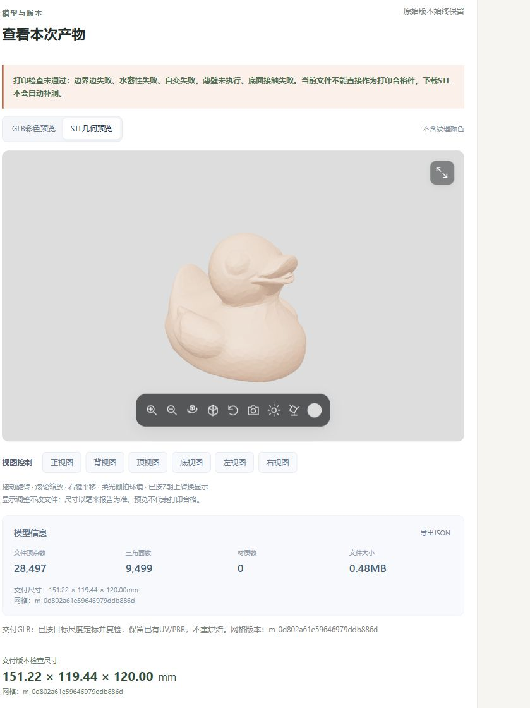

# 生成结果GLB与STL预览

- 日期：2026-10-29；任务：MID-PREVIEW-001；界面版本：result-preview-v1。
- 范围：仅替换生成完成后的模型预览。上传、参数、生成流程、打印报告及GLB/STL下载行为保持。

## 1.参考与实现

参照用户指定的[MeTool STL查看器](https://metool.online/zh/3d/stlViewer/)和[MeTool GLB预览](https://metool.online/zh/3d/glbPreview/)的灰色圆角画布、浮动工具栏、全屏、六向视图和模型信息，使用现有React/Three.js自行实现。没有复制外站源码、贴图或商标，没有将用户模型上传外站，不增加依赖。

完成结果新增GLB彩色/STL几何切换；工具栏提供放大、缩小、自动旋转、线框、复位、截图、环境切换、光照和背景色。自动旋转默认关闭。光照面板可调主光、环境光、曝光、显示底面网格，以及仅用于观看的X/Y/Z轴90°旋转。可切换柔光棚拍环境与项目已有官方森林HDR。

GLB沿用文件中原UV/PBR材质。STL没有纹理材质，使用查看器诊断色；模型信息中的STL材质数为0。PNG和JSON都需点击导出，不自动下载。此前“下载GLB/下载STL”按钮仍在原位置。

## 2.为什么外站显示侧倒或顺时针转动

STL只记录三角形，没有统一的朝上轴元数据或旋转动画。本项目打印STL采用毫米/Z朝上，GLB采用米/Y朝上；外站若将STL直接按Y朝上显示，就会侧倒。连续顺时针转动由查看器自动旋转控制，不是文件中心导致。中心会影响绕转支点，不能决定旋转方向。

本轮只在预览父节点上将STL绕X轴转-90°，再按实际包围盒居中、归一化并以中心作为OrbitControls目标；底面网格按真实显示底部定位。原顶点、GLB节点/材质及下载文件不改，不为了匹配外站而旋转实际打印文件。显示旋转也不会写回文件。

GLB的Y朝上/米单位与[glTF2.0坐标规范](https://registry.khronos.org/glTF/specs/2.0/glTF-2.0.html#coordinate-system-and-units)一致；本项目STL的Z朝上由实际几何及毫米报告核对。

实际指定任务`123a6686-eb9c-42af-b917-9f8515f0422f`、网格`m_0d802a61e59646979ddb886d`：

| 文件 | 三角面 | 文件坐标包围盒 | 预览朝上 |
| --- | --- | --- | --- |
| GLB | 9499 | 0.151223645×0.119999997×0.119441248m | Y |
| STL | 9499 | 151.223640×119.441250×120.000000mm | Z转为Y显示 |

STL显示转换后的包围盒为151.223640×120.000000×119.441250mm，与GLB朝向一致。STL原中心约(0.061901,-0.022291,60)mm，是底部位于Z=0的正常打印坐标；预览另行居中。顶点统计按文件属性计数，STL每个三角形重复存顶点，28497不代表比GLB的6114个材质顶点更复杂。

## 3.实现和兼容接口

- [结果组件](../frontend/src/ResultPreview.tsx)、[工具栏](../frontend/src/PreviewToolbar.tsx)、[显示几何](../frontend/src/preview-geometry.ts)、[独立样式](../frontend/src/result-preview.css)。
- [App接入](../frontend/src/App.tsx)仅在succeeded且存在真实主交付GLB时启用新预览，原待处理/确认预览继续使用旧ModelView；上传表单和全局样式文件保持。
- [文件读取](../frontend/src/api.ts)提取deliverySTLBlob复用既有认证/任务/版本端点，读取Blob不会下载或创建任务；原downloadSTL继续调用同一逻辑。
- 公共Schema、REST和任务状态不变。GLB绑定delivery.artifact_id/mesh_version，STL请求同版本毫米处理版；历史无单位原件缺STL依据时禁用。读取保留10分钟文件超时、真实字节进度、退出取消和失败重试；环境读取失败保留当前照明并说明原因。
- 预览尺寸只取同版本服务器检查报告；未知不填0，不用画布归一化坐标冒充毫米。外部GLB资源拒绝读取，图片/模型/密钥不发送第三方。

## 4.实际验证

本机执行，未连接SSH或重启云端服务，未调用重建/LLM/修复/切片。固定几何/组件/XHR替身测试与下方真实页面分开。

```powershell
cd frontend
npm test -- --reporter=dot
npm run build
```

- 修改前新增检查因缺少显示几何/工具栏模块，2个测试文件失败、原12项通过，日志保留。首轮新增实现16项通过；首次类型构建发现inspection可空访问，修订后通过。
- 最终前端5个测试文件/17项通过。类型检查/Vite构建通过，仍有现存Three.js主包大于500kB提示；未为本轮新增拆包或依赖。
- 固定非对称/偏移包围盒、GLB节点变换、STL轴向、原顶点保持、六向相机、窄视口相机距离、空模型拒绝、真实几何统计、默认旋转关闭及STL读取不下载均验证。
- IAB实际页面读取指定任务GLB和同版本STL，各9499面、GLB保留颜色且两者同向直立居中；自动旋转默认false，按钮可切换true，复位关闭。缩放、线框、六向视图、90°显示旋转/复位、灯光键盘调整及面板重开保留、背景输入、HDR切换、全屏/退出均实际操作。
- 显式点击导出PNG和JSON取得本机下载文件。390px窄屏工具栏约279.33px，位于301.33px画布内；六视图自动换成三列，随后恢复浏览器尺寸。浏览器错误日志为空。浏览器范围输入fill未触发React受控值，改用键盘确认真实调整；没有因此修改业务逻辑。
- 两份实际源文件SHA256保持，与前一轮独立读回记录一致；旧ModelView和全局style.css保持原字节。没有重新生成或修补这只鸭子，原打印failed及薄壁not_run继续展示。
- 收尾补充颜色input事件，选色即时更新画布；最终实际页面确认#e4e9f0背景生效，STL材质数0、导出JSON为同网格及preview_only=true/print_certified=false。

[精简实证](evidence/result-preview-20261029/result.json)。完整基线/构建/轴向诊断/截图保存在本机`runs/model-preview-20261029-01`，模型文件不入Git。

## 5.使用和停止点

本机已生成新的frontend/dist，现有5173页面刷新即可。队友更新仓库后按原启动说明构建/启动前端，云端API无需改动。生成完成后选择GLB或STL观看；未完成任务保留旧预览，切换格式会读取对应文件，不提交新任务。

本轮不修首次导出丢7面或接入独立打印副本；预览改善不代表孔洞修好，也不将failed改成通过。没有实物打印、全浏览器兼容性或百万面性能评估结果。

## 6.人工复核清单

1. 阅读第3节链接的主要代码及App/api差异，确认上传、参数、后台和源模型没有改变。
2. 核对两张实际页面图，刷新指定任务切换GLB/STL；应同向居中、STL无纹理，原打印失败提示保持。
3. 体验自动旋转开关、缩放、线框、六向视图、灯光、复位及全屏；确认这些只改变显示。
4. 点击截图/JSON及原GLB/STL下载，确认仅点击时下载、文件版本与报告对应。

人工复核：待用户/组员实际反馈；AI验证不代填通过，上一轮“核对完毕”不覆盖本轮。按已有授权完成Git交接后停止。

### 实际页面




