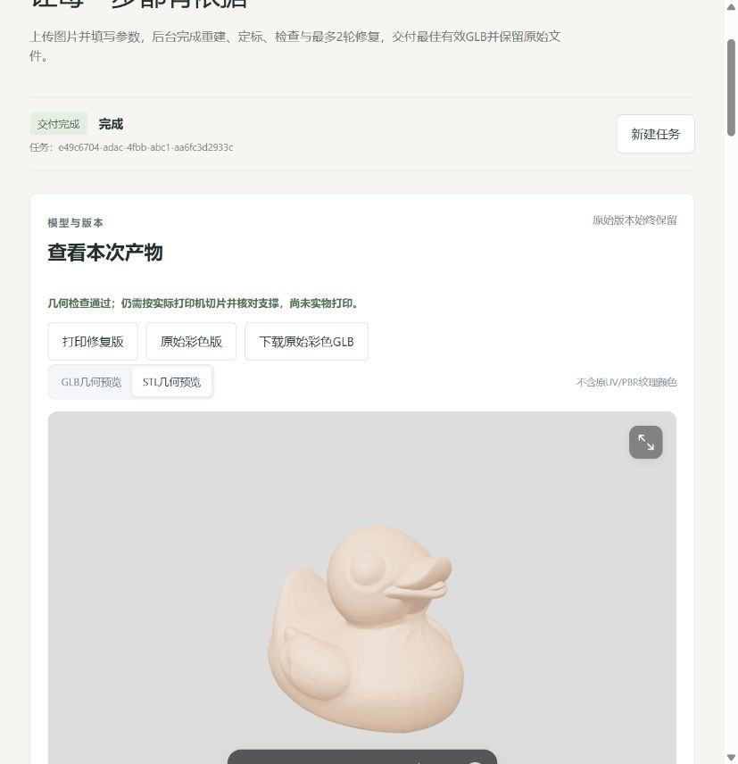
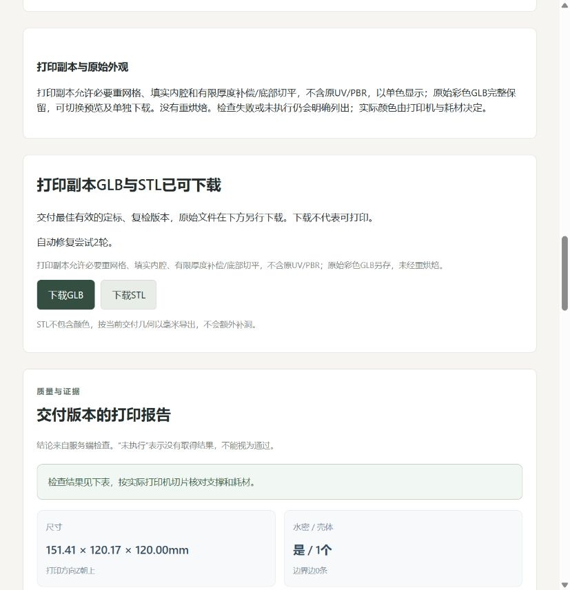

# 自动打印副本接入与验收

日期：2026-11-02；任务：MID-PRINT-WEB-001；代码基线：51ea614。用户明确授权将此前成功切片的MeshFix/MeshLib流程接入网页，生成后自动修复/复检，提供同版本GLB/STL预览下载，保留原始彩色GLB并更新云端、记录和提交推送。

## 1.实际行为与边界

新自动任务保存print-copy-v1。TRELLIS.2常驻重建后保留首次彩色GLB，在副本上清理、毫米定标和检查；需要时执行最多2轮打印修复，每轮重新检查。主预览及下载使用最佳有效的打印副本，检查失败/未执行仍明确说明，print_certified始终false。原始彩色版可切换预览和独立下载，不重烘焙，不修改源文件。

打印副本适用于100～150mm高的简单摆件。它允许必要重网格，不保留原UV/PBR，以统一单色显示；STL与打印GLB来自同一毫米/Z朝上逻辑几何，GLB文件按米/Y朝上显示。实际打印颜色由设备和耗材决定。网页上传和原有生成参数保持；生成面数预算约束首次重建，不强制把修复后网格再次降到低面数。

旧任务、原幂等请求及历史检查不迁移、不重新生成。刷新旧任务不会自动修复旧文件；新提交使用新政策。超范围、缺工具、原生超时、外部独立主要部件或保形拒绝都会说明原因，保留最佳有效文件，不能将补洞/水密单项作为可打印认证。

## 2.实现与兼容契约

- [统一工具](../src/image_to_3d_print/geometry/commands.py)增加服务端专用repair_print_copy/export_print_copy，复用ToolOutcome、MeshInspection及网格版本；[适配器](../src/image_to_3d_print/geometry/print_copy.py)调用原[原生算法](../scripts/tools/print_repair_worker.py)，没有复制Tiny网站代码或接入未通过的质心扇形候选。
- [原生配置](../src/image_to_3d_print/print_config.py)由后端加载，复用PrintDemoConfig字段；PyMeshFix0.18.1/MeshLib-Core3.1.4.297及已安装隔离目录保持，无新增依赖/模型。每次原生调用默认180秒，工作流总活动预算保持1800秒。
- 第1轮MeshFix闭合与闭合包含判定填实内腔，关闭默认连接组件/删除小组件；第2轮依据实际薄壁/底面结果作≤0.8mm厚度补偿、0.35mm体素、≤0.06mm简化误差及≤0.5mm底部切平/局部自交处理。固定三方向轮廓IoU≥0.97、尺寸变化≤2%，参考始终为同任务祖先。保形失败不采用候选。
- [自动图](../src/image_to_3d_print/workflow/automatic.py)将修复与检查放在独立节点，保留逐轮证据及最佳版本；新政策关闭首次GPU补片，2轮留给打印副本。取消/超时沿原worker进程树回收，常驻实现和low_vram保持；服务更新时空闲重启worker会清空当前缓存，下次首次请求仍需冷加载。
- generation-v1兼容增加geometry_policy（旧默认preserve_uv，新print_copy）、original_artifact_id、stl_artifact_id。完成时校验原件属于本任务，STL与主GLB/报告同mesh_version；旧客户端及公共1.0.0不改。Schema/生成前端类型同步，细节见[接口](接口与字段.md)。
- 前端默认打印修复版，支持GLB/STL切换及原始彩色版切换/下载；仅点击下载，不自动下载。STL端点优先返回已登记并独立读回的同版本文件，旧任务仍兼容按需转换，GET不推进修复。

## 3.真实云端结果

两次均在同一AutoDL实例使用已有真实GLB，不运行新重建、LLM或训练。重建节点明确标记existing_artifact_replay，随后实际执行新LangGraph几何链、原生算法、Blender4.5.14/固定Toolbox及独立导出。验证存储与生产36个旧任务隔离。

| 项目 | 之前成功切片的小鸭原件 | 网页曾有孔的123a6686原件 |
| --- | --- | --- |
| 验证任务 | e49c6704-adac-4fbb-abc1-aa6fc3d2933c | 92b4afed-d2c6-4857-9323-59cd59a17ae7 |
| 修复尝试 | 2轮 | 2轮，第2轮保形拒绝 |
| 主交付面数 | 166738 | 4704，保留第1轮有效版 |
| 高度 | 120mm | 120mm |
| 水密/组件/边界 | 是/1/0 | 是/1/0 |
| 非流形边/顶点、自交 | 0/0、0 | 0/0、0 |
| 薄壁/底面 | 通过/通过 | 17面薄壁命中、底面失败 |
| 悬垂 | warn，需要支撑 | warn，需要支撑 |
| 打印检查 | passed，仍需实际打印机切片 | failed，明确说明，未降门槛 |
| 原始彩色文件 | SHA256保持 | SHA256保持 |

通过件尺寸151.407×120.173×120.000mm；新流程没有强制低面数覆盖打印几何。新STL在本机现有PrusaSlicer2.9.6按既有演示配置实际切片：返回0、672层、最高120mm、非空正向挤出，耗时8.28秒。未向打印机发送G-code，没有实物打印结论。其STL SHA256为12b14971ae8c0df360cc21e9a8c918a1bfffbda8768daa2a0f3a7db80dd8eefc。

## 4.测试、页面和实际部署

- 首先新增4个失败测试保存baseline.log；初次测试修改冻结配置失败后改用新模型验证，生产冻结规则不变。最终本机完整307通过/14项平台跳过/89.77秒；聚焦23通过；Linux含真实原生工具专项20通过。最后统一打印显示色补丁的本机/Linux各7项通过，未改变检查几何。前端23项、TypeScript/Vite构建通过，保留既有大包提示。
- 固定场景覆盖同版本GLB/STL/原件、0轮正常、2轮薄壁仍失败、缺原生工具/保形失败回退、错误版本/未授权工具、错误原件/STL引用、只读下载和旧幂等。新原生算法行为沿此前固定测试，不为网站补洞放宽门槛。
- 浏览器连接隔离云端API的真实任务，实际加载166738面GLB、STL和原始彩色GLB；点击3个下载按钮，实际下载字节摘要与源文件逐一一致。页面刷新/切换不重新重建或自动下载。此为已有模型的真实CPU链与HTTP联调，不是新图片GPU推理。
- 原生回放首次脚本来源查找、配置路径、JPEG扩展名不符先失败，修订后重用源文件/独立新目录，未改业务算法或伪造成功。发布前严格摘要校验曾拒绝部署，查明仅CRLF/LF不同后允许精确的换行归一比较，不覆盖未知代码。
- 云端初查有1个用户任务运行，未停止它；任务完成后空闲备份代码/配置/SQLite，更新16个清单文件及打印配置。API配置已返回print-copy-v1、print_copy_configured=true、gpu_hole_policy=null；36个旧上下文/响应/状态完全保持，API/单worker恢复。常驻相关源码/模型环境未改；发布后无活动计算，查询GPU0MiB/0%，不代关机。
- 生产没有提交新图片GPU任务；新任务政策通过服务能力和独立真实几何路径验证，后续新图片效果仍由具体网格检查决定。不要将单鸭通过泛化为所有图均可打印。

精简[结果](evidence/print-web-20261102/result.json)、[通过件](evidence/print-web-20261102/passed.json)、[失败件](evidence/print-web-20261102/failed.json)入库。完整日志/文件在本机runs/print-web-20261102-01及云端同名前缀目录；模型、G-code、数据库备份、密钥不入Git。

## 5.使用与复现

刷新网页后新建任务，建议目标高度120mm。提交后无需中途确认，完成后默认显示打印副本；切换STL看几何、切换原始彩色版看生成外观。打印版GLB/STL和原彩色GLB分别点击按钮下载。检查未通过时，按失败原因处理，不能将文件直接作为合格打印件。

```powershell
$env:PYTHONUTF8='1'
runtime/envs/backend/Scripts/python.exe -m pytest tests -q
runtime/envs/backend/Scripts/python.exe scripts/tools/export_tool_schemas.py --check
runtime/envs/backend/Scripts/python.exe scripts/tools/export_runtime_schemas.py --check
runtime/envs/backend/Scripts/python.exe scripts/tools/export_frontend_types.py --check
cd frontend
npm test -- --reporter=dot
npm run build
```

网页没有自动启动切片器；表面检查通过仍需打印人员按实际设备、耗材及支撑重切片。独立CLI继续可用，旧任务保持旧交付。

## 6.本轮人工复核

状态：用户2026-11-02按本节清单明确回复“已核对，本轮人工复核通过”，据此记录本轮新增代码/结果人工复核通过；不代表实物打印或生产新图片GPU全链通过。

1. 阅读本报告第1～4节及print_copy.py、automatic.py新增节点、runtime_contracts.py、STL端点和前端切换代码，核对2轮上限、同版本/原件保护、失败回退及无UV/PBR说明。
2. 核对通过件和失败件JSON，确认仅第1份达到几何/演示切片门槛，第2份仍失败；不把工具完成或水密视为整体通过。
3. 刷新网页，新任务完成后核对打印GLB/STL及原始彩色版预览和3个下载按钮，原件保留、不自动下载，不增加中途操作。
4. 接受100～150mm简单摆件范围、实际打印未执行、生产新图片GPU全链本轮未重跑；给出本轮人工结论。

以下图片为隔离云端已有真实模型回放，不是新GPU推理。




