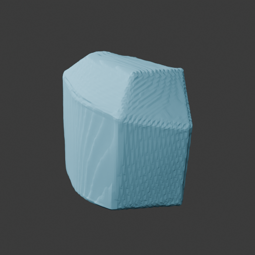
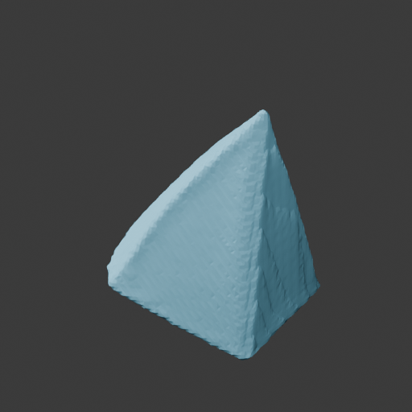
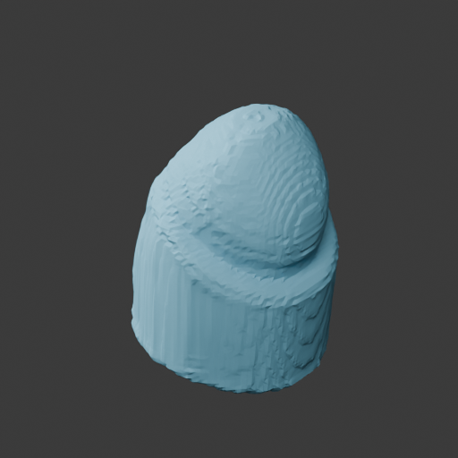
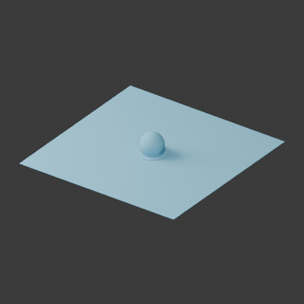

# 重建与几何工具链交付

- 日期：2026-10-21；任务：MID-GEOM-001；工具包0.2.0，内部schema0.1。
- 覆盖清单1～5、7～24、48、52共25项的工具层，实现、固定回归及同一云端真实图片验证已交付。页面/HTTP/Agent接入由对应方向完成，不能等同完整产品。
- 原CPU测量报告只记录此前第11项的一部分，标题和历史人工验收保留；本报告承接扩大后的方向。
- 用户本轮明确答复“人工确认：已确认，你代填一下”，据此记录整体人工确认通过；未展开的逐项阅读不补写为逐项通过。该结论不批准具体结构提案或启用尚待核验的映射。

## 1.25项交付矩阵

| 项 | 工具实现与实际验证 | 接入/验收边界 |
| --- | --- | --- |
| 1图片保存 | AssetStore保存原字节、asset_id、公共AssetRecord；CLI真实导入 | 页面/HTTP上传字节后调用，不接客户端路径 |
| 2合法性 | 真实解码、格式/损坏、10MiB/4096限制、伪扩展名与路径回归 | 错误图片不调用模型 |
| 3前景准备 | 原图、256方形等比前景/蒙版；透明图及JPEG→真实RMBG通过 | 用户前景复核页面待接入 |
| 4适用性 | InputReview绑定资产与具体前景；拒绝/不确定阻断 | 未实现语义分类器；实际人工确认由应用提供 |
| 5用户约束 | 复用ModelTaskRequest；缺高度/轴向、负数、错资产、尺度溢出回归 | 服务核对资产/测量证据/配置登记并追问 |
| 7动态图片 | TripoSR真实生成block/pyramid/knob；TRELLIS.2真实生成JPEG摆件 | 没有固定官方T图；fixture确认不是用户验收 |
| 8重建适配 | 显式后端/源码、独立Python、离线权重、公共结果/错误 | 候选为native_geometry变体，无静默替换 |
| 9运行证据 | UUID目录、输入摘要、参数/版本、日志、时间/显存及产物 | 队列、数据库和累计预算由工作流接入 |
| 10原始初检 | 独立读取、非空/有限数/索引、组件/缺陷；465万面真实恢复 | 有效网格不等于可打印实体 |
| 11坐标测量 | 原生Z朝上、GLB转换可逆；TripoSR共享开发映射及第三图核验 | 映射单独人工启用未确认；候选输入视角未校准，保持not_run/null |
| 12基础清理 | 重复/退化、未引用顶点及法线；固定与真实候选验证 | 候选法线一致但孔洞/非流形仍存在 |
| 13结构处理 | 凸平面三/四边小洞、显式组件删除，提案/确认/应用分离 | 固定fixture验证；真实提案未批准，不默认只留最大件 |
| 14姿态 | 正负X/Y/Z共6朝上轴、固定旋转及预览 | 服务核对实际人工姿态后传human_action |
| 15毫米定标 | 一个高度等比缩放，保存4×4变换；3张真实结果80mm | 80mm为固定测试目标，不是实测尺寸 |
| 16打印平面 | 最低点Z=0，接触面积/高度与独立BedReview | 平移不证明稳定；真实模型底面仍失败/待确认 |
| 17版本 | 原始和各轮只新增，父版本/摘要/参数、最多2轮及确认幂等 | 当前分支、等待项和重启状态由工作流保存 |
| 18大网格 | 球体327680→80000面保形/检查通过；真实4652560→100000面提案 | 原逐面检查超时保留未知；真实候选仍缺陷，未应用 |
| 19拓扑法线 | NumPy/稀疏连通图逐项检查，BMesh另存交叉证据 | 非流形边与顶点分别报告 |
| 20自交 | 固定Blender打印工具BVH返回面索引，真实自交fixture检出 | 缺工具/超时不得通过 |
| 21薄壁 | 0.6/0.9mm失败，1.2mm警告，1.6mm通过 | 固定种子逐面射线抽样；坏拓扑时正式项未执行，非全局最小壁厚证明 |
| 22悬垂底面 | 朝下法线对-Z夹角<45°、临界面/底面排除；斜面回归 | 支撑和稳定仍需对应版本人工切片 |
| 23尺寸空间 | 高度误差≤max(0.5mm,1%)，外形与配置空间检查，未知阻断 | demo_v1仅演示，无实际打印机证据 |
| 24质量结论 | 通过/失败/警告/未执行与统一verdict；组件警告不漏过公共成功门槛 | 仅既有悬垂warn允许进入后续切片；工具成功不是任务成功 |
| 48导出 | 真实3图及fixture的STL/GLB，独立尺寸重读 | STL毫米数值、GLB米/Y朝上；候选文件不代表可打印 |
| 52Linux工具 | Blender4.5.14、固定打印源码、必要系统库和隔离CPU依赖；12fixture实测 | 克隆不含环境/权重；部署与调用见接手说明 |

## 2.代码与契约

入口见[几何工具接口与接手说明](几何工具接口与接手说明.md)。主要代码：[图片资产](../src/image_to_3d_print/image/assets.py)、[重建适配](../src/image_to_3d_print/adapters/reconstruction.py)、[版本/定标](../src/image_to_3d_print/geometry/core.py)、[结构提案](../src/image_to_3d_print/geometry/structure.py)、[打印检查](../src/image_to_3d_print/inspection/service.py)、[导出](../src/image_to_3d_print/artifacts/export.py)、[统一门面](../src/image_to_3d_print/geometry/commands.py)，回归见[tests/geometry](../tests/geometry)。

公共20模型/JSONSchema1.0.0字段兼容，内部Pydantic命令、配置、版本、提案及ToolOutcome另行[自动导出](../schemas/geometry-tools-v0.1.schema.json)。公共ready_for_print修正为同时核对新增CheckResult，拒绝额外失败/未执行/警告；原必需项、阈值及仅允许悬垂warn的规则不变。该问题先保留3条有效失败基线再修复。

模型默认门面不能自行接受图片、确认姿态、结构、底面或组件。由应用核对真实用户输入、当前等待项/版本后传服务端human_action=True。固定验证中的test_fixture确认仅证明工具接口，不是人工批准。

## 3.实际验证

基线main/951bfb5且工作树干净。先保存失败基线，修订见[GEOM-BUG-001～010](../spec/bug调试文档.md)。同一云端RTX4090D24564MiB、16核/80GiB；模型环境/权重复用，本机编辑、备份和Git。

| 验证 | 实际结果 | 原始记录 |
| --- | --- | --- |
| 全量离线 | 159 passed in 3.04s，含历史回归和新工具/停止/安全用例 | [测试日志](geometry-evidence/tests-final.txt) |
| schema/固定数据 | 内部schema一致，公共20模型一致，30例静态准备通过；evaluation/holdout模型未执行 | schema及prepared-data日志 |
| Linux检查器 | 12fixture、14条预期、0不匹配，7.090秒 | results.json/geometry-final2 |
| 真实结构工具 | 小洞、指定组件、327680→80000面球体简化共3例，0错误，56.524秒 | structure-final；确认=test_fixture |
| 动态真实链 | 3张TripoSR图重建→清理→80mm→检查→STL/GLB，59.119秒 | triposr-final |
| JPEG/RMBG/候选 | JPEG真实去背景；2323462顶点/4652560面PLY，原始88365047字节 | trellis-jpeg-first/fixed |
| 候选CPU清理 | 法线一致性false→true，孔洞/非流形保留；清理/定标/简化提案共631.456秒 | candidate-cleanup-final |
| CPU预览 | 3个具体定标版本+1个明确未应用的候选提案PNG | previews-final |

| TripoSR图片 | 原始顶点/面 | 加载准备/推理秒 | 峰值allocated MiB | 定标外形mm | 打印判定 |
| --- | --- | --- | --- | --- | --- |
| block | 17786/35464 | 7.198/0.792 | 1939.054 | 67.197×61.901×80 | blocked |
| pyramid | 13876/27631 | 7.895/0.819 | 1938.695 | 56.855×63.973×80 | blocked |
| knob | 16286/32455 | 8.195/0.786 | 1938.916 | 59.747×59.653×80 | blocked |

模型内部耗时不含Python启动、CPU检查和导出，59.119秒是3例整条链。三份模型存在边界/非流形及底面问题，非水密，正式薄壁项未执行；工具正确保留失败并阻断，导出的只是候选。没有计算正式成功率或后端优劣。

## 4.候选与测量限制

TRELLIS.2使用既有1024_cascade/seed0的pipeline.run，导出native_geometry原生PLY；不含官方to_glb重网格/PBR/视频。变体显式标注，与历史完整官方T样例分开，不冒充正式同机比较。

JPEG候选加载准备106.089秒、推理84.060秒、模型内部总190.756秒，allocated3388.503MiB/reserved4686MiB。模型执行0，但旧200万面读取上限导致接入失败；改为500万面/稀疏拓扑后只读恢复已有产物，未重跑候选模型。

原网格逐面打印检查120秒超时，保持not_run。早期提案p_aab3c9f99aff4fa1835da2af，以及清理后p_237ad788163644d6bca8581e，均未批准/应用。清理后10万面候选仍检出525个自交面；孔洞/非流形也未解决。保形通过仅允许提出修改，不能证明可打印，不为结束任务而批准有缺陷提案。

实际预览还出现目标摆件之外的大平面，属于本次输入的重建质量失败。根因在模型生成或前处理的哪一环尚未定位，不能直接断言换模型即可解决；本轮保留原输入/前景/参数及网格，不用删平面或自动底座掩盖失败。

TripoSR预先固定12组候选，用block/pyramid两张development图选择一个共享映射，再用未参与选择的knob核验：yaw=-90°/pitch=0°，IoU约0.916465/0.778845/0.913275。这是开发校准，非冻结评估；[mapping.json](geometry-evidence/mapping.json)的单独启用仍pending，运行时不输出未经复核的质量分。TRELLIS.2输入视角仍未校准。

## 5.预览与人工确认

以下为CPU几何诊断图；候选图是早期未应用提案，不能与清理后提案混认。打印缺陷以JSON逐项检查为准。






[人工复核清单](重建与几何人工复核清单.md)记录用户本轮整体确认原话；未逐项导读的内容不记逐项通过，先前CPU验收未被复用。具体提案和映射另行确认。

## 6.复现、备份与停止点

在接手说明的CPU环境执行：

```bash
python -m pytest tests -q --tb=short
python scripts/tools/export_tool_schemas.py --check
python scripts/p1/export_schemas.py --check
python scripts/p1/check_prepared_data.py
python scripts/tools/validate_geometry.py --cloud-root /root/autodl-tmp/image-to-3d-print-agent --output results/new-geometry-check
python scripts/tools/validate_structure.py --cloud-root /root/autodl-tmp/image-to-3d-print-agent --output results/new-structure-check
```

真实模型入口会计算，阅读/接手不自动重跑。详细命令、依赖、确认和单位见接手说明。云端独立目录runs/mid-geometry-20261021-01/workspace未覆盖历史目录。

[精简结果](geometry-evidence/results.json)的长索引数组仅留数量及前10项；完整JSON/原始模型/日志在被忽略的本机runtime/mid-geometry-delivery/evidence.zip，[manifest](geometry-evidence/manifest.json)保存实际文件摘要与重复内容指向。ZIP共205个文件引用/190个去重内容、154744964字节，SHA256=c95870ceb649f38ca7730fb983cc205f9c8f3a4b1d9ddf867478bce1f8b3a265，下载后CRC/摘要通过。权重/环境/完整产物不入Git。

[结束快照](geometry-evidence/stop.json)：本轮活动计算进程0、GPU0MiB。实例由用户自行关机；本方向记录及授权Git同步后停止。后续尚需页面/HTTP/Agent接入、当前版本预览/切片和实际交互验收；正式选型、保留集及训练未启动。
