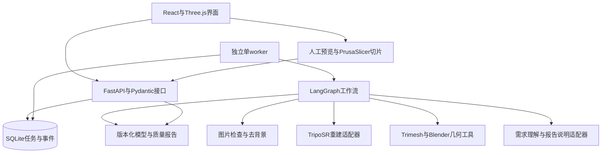

# 2D图像到3D打印模型Agent工作流：技术方案与分阶段开发计划

- 文档版本：v0.1。
- 制定日期：2026-10-16。
- 对应课题：课程总表第18题，实用与创意应用类P05。
- 项目标识：`image_to_3d_print`。
- 第一版目标：单张物体图片到经过修复、定标、检查及人工切片确认的STL模型。
- 当前状态：技术方案和计划已制定，尚未实现系统；下文指标均为拟定验收要求，不代表已经达到。
- 计划假设：按3人小组、约4周、20个工作日安排；实际人数或课时不同时，保持阶段依赖顺序，调整工期。
- 需求依据：[课程规划与开发规范](<Agent开发课程实验课题总体规划与开发规范(3).md>)的第1.3节、第2章、第5.1节和第5.6节。

## 1. 第一版目标和范围

### 1.1产品目标

用户上传一张轮廓清晰的物体图片，填写目标高度并选择预设打印参数。系统检查输入，调用现成的图像重建模型，生成候选网格，执行受限修复、等比缩放和可打印性检查，展示修复前后效果，输出候选STL文件与质量报告。用户在切片软件中确认尺寸、分层和支撑后，系统保存验证证据，完成任务。

一条任务完成后，至少能够回答：

1. 模型根据哪张图片、哪组参数生成？
2. 尺寸来自用户指定还是实物测量？
3. 原始网格有什么问题，系统修改了什么？
4. 哪些检查通过，哪些存在风险，哪些没有执行成功？
5. 导出的文件能否重新读取、正确显示尺寸并完成切片？

### 1.2范围划分

| 类型 | 第一版约定 |
| --- | --- |
| 输入图片 | 单张PNG/JPEG；单个、不透明、轮廓清晰、主体较完整的简单摆件；优先纯色背景 |
| 物体范围 | 非功能性简单摆件；不要求内部结构、精密配合或承力性能 |
| 尺寸 | 用户提供目标高度，或提供沿明确轴向测得的实物高度；统一换算为毫米 |
| 打印方式 | 先固定FDM、PLA、0.4毫米喷嘴、0.2毫米层高的项目演示配置 |
| 必需能力 | 图片检查、去背景、单图重建、基础修复、姿态确认、定标、检查、预览、STL导出、切片证据记录 |
| 底面处理 | 用户确认朝向后平移至打印平面；没有稳定底面时要求调整姿态或人工处理 |
| 输出 | 原始网格、各次修复网格、GLB预览、候选/确认后的STL、JSON质量报告、Markdown质量报告、事件记录 |
| 暂缓能力 | 多视图融合、3MF导出、自动加底座、自动厚化、自动生成支撑、复杂机械外壳、彩色打印 |
| 不进入范围 | 从零训练重建模型、人物和透明物体、精密测量、直接控制打印机、自动下单制造、通用聊天、多Agent自由讨论 |

本方案将课程中的“STL/3MF”收敛为第一版交付STL；3MF列入后续规划。若教师明确要求两种格式均交付，应在开发前更新当前任务和导出模块验收范围。

### 1.3成功与失败的界定

- **任务成功**：输入满足范围，尺度已确认，必需几何检查均已实际执行并符合要求，候选STL重新读取成功，用户完成预览与切片确认，证据和报告完整。
- **等待输入**：缺少尺寸、图片需要替换、姿态尚未确认、修复操作需要确认，或者尚未提交切片确认。
- **任务失败**：模型或工具不可用、超时、超过修复上限、存在无法消除的阻断缺陷，或者用户提交的切片结果为失败。
- 正确识别不适用输入属于“边界处理正确”，不计为“成功生成可打印模型”。
- 模型生成、网格合格、切片通过分别记录；三者不能互相代替。

## 2. 技术选型和运行方式

### 2.1选型表

| 层次 | 第一版选择 | 选择理由及边界 |
| --- | --- | --- |
| 主服务 | Python3.11、FastAPI、Pydantic | 统一输入输出校验，提供任务、事件和产物接口 |
| 工作流 | LangGraph及SQLite检查点 | 主流程固定，支持缺尺寸、修复确认和切片确认时暂停与恢复[3] |
| 图像预处理 | Pillow、rembg | 检查图片、统一色彩与透明背景；保存处理结果供用户复核 |
| 重建后端 | TripoSR预训练模型 | 先建立单图重建基线，不进行训练；通过独立适配器调用[1] |
| 几何处理 | Trimesh、Blender批处理脚本 | Trimesh执行读写、包围盒和基础修复；Blender执行更复杂的网格检查[2][5] |
| 打印检查 | 与Blender版本匹配的3D打印检查工具 | 使用流形、自交、薄壁和悬垂检查，封装为固定JSON结果；阶段0验证实际可调用性[5] |
| 持久化 | SQLite、任务产物目录 | 保存任务元数据、状态、事件和相对产物路径；不引入Redis或分布式任务系统 |
| 后台执行 | 独立单worker进程 | GPU任务并发数为1；API只负责接收、查询和提交输入，避免在请求进程执行重计算[4] |
| 前端 | React、TypeScript、Vite、Three.js | 上传、填写约束、模型预览、修复对比、检查展示和下载 |
| 切片验证 | PrusaSlicer人工验证 | 固定软件版本和打印配置，导入候选STL、生成分层并保存截图与配置摘要 |
| 测试 | pytest、固定fixture、批量评估脚本 | 默认不依赖公网、GPU或付费语言模型；真实推理另做阶段验收 |
| 语言模型 | 显式配置的兼容服务，通过独立适配器调用 | 仅承担需求理解、追问措辞、依据报告生成说明；几何判断由工具和代码决定 |

TripoSR的官方代码支持逐张处理多个图片路径，这不等于多视图联合重建。第一版只提交一张主图，不将正侧背图片拼接后宣称实现多视图融合[1]。

### 2.2当前硬件事实和环境门槛

2026-10-16只读检测到当前电脑为NVIDIA GeForce RTX3060LaptopGPU，显存6144MiB。TripoSR官方README给出的默认单图显存参考约为6GB，因此必须先进行真实冒烟验证，不能据此承诺速度或显存一定充足[1]。

- 主服务、重建后端分别使用独立Python3.11环境；Blender使用自身运行环境，由子进程调用。
- 依赖版本在阶段0实际运行成功后锁定，同时记录PyTorch、CUDA运行时、驱动、模型权重版本、Blender及检查工具版本。
- 首次显存不足时，允许按事先验证的低显存参数重试1次，并记录参数变化；仍失败则返回`GPU_OUT_OF_MEMORY`，不静默切换CPU或更换模型。
- 第一版单worker串行执行；先采用每任务子进程加载模型的简单方式，记录模型加载与推理耗时，不提前实现常驻推理服务。
- 初始预算：重建子进程300秒、单次Blender操作120秒、任务累计活动执行时间900秒。用户等待时间单独统计，不占活动执行预算。
- 若本机无法满足阶段0门槛，先更新任务记录，配置小组已有的GPU服务器并保持适配器接口不变；不得在未配置时编造远程地址或自动产生付费调用。
- 语言模型缺少配置时，自由文本解析入口明确不可用，结构化表单入口仍可运行；离线fixture只用于测试，不冒充真实模型输出。
- 实际打印机、打印空间和切片配置由阶段0确认；尚未确认时，不把演示参数描述为真实设备已经验证的参数。

## 3. 系统架构和模块划分



### 3.1模块职责

| 编号 | 模块及建议位置 | 输入 | 输出 | 边界与主要验收点 |
| --- | --- | --- | --- | --- |
| M01 | `schemas/`数据契约 | 上传信息、用户约束、工具响应 | 请求、状态、检查、错误和产物模型 | 缺字段、非法单位和非法状态被拒绝；其他模块共用模型定义 |
| M02 | `image/`图片处理 | 图片文件及背景信息 | 输入检查、去背景图片、主体蒙版 | 损坏文件不能进入GPU步骤；用户能看到预处理是否误删主体 |
| M03 | `adapters/reconstruction.py`重建 | 去背景图片、固定后端参数 | 原始网格、模型及参数记录、耗时 | 真实生成有效网格；错误显式返回；不负责可打印性结论 |
| M04 | `geometry/`修复与定标 | 原始网格、姿态、尺度、修复指令 | 新版本网格、变换矩阵、修改记录 | 不覆盖原始文件；缩放等比；每次修改可追踪 |
| M05 | `inspection/`打印检查 | 定标网格、打印配置 | 缺陷数量、位置索引、阈值、通过/失败/不确定结果 | 所有必需检查实际执行；薄壁和自交不能由水密检查替代 |
| M06 | `workflow/`编排与交互 | 结构化状态、工具结果、人工输入 | 下一步骤、追问、暂停、恢复、结束 | 最大修复2轮；无效输入不推进；恢复时不重复执行已完成重建 |
| M07 | `jobs/`与`api/`任务服务 | 创建、补充输入、查询、取消请求 | 任务状态、事件、产物访问 | 长任务异步；状态落库；取消能停止当前子进程 |
| M08 | `artifacts/`与`reports/`导出报告 | 经过检查的网格、工具记录 | GLB、STL、JSON/Markdown报告 | 导出后重新读取；报告指向具体网格版本；毫米约定明确 |
| M09 | `frontend/`与`evals/`交付验证 | API、模型、评估清单、切片证据 | 用户界面、评估报告、演示材料 | 原始/修复模型可切换；失败可解释；结果可复现 |

模块是代码职责划分，不代表部署9个服务，也不要求9个Agent。

### 3.2小组分工建议

| 角色 | 主要负责 | 必须交叉复核的内容 |
| --- | --- | --- |
| A：重建与几何 | M02～M05、重建环境、问题网格fixture、切片参数 | 与B核对工具schema，与C核对GLB和单位显示 |
| B：后端与工作流 | M01、M06、M07、持久化与任务接口 | 复核A的错误行为和工具记录，与C进行接口联调 |
| C：前端与评估 | M08的报告展示、M09、数据整理、演示和评估记录 | 与A复核切片结果，与B复核等待/恢复/取消行为 |

每个阶段仅设置一个当前任务。组员围绕同一阶段的契约分工，不各自维护相互冲突的需求和状态定义。若为4人组，可将数据评估与文档职责独立分配。

## 4. 工作流、状态和停止条件

### 4.1工作流顺序

1. **接收与校验**：上传图片并提交约束；文件合法性、大小和字段由代码校验。
2. **图片复核**：检查主体、背景和遮挡，保存去背景结果；质量不满足范围时请求换图。
3. **尺度与姿态澄清**：缺高度或单位时暂停并追问；确认哪个方向对应高度。允许在尺度缺失时提供无单位预览，但不交付已定标的最终STL。
4. **重建与初检**：调用TripoSR，保存原始网格并检查空网格、无效坐标和组件情况。
5. **基础修复**：清理重复/退化元素、统一法线；补洞或删除组件等可能改变结构的操作必须展示并确认。
6. **定标与落地**：按确认的朝向等比缩放，平移最低点到Z=0；保存变换矩阵。
7. **完整检查**：执行拓扑、自交、厚度、悬垂、尺寸和打印空间检查；生成检查报告。
8. **修订分支**：有已支持且已授权的修复方案时生成新版本并复检，最多2轮。无法自动处理的缺陷明确说明；不支持的自动厚化或加底座不能被假装执行。
9. **预览与候选导出**：展示修复前后模型和风险，生成候选STL并重新读取；任务进入等待切片确认。
10. **切片确认与结束**：用户导入切片软件，确认尺寸、分层、支撑和底面，提交结果与证据；通过后生成最终报告并结束。

图片替换会产生新的`run_id`并保留旧任务；只补尺寸、确认姿态或提交切片结果时恢复原任务，不重复付出重建成本。

### 4.2任务状态

任务状态严格使用课程统一集合，不额外创造同义状态。具体节点放在`stage`字段，检查项结论放在`checks`字段。

| 状态 | 含义及转换 |
| --- | --- |
| `queued` | 已创建并等待worker；执行后进入`running` |
| `running` | 正在执行节点；可进入等待、成功、失败或取消请求 |
| `waiting_for_input` | 等待尺寸、姿态、修复确认或切片结果；有效补充后重新排队，由worker恢复 |
| `cancel_requested` | 已请求取消，worker停止当前子进程并收尾 |
| `succeeded` | 检查、预览、切片确认和产物记录均完成 |
| `failed` | 执行失败、检查阻断且无法继续，或者切片验证失败；保留诊断产物 |
| `cancelled` | 已取消；停止后续工具调用，保留已生成版本 |

终态不直接恢复；用户再次尝试创建新任务。重复提交同一等待项时，只接受与当前`pending_input_id`一致的第一份有效输入；重复请求返回已有处理结果，不重复推进工作流。

### 4.3预算和错误行为

- `max_repair_rounds=2`；自动修复失败或到达上限时停止，不无限改提示词或反复重建。
- 每任务语言模型调用上限4次，总输入输出token预算12000；模型名、用量、调用次数必须记录。供应商单价未配置时费用记为未知，不记为0。
- 检查结果使用`pass`、`fail`、`warn`、`not_run`；`not_run`不能解释成通过。
- 必需几何检查失败或未执行时，不允许任务成功；悬垂警告需在切片配置中说明支撑策略并由用户确认。
- 等待输入时释放worker，不用等待循环占用GPU。
- worker重启后，尚未开始的任务可以继续；等待输入的任务从检查点恢复。中断中的计算任务明确记录`WORKER_RESTARTED`并结束，不自动重跑昂贵步骤。
- LangGraph的`interrupt()`恢复时会重放所在节点[3]。因此确认节点与重建、修复等有副作用的节点分开，不能在同一节点先重建再等待确认。

| 错误码示例 | 处理方式 |
| --- | --- |
| `INVALID_IMAGE`、`INVALID_ARGUMENT` | 拒绝输入，说明具体字段或文件问题 |
| `SCALE_REQUIRED`、`ORIENTATION_REQUIRED` | 作为等待输入原因，保留任务上下文 |
| `MODEL_NOT_CONFIGURED`、`TOOL_UNAVAILABLE` | 明确缺失项，不能使用预置模型文件伪装成功 |
| `GPU_OUT_OF_MEMORY`、`TOOL_TIMEOUT` | 按已声明预算处理并记录；到达上限后失败 |
| `MESH_NOT_PRINTABLE`、`REPAIR_LIMIT_REACHED` | 保存缺陷和修改版本，输出人工处理建议 |
| `SLICER_VALIDATION_FAILED` | 保留切片失败证据，不改为成功 |

## 5. 数据契约与API

### 5.1关键数据模型

| 模型 | 核心字段 |
| --- | --- |
| `ModelTaskRequest` | `image_asset_id`、`height_value`、`height_unit`、`scale_source`、`orientation`、`printer_profile_id`、`description` |
| `WorkflowState` | `run_id`、`stage`、`status`、`pending_input_id`、`pending_input_type`、`mesh_version`、`repair_round`、`artifacts`、`checks`、`warnings`、`error` |
| `PrinterProfile` | `profile_id`、`version`、`process`、`material`、`nozzle_mm`、`layer_height_mm`、`min_wall_mm`、`build_volume_mm`、`slicer_version`、`supports_policy` |
| `MeshInspection` | `mesh_version`、`dimensions_mm`、`volume_mm3`、`component_count`、`watertight`、`boundary_edge_count`、`non_manifold_edge_count`、`non_manifold_vertex_count`、`checks` |
| `CheckResult` | `name`、`status`、`value`、`threshold`、`unit`、`tool_version`、`evidence_artifact_id`、`details` |
| `ArtifactRecord` | `artifact_id`、`run_id`、`mesh_version`、`kind`、`relative_path`、`created_at`、`derived_from`、`unit` |
| `SlicerConfirmation` | `pending_input_id`、`mesh_version`、`result`、`slicer_version`、`printer_profile_id`、`dimensions_mm`、`supports_enabled`、`layer_preview_asset_id`、`notes` |

`task_id`固定表示课题能力`image_to_3d_print`；`run_id`表示一次执行，使用UUID。所有工具参数和输出均通过Pydantic校验。磁盘绝对路径不作为客户端可任意指定的参数。

### 5.2首版接口

| 方法与路径 | 用途 | 主要约定 |
| --- | --- | --- |
| `POST /api/v1/assets` | 上传图片或切片证据 | 返回`asset_id`；扩展名与实际格式都校验 |
| `POST /api/v1/model-tasks` | 创建任务 | 返回HTTP202和`run_id`；不等待GPU计算结束 |
| `GET /api/v1/model-tasks/{run_id}` | 查询状态与当前结果 | 返回统一状态、阶段、待补项、检查和产物 |
| `GET /api/v1/model-tasks/{run_id}/events?after={event_id}` | 增量获取事件 | 第一版使用轮询，不引入WebSocket |
| `POST /api/v1/model-tasks/{run_id}/inputs` | 提交尺寸、姿态、修复确认 | 校验当前等待项及输入类型；恢复同一工作流 |
| `POST /api/v1/model-tasks/{run_id}/slicer-confirmation` | 提交切片结果 | 必须引用正在等待确认的网格版本及证据 |
| `POST /api/v1/model-tasks/{run_id}/cancel` | 取消任务 | 可重复请求；已终态则返回当前状态 |
| `GET /api/v1/model-tasks/{run_id}/artifacts/{artifact_id}` | 预览或下载产物 | 通过产物ID定位当前任务文件，不能任意读取路径 |

响应公共字段沿用课程规范：`request_id`、`task_id`、`run_id`、`status`、`data`、`evidence`、`datasets`、`artifacts`、`warnings`、`events`和`error`。本任务不用的集合返回空数组，不另设同义字段。

合法创建请求示例：

```json
{
  "image_asset_id": "asset_example",
  "height_value": 80,
  "height_unit": "mm",
  "scale_source": "user_target",
  "orientation": {
    "up_axis": "z",
    "confirmed": false
  },
  "printer_profile_id": "fdm_pla_04_demo_v1",
  "description": "生成简单摆件，保留主体轮廓"
}
```

`height_value`缺省时允许创建任务并追问，取值为0、负数或单位不在白名单时直接拒绝。默认演示高度为80毫米，表单必须让用户确认该值，不能在缺失尺度时静默填入。

### 5.3产物与质量报告

每次执行使用独立目录，版本只新增，不覆盖原始模型：

```text
runs/<run_id>/
├── input/original.png
├── input/foreground.png
├── input/request.json
├── meshes/raw.glb
├── meshes/repaired_v001.glb
├── meshes/repaired_v002.glb
├── exports/candidate.stl
├── reports/inspection_raw.json
├── reports/inspection_v001.json
├── reports/quality_report.json
├── reports/quality_report.md
├── evidence/slicer_layer_preview.png
├── evidence/slicer_confirmation.json
└── manifest.json
```

目录按实际步骤产生，不要求创建没有内容的版本。报告至少包含：尺度来源、目标与导出尺寸、工具版本、原始/修复网格的检查对比、每次操作及参数、未解决问题、语言模型用量、执行时间、切片配置、确认结果与对应网格版本。

体积只在网格封闭且方向有效时作为物理体积报告；条件不满足时返回`null`和原因。不要为完成报告而输出无意义的体积数值。

## 6. 关键几何处理与打印判定

### 6.1定标

第一版只使用用户确认的一个高度做等比缩放，不通过拉伸三个轴来凑尺寸。`scale_source=user_target`表示用户希望打印成多高；`measured_object`表示有实际测量依据，两者在报告中区分。

设确认姿态后的网格高度为\(H_m\)，目标高度为\(H_t\)，缩放系数为：

\[
s=\frac{H_t}{H_m}
\]

网格统一乘以\(s\)，再将最低点平移到Z=0。\(H_m\)为0或无效时直接失败。变换后以及STL导出重读后都重新测量，不只检查缩放参数。

STL按毫米数值导出，并在manifest和报告中写明单位；切片软件导入时再次确认毫米约定，不能仅凭文件扩展名推断尺寸。

定标后的服务内部坐标统一为毫米；Blender适配器明确转换毫米与其场景单位，不依赖默认设置。使用边长10毫米的立方体验证往返尺寸为10毫米、体积为1000立方毫米，并用0.9毫米薄壁fixture检查厚度阈值单位，防止出现1000倍尺度错误。

### 6.2修复策略

自动允许的操作限定为已通过fixture验证的重复/退化元素清理和法线修正。受控补洞仅面向可识别的小型边界缺陷，预览确认后执行；不把所有开口都当作缺陷。Trimesh的补洞操作有适用边界，不能假定能修好任意复杂孔洞[2]。

- 多连通组件不能无条件只保留最大组件，避免删除物体的真实结构。
- 网格过大时才启用已验证的简化；原始版本必须保留，简化后重新检查轮廓、拓扑和尺寸。
- 第一版不实现任意薄壁加厚、复杂自交重建或自动生成底座。此类缺陷停止交付并解释处理路径。
- 每轮修复保存输入版本、输出版本、操作、参数、执行时间及检查变化。
- 修复后任何阻断项仍存在，不能仅因水密率提高就输出合格结论。

### 6.3首版打印配置与检查规则

下面数值是本项目演示配置的初始阈值，不是所有FDM打印机的通用保证。阶段0结合实际设备和切片配置冻结为`PrinterProfile`版本。

| 检查项 | 工具/判定方式 | 第一版处理 |
| --- | --- | --- |
| 空网格、NaN、Inf | 代码检查顶点与面 | 任一存在即失败 |
| 边界与非流形 | Trimesh边关联检查＋Blender流形检查；包含非流形顶点 | 交付网格边界边、非流形边及非流形顶点均为0 |
| 水密与法线 | Trimesh、Blender检查一致性与有效实体 | 必须通过；不能代替自交检查 |
| 自交 | Blender打印检查工具，记录相交面及工具版本[5] | 检出的自交面数为0；工具失败则该项为`not_run`并阻断交付 |
| 薄壁 | Blender厚度检查；初始`min_wall_mm=1.2`[5] | 检出低于阈值的区域则阻断；临界或不确定结果转人工复核 |
| 悬垂 | 初始角度阈值45°；明确检查器角度定义[5] | 记录候选面及支撑提示；由切片配置和人工分层复核解决 |
| 底面 | 朝向确认、Z最低点为0、人工复核接触面 | 放置不稳定则调整姿态；首版不自动削切主体 |
| 尺寸和打印空间 | 包围盒与已确认的设备空间比较 | 目标高度和全部外形尺寸满足约束；设备空间未知时不能确认该项通过 |
| 文件完整性 | 独立重读导出STL与GLB | 有效顶点、三角面和尺寸一致；失败即阻断 |
| 切片 | 固定版本PrusaSlicer生成分层 | 不仅检查导入；还检查空层、缺失结构、底面和支撑，并保存证据 |

厚度检查结果表示工具在其检测方法下发现的薄壁，不宣称已经数学证明全局最小壁厚。悬垂候选定义为向下表面法线与-Z方向夹角小于45°的面，贴合打印平面的底面单独处理；角度实现须用已知斜面fixture核对。

## 7. 分阶段开发计划

### 7.1开发顺序总表

依赖顺序为：**环境与样例→数据契约→命令行完整路径→几何质量门槛→Agent工作流→异步API→前端→保留集验收**。每阶段达到门槛并归档后，再切换到下一当前任务。

| 阶段 | 工作日 | 主要负责 | 开发内容 | 可核验交付物 | 进入下一阶段的验收标准 |
| --- | --- | --- | --- | --- | --- |
| P0：技术可行性 | D1～D2 | A，B复核 | 确认GPU/打印配置；建立两个Python环境；运行TripoSR；运行Blender检查；锁定依赖 | 环境说明、锁定版本、1个真实重建网格、工具检查JSON、耗时/显存记录 | 当前设备连续完成2张不同图片的真实推理；原始网格可读；立方体及薄壁/自交fixture能得到预期检查结果；确认可用切片配置 |
| P1：契约和样例 | D3～D4 | B，C复核 | 定义schema、状态、错误和API草案；整理首批样例与标注；建立项目规则和文档 | Pydantic模型、测试fixture、评估清单v1、AGENTS.md、当前任务文档 | 正常/缺尺度/非法单位/工具失败等契约测试通过；样例、阈值和状态没有矛盾；先写测试再实现目标行为 |
| P2：命令行完整路径 | D5～D7 | A，B复核 | 单图去背景→重建→基础修复→姿态/尺度→落地→GLB/STL→基础报告；人工切片 | 一个命令行入口、版本化产物、首份质量报告、1个分层验证记录 | 至少3个正常对象完成全流程；高度达到约定误差；原始网格保留；至少1个候选STL可生成有效分层；尚未实现的检查如实标记，不能提前称为最终合格 |
| P3：几何检查与修订 | D8～D10 | A，C复核 | 完整检查、自交/薄壁fixture、受控修复、修复前后对比、导出重读 | 检查器、修复记录、缺陷定位、质量门槛测试 | 已知孔洞/非流形/法线/薄壁/自交样例在对应阶段被发现；合格候选全部经过必需检查；最多2轮修复，无无限循环；结构性修改有确认 |
| P4：Agent工作流 | D11～D13 | B，A复核 | LangGraph状态、补尺度、姿态和修复确认、语言模型适配、切片等待与恢复 | 工作流、检查点、离线轨迹测试、至少1次真实语言模型交互记录 | 缺高度时不进入已定标交付；补齐后恢复同一任务；确认节点不会重复重建；工具与预算错误可解释；真实交互与测试fixture分别标识 |
| P5：异步后端 | D14～D16 | B，C复核 | FastAPI、SQLite任务仓储、单worker、事件查询、上传/下载、取消和重启行为 | 可运行REST服务、契约测试、任务/事件记录 | 创建请求快速返回；2个任务串行执行；等待任务不占GPU；排队/等待/运行取消均符合状态机；重启后状态可解释；API错误结构一致 |
| P6：前端联调 | D17～D18 | C，A/B复核 | 上传表单、进度/追问、原始与修复模型切换、报告、下载、切片结果提交 | 可用界面、至少3条完整演示轨迹 | 能完成正常生成、缺尺度补充、缺陷失败三类操作；显示单位和风险；GLB相机可旋转缩放；前端不自行推断检查通过 |
| P7：固定评估与交付 | D19～D20 | 全组 | 冻结版本；运行完整测试和固定评估；首次运行保留集；整理复现及答辩材料 | 评估结果、失败清单、版本说明、5份切片证据、演示说明 | 达到第8节门槛；失败计入结果并记录；文档/代码/测试一致；成员能解释负责模块和完整流程 |

本表是排期估算。P0或P3出现关键工具不可用时，先调整计划和当前任务，不通过跳过检查来维持日期。

### 7.2每阶段的固定闭环

1. 在`spec/当前开发任务.md`写清目标、输入输出、边界、错误和验收命令。
2. 为目标行为准备固定输入和预期结果；失败先进入Bug记录。
3. 实现本阶段必要改动，人工阅读AI生成的主要代码。
4. 运行相关测试；阶段结束时运行完整测试和开发评估集。
5. 保存数据、代码、模型和配置版本以及修改前后结果。
6. 更新已完成任务和长期接口说明，提交阶段结果，再切换下一当前任务。

### 7.3首个实际开发任务

**任务名：验证本机能否运行单图重建与打印检查工具。**

- 输入：2张不同简单物体图片、1个标准立方体、薄壁与自交问题网格。
- 输出：2份原始重建网格、检查JSON、环境锁定记录、单图耗时和峰值显存、可用打印/切片配置。
- 完成标准：两张图片都实际生成可读取网格；几何工具对已知正常与问题网格给出正确结果；确认所选工具版本与环境可共同工作。
- 停止点：完成P0并归档后，才开始P1；本次方案交付不执行模型安装、下载或开发实现。

### 7.4验收入口约定

以下命令是开发阶段需要实现并验证的统一入口，当前规划仓库尚未提供对应业务代码，不能据此声称已经可运行。各阶段完成时，将实际依赖安装步骤、环境名称和成功命令同步到README。

```bash
# P1起：无需GPU和公网的单元与契约测试
python -m pytest tests/unit tests/contract

# P2起：使用固定请求运行真实完整路径
python -m image_to_3d_print.cli run --request examples/simple_figurine.json

# P4起：工作流与适配器集成测试，使用固定fixture
python -m pytest tests/integration -m "not gpu"

# P5起：分别在两个终端启动API与worker
python -m uvicorn image_to_3d_print.api.app:app --host 127.0.0.1 --port 8000
python -m image_to_3d_print.jobs.worker

# P7：固定版本与数据清单的批量评估
python -m image_to_3d_print.evaluation --dataset evals/dev.jsonl --output runs/evals/dev
```

## 8. 评估数据、指标和最终验收

### 8.1数据集设计

至少准备30个固定任务用例，按物体或来源分组划分，避免同一物体的不同图片同时进入开发集和保留集。

| 数据划分 | 数量 | 用途 |
| --- | --- | --- |
| 开发/提示样例集 | 10例：6正常＋4异常/边界 | 调整图片处理、提示、参数和修复规则；不是训练重建模型 |
| 开发评估集 | 10例：6正常＋4异常/边界 | 每阶段重复评估，观察改进和回归 |
| 最终保留集 | 10例：6正常＋4异常/边界 | 在版本冻结后首次执行；不用于挑选参数或提示 |

异常/边界任务覆盖：未知尺度、单图遮挡、复杂背景、损坏文件、不适用物体和工具错误。另准备固定几何fixture，明确包含孔洞、非流形边/顶点、反向法线、自交、薄壁、已知斜面和多个组件，用于验证检查器，不能只等待重建模型偶然生成这些缺陷。

每例记录`case_id`、`dataset_version`、来源与许可、所属物体、输入、预期行为、目标高度、打印配置、是否有参考网格和标注依据。没有参考网格时不填写假的几何误差。

### 8.2验收门槛

以下为小组拟定的第一版门槛，P1明确计算口径，P2完成基线实测后冻结阈值并进入后续评估。若因数据质量或设备限制需要调整，应在保留集首次执行前说明理由并更新版本，不能看完保留集结果后降低标准。

| 指标 | 计算口径与门槛 |
| --- | --- |
| 正常任务成功率 | 三份集合共18个正常任务至少成功15个，且保留集6个正常任务至少成功5个；成功必须满足第1.3节全部条件 |
| 缺尺度处理 | 所有缺尺度测试均主动请求尺度；未知时不标成毫米真实尺寸，不直接完成已定标交付 |
| 尺度误差 | 每个成功任务导出重读后的高度误差不超过`max(0.5毫米,目标高度×1%)`；此指标仅验证定标，不代表真实物体整体形状误差 |
| 拓扑质量 | 每个成功任务水密，边界边、非流形边、非流形顶点和检出自交面数均为0；法线检查通过 |
| 薄壁检出 | 已知0.6毫米与0.9毫米薄壁fixture均被发现；1.6毫米正常fixture通过；阈值附近样例标明不确定并复核，不强行给确定结论 |
| 检查完整性 | 成功任务的全部必需检查实际执行率为100%；工具不可用不能显示`pass` |
| 文件可读率 | 成功任务的GLB和STL重新读取成功率100%，重读尺寸符合要求 |
| 轮廓一致性 | 固定投影视角、主体蒙版和归一化方法后，正常成功样例轮廓IoU中位数至少0.70；相机及计算口径在P1定义、P2实测后冻结 |
| 修复保形 | 同一视角下修复后的轮廓IoU相对原始重建下降不超过0.05；超过时必须说明并请求确认，不能无提示替换 |
| 切片验证 | 至少5个不同对象使用固定版本和配置完成分层验证，包含至少1个经过缺陷修复的对象；保存尺寸、支撑设置、分层截图及对应网格版本 |
| 状态与停止 | 缺配置、超时、取消、重启、超过修复上限等固定用例全部符合预期；工具轨迹与任务终态一致 |
| 证据与结构化结果 | 成功任务必需字段有效率、网格版本与检查/切片证据对应率均为100% |
| 延迟与资源 | P0记录冷启动加载、推理、修复、检查的分段耗时与峰值显存；任务累计活动执行不超过900秒，超时正确结束；不套用其他GPU的宣传速度 |

成功任务须完成切片确认；“至少5个不同对象”是切片证据的物体多样性底线，不表示其他成功任务可以跳过确认。可复用同一固定切片配置，但每个任务都必须对应自己的网格与分层证据。

轮廓IoU只衡量选定视角的轮廓，不用于证明背面或内部结构准确。存在参考网格时，补充报告对齐方式和归一化Chamfer Distance；使用已知尺度与刚性对齐，不用任意非等比形变降低误差。

### 8.3评估对比与失败记录

- 对同一批输入分别评估“原始重建网格”和“经过完整工作流处理后的网格”，比较尺度误差、网格缺陷、轮廓保持、文件可读和切片结果。
- 按数据、预处理、重建、修复、规则、状态、接口和资源不足分类失败，不能只展示成功图片。
- 汇总所有任务延迟与失败原因；成功率分母固定，不把拒绝任务或未完成切片的任务转为成功。
- 保留集结果用于报告泛化表现；若据此修复问题，原保留集改为已见回归集，后续泛化验证另设新保留集。

## 9. 项目目录、版本管理与文档纪律

以下是开发期建议结构，本次仅交付规划文档与仓库说明，不预建无内容的业务目录。

```text
image-to-3d-print-agent/
├── README.md
├── AGENTS.md
├── 技术方案与分阶段开发计划.md
├── pyproject.toml
├── locks/                       # 阶段0验证后的环境锁定文件
├── src/image_to_3d_print/
│   ├── cli.py
│   ├── evaluation.py
│   ├── schemas/
│   ├── api/
│   ├── jobs/
│   ├── workflow/
│   ├── image/
│   ├── geometry/
│   ├── inspection/
│   ├── adapters/
│   ├── artifacts/
│   └── reports/
├── scripts/                     # 固定重建与Blender入口
├── frontend/
├── examples/                    # 可复现的结构化演示请求
├── tests/fixtures/               # 可入库的小型授权测试样例
├── evals/                       # 数据清单、指标和评估结果摘要
├── spec/
│   ├── 当前开发任务.md
│   ├── 未来规划.md
│   ├── 已完成任务.md
│   └── bug调试文档.md
├── doc/
│   ├── 架构设计.md
│   ├── 接口与字段.md
│   ├── 环境与运行.md
│   ├── 评估设计.md
│   └── AI协作记录.md
└── runs/                        # 本机运行产物，不提交Git
```

- 主分支为`main`；每个阶段形成可复现提交，提交说明对应当前任务和验收结果。
- API/schema是契约的唯一实现来源；文档说明业务含义，不在多处复制并各自修改同一契约。
- 模型权重、虚拟环境、node_modules、完整运行产物和本地数据库不提交Git；保留下载说明、版本和小型测试数据。
- 密钥通过环境变量或系统凭据提供，不进入文档、代码、截图或日志。
- 上传文件使用服务端分配的ID和目录，限制类型、大小与像素数；子进程调用固定脚本和参数列表，不执行模型或用户生成的任意代码。
- 默认仅在本机运行；本轮不增加公网部署、账号体系或打印机控制能力。
- 人工确认覆盖本次任务内的明确操作；后续涉及结构性修复与最终交付时展示具体模型和操作，不能用一次笼统同意替代。
- AI协作记录说明主要改动、人工阅读范围及真实验证结论，不记录模型思维过程；未实际运行的测试不得写成通过。

## 10. 交付检查清单

- [ ] P0真实环境和工具可行性通过，依赖与模型版本已锁定。
- [ ] 单图、单体、目标高度、FDM演示配置的边界已写入输入界面和当前任务。
- [ ] 原始网格保留，修复与变换均有独立版本和记录。
- [ ] 必需打印检查实际执行，失败或未执行项不会被当作通过。
- [ ] 缺尺度追问、暂停恢复、修复上限、超时和取消均经过测试。
- [ ] 成功任务具备GLB、STL、质量报告及匹配的切片证据。
- [ ] 固定评估与保留集按冻结口径执行，失败样例进入Bug记录。
- [ ] README能让其他组员根据已验证命令复现运行。
- [ ] 当前任务、已完成任务、架构、接口和AI协作记录与代码一致。
- [ ] GitHub仓库为私有，仅添加明确需要访问的小组成员。

## 11. 技术资料与依据

以下为制定方案时核对的官方资料，访问日期为2026-10-16。具体安装版本在P0实际验证后记录，不将文档示例版本直接当作项目已验证版本。

1. [TripoSR官方仓库](https://github.com/VAST-AI-Research/TripoSR)与[单图推理脚本](https://github.com/VAST-AI-Research/TripoSR/blob/main/run.py)：单图重建、默认显存参考、模型参数和逐图处理方式。
2. [Trimesh修复接口](https://trimesh.org/trimesh.repair.html)与[STL读写接口](https://trimesh.org/trimesh.exchange.stl.html)：补洞、法线和网格读写能力及边界。
3. [LangGraph人工中断与恢复](https://docs.langchain.com/oss/python/langgraph/interrupts)：检查点、暂停/恢复及恢复时节点重放行为。
4. [FastAPI后台任务说明](https://fastapi.tiangolo.com/tutorial/background-tasks/)：区分轻量后台操作与重计算任务；本方案据此选择独立worker，不在API请求内运行重建。
5. [Blender官方3D打印工具检查实现](https://github.com/blender/blender-addons/blob/main/object_print3d_utils/operators.py)：流形、自交、厚度和悬垂检查的参考实现；实际使用与选定Blender版本匹配的工具版本，不假定该历史插件路径始终可用。
6. [Prusa喷嘴与打印配置说明](https://help.prusa3d.com/article/creating-profiles-for-different-nozzles_127540)：喷嘴变化需要相匹配的打印配置；本方案中的参数须随设备配置一起冻结。
